# Learn gRPC 📡

<div align="center">

[](https://opensource.org/licenses/MIT)
[](https://grpc.io/)
[](https://github.com/TheLearningHubOrg/learn-grpc/actions/workflows/ci.yml)
[](https://github.com/TheLearningHubOrg/learn-grpc/releases)
[](https://protobuf.dev/)
[](https://www.rfc-editor.org/rfc/rfc9113)

**From your first `.proto` file to staff-level gRPC: wire format, streaming, deadlines, load balancing, security and production operations.**  
Protocol Buffers and editions, HTTP/2 framing, the four RPC patterns, interceptors and metadata, status codes and rich errors, retries, client-side load balancing, xDS, mTLS, health checking and observability.

[Getting Started](#1-stage-1-foundations-the-rpc-model-http2--the-wire) • [Protocol Buffers](#2-stage-2-protocol-buffers-schema-design--code-generation) • [RPC Patterns](#3-stage-3-the-four-rpc-patterns-in-go) • [Interceptors & Errors](#4-stage-4-interceptors-metadata-deadlines--errors) • [Resilience & Load Balancing](#5-stage-5-resilience-name-resolution--load-balancing) • [Security & Operations](#6-stage-6-security-health-observability--deployment) • [Interview Prep](#7-stage-7-staff-grpc-platform-engineer-interview-handbook--cheatsheet)

<br/>

<a href="https://www.buymeacoffee.com/manthanank">
  
</a>

</div>

---

## 🗺️ 7-Stage Pedagogical Roadmap

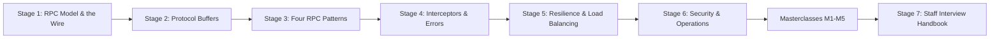

| Stage | Focus Domain | Core Concepts & Engineering Outcomes |
| :--- | :--- | :--- |
| **Stage 1** | **Foundations: the RPC Model, HTTP/2 & the Wire** | Channels, stubs and subchannels; `grpc.NewClient`; HTTP/2 streams, `HEADERS`/`DATA`/trailers; `:path`, `content-type: application/grpc`, `grpc-timeout`, `grpc-status`; the 5-byte message prefix; serving gRPC and `/health` on one port with h2c. You can run the starter, call it with `grpcurl` and read a call byte by byte. |
| **Stage 2** | **Protocol Buffers: Schema Design & Code Generation** | proto3 syntax, scalar type choice (`int32` vs `sint32` vs `fixed32`), varint/ZigZag/tag encoding, `oneof`, `map`, `optional` and field presence, well-known types, `reserved`, editions, `buf lint`, `buf breaking`, `buf generate` with plugins pinned by `go tool`, protojson. You can design a schema that evolves without breaking clients. |
| **Stage 3** | **The Four RPC Patterns in Go** | Unary, server, client and bidirectional streaming; generated `grpc.ServerStreamingServer[T]` types; `SendAndClose`, `CloseSend`, `CloseAndRecv`, `io.EOF`; half-close and goroutine rules; flow control and backpressure; Java and Node clients; `bufconn` tests. You can build and test a streaming service end to end. |
| **Stage 4** | **Interceptors, Metadata, Deadlines & Errors** | `ChainUnaryInterceptor`, stream wrappers, `metadata.NewOutgoingContext`, `-bin` keys, deadline propagation over `grpc-timeout`, `RST_STREAM(CANCEL)`, the 17 status codes, `google.rpc.Status` with `errdetails`. |
| **Stage 5** | **Resilience, Name Resolution & Load Balancing** | Service config, `retryPolicy` and its backoff maths, hedging, `dns:///` and `round_robin`, headless Services, proxy vs client-side balancing, gRPC-Web through Envoy. |
| **Stage 6** | **Security, Health, Observability & Deployment** | `credentials.NewTLS` and mTLS, `PerRPCCredentials`, server reflection and `grpcurl`, `grpc.health.v1` and Kubernetes `grpc` probes, OpenTelemetry tracing, the metrics to alert on. |
| **Masterclasses** | **Transport internals, proxyless xDS, browser bridges, performance, flagship blueprint** | HTTP/2 flow control, keepalive and `GOAWAY`; xDS bootstrap and `xds:///` targets; gRPC-Web vs Connect vs grpc-gateway; compression, message sizing and benchmarking; an end-to-end production platform. |
| **Stage 7** | **Staff Interview Handbook** | 50 interview Q&As across core concepts, internals, architecture and debugging scenarios, plus a one-page cheatsheet. |

The examples, the starter project and its tests are written in **Go**. gRPC is language-neutral, but Go is where the reference server work happens in practice: `grpc-go` is maintained by the gRPC team, the Go code generators are first-party, and most of the cloud-native control planes that speak gRPC (Kubernetes, etcd, Envoy's Go control plane, Istio) are Go. Where a section compares clients, Java (`grpc-java`) and Node.js (`@grpc/grpc-js`) snippets sit next to the Go one.

---

## 🆕 gRPC Versions, What's New & Migration

gRPC has no single version number. Each language implementation (`grpc-go`, `grpc-java`, the C-core family for C++/Python/Ruby/PHP, `grpc-dotnet`, `@grpc/grpc-js`) ships on its own schedule, roughly every six weeks, and the protocol itself has been stable since 1.0. Protocol Buffers versions separately: `protoc` releases use one number per release (v21, v22 … v31), and each language runtime has its own line (`google.golang.org/protobuf` is v1.36.x). This guide targets **grpc-go v1.85** and **protobuf-go v1.36.12**, which are the versions pinned in [`go.mod`](go.mod).

### V.1 Release Timeline

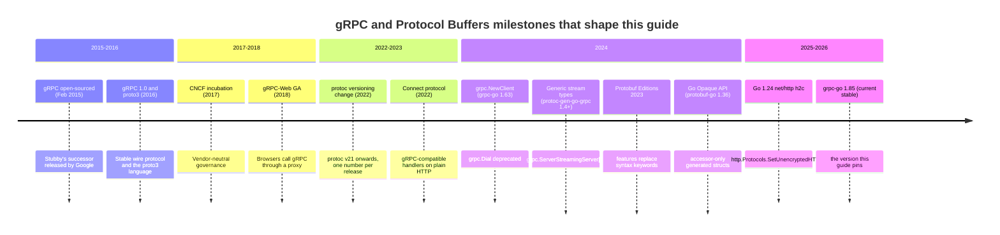

### V.2 Compatibility Matrix

| Component | Version in this guide | Requires | Notes |
| --- | --- | --- | --- |
| Go toolchain | 1.26 (`go 1.26.0` in `go.mod`) | — | grpc-go supports the two most recent Go releases. |
| `google.golang.org/grpc` | v1.85.0 | A supported Go release | `grpc.NewClient`, generic streams, `SupportPackageIsVersion9`. |
| `google.golang.org/protobuf` | v1.36.12 | A supported Go release | Open, Hybrid and Opaque generated APIs. |
| `protoc-gen-go` | v1.36.12 | protobuf-go of the same or newer version | Pinned with a `tool` directive in `go.mod`. |
| `protoc-gen-go-grpc` | v1.6.2 | grpc-go v1.64+ | Generated code asserts `grpc.SupportPackageIsVersion9`. |
| `buf` CLI | current stable (1.75 used to build this repo) | — | Uses `buf.yaml` / `buf.gen.yaml` version `v2`. |
| `protoc` | current stable (v31 tested) | — | Only needed if you skip buf. |
| `grpcurl` | v1.9.3 | Server reflection, or `-proto` files | Used in CI to call the container. |
| Kubernetes `grpc` probes | beta in 1.24, GA in 1.27 | Server implements `grpc.health.v1` | See [6.3](#63-the-standard-grpc-health-checking-protocol). |
| Other runtimes | `grpc-java`, `@grpc/grpc-js`, `grpcio`, `Grpc.AspNetCore`: current stable | — | All speak the same wire protocol; mix freely. |

### V.3 What's New in Current gRPC-Go and Protobuf

#### `grpc.NewClient` replaces `grpc.Dial`

`grpc.Dial` and `grpc.DialContext` are deprecated. `grpc.NewClient` never connects eagerly and never blocks: the channel starts idle, and the first RPC triggers name resolution and the connection. It also defaults to the `dns` resolver, where `Dial` defaulted to `passthrough`, so targets like `localhost:8080` now go through DNS.

```go
// Before: blocking dial, passthrough resolver by default.
ctx, cancel := context.WithTimeout(context.Background(), 5*time.Second)
defer cancel()
conn, err := grpc.DialContext(ctx, "localhost:8080",
	grpc.WithTransportCredentials(insecure.NewCredentials()),
	grpc.WithBlock())
```

```go
// After: lazy, non-blocking, dns resolver by default. Failures surface on the first RPC.
conn, err := grpc.NewClient("localhost:8080",
	grpc.WithTransportCredentials(insecure.NewCredentials()))
```

If code relied on `WithBlock` to wait for readiness at startup, replace it with a health check RPC with a deadline, or call `conn.Connect()` and watch `conn.GetState()`.

#### Generic stream types

`protoc-gen-go-grpc` 1.4 and later emit generic stream interfaces from the `grpc` package instead of one hand-written interface per method. The old names remain as type aliases, so existing code compiles unchanged.

```go
// Before (still compiles: it is now an alias)
func (s *svc) StreamRoadmap(req *learningv1.StreamRoadmapRequest, stream learningv1.LearningService_StreamRoadmapServer) error
```

```go
// After
func (s *svc) StreamRoadmap(req *learningv1.StreamRoadmapRequest, stream grpc.ServerStreamingServer[learningv1.Stage]) error
```

#### Unimplemented servers must be embedded by value

Since `protoc-gen-go-grpc` 1.5, `Register…Server` calls a `testEmbeddedByValue` method. Embedding `*UnimplementedLearningServiceServer` as a nil pointer now panics at registration, during startup, instead of panicking later on the first call to an unimplemented method.

```go
// Before: compiles, then panics when an unimplemented RPC is called.
type svc struct{ *learningv1.UnimplementedLearningServiceServer }
```

```go
// After: embed by value.
type svc struct{ learningv1.UnimplementedLearningServiceServer }
```

#### Protobuf Editions

Editions replace `syntax = "proto2"` / `"proto3"` with `edition = "2023"` plus per-file, per-message or per-field *features*. The wire format is unchanged. An edition 2023 file behaves like proto2 by default (explicit presence on every singular field), so a mechanical conversion of a proto3 file adds `option features.field_presence = IMPLICIT;` to keep proto3 behaviour. Details are in [2.8](#28-protobuf-editions).

```protobuf
// Before
syntax = "proto3";
message GetStageRequest { int32 stage_number = 1; }
```

```protobuf
// After: same wire format, same generated API.
edition = "2023";
option features.field_presence = IMPLICIT;
message GetStageRequest { int32 stage_number = 1; }
```

#### Go Opaque API

protobuf-go 1.36 can generate structs with unexported fields and only accessors (`GetX`, `SetX`, `HasX`, `ClearX`). It is selected per file through the `features.(pb.go).api_level` feature in an editions file. Edition 2023 and proto3 files default to the Open API used in this guide, where fields are exported; edition 2024 makes Opaque the Go default.

```go
// Open API (default)
req := &learningv1.GetStageRequest{StageNumber: 1}
```

```go
// Opaque API: builders and setters only
req := learningv1.GetStageRequest_builder{StageNumber: proto.Int32(1)}.Build()
req.SetStageNumber(2)
```

#### Cleartext HTTP/2 in the Go standard library

Go 1.24 added `http.Protocols`. An `http.Server` can accept HTTP/2 with prior knowledge on a plaintext port, which is exactly what a gRPC client with insecure credentials sends. The starter project uses it to serve gRPC and `GET /health` on one port without `golang.org/x/net/http2/h2c`.

```go
// Before: extra module and wrapper.
handler := h2c.NewHandler(mux, &http2.Server{})
```

```go
// After: standard library only.
var p http.Protocols
p.SetHTTP1(true)
p.SetUnencryptedHTTP2(true)
srv := &http.Server{Addr: ":8080", Handler: mux, Protocols: &p}
```

### V.4 Migration Guide (older grpc-go and protoc setups → current stable)

```bash
# 1. Upgrade the runtime libraries.
go get google.golang.org/grpc@latest google.golang.org/protobuf@latest

# 2. Pin the code generators in go.mod (Go 1.24+ tool directive).
go get -tool google.golang.org/protobuf/cmd/protoc-gen-go@latest
go get -tool google.golang.org/grpc/cmd/protoc-gen-go-grpc@latest
go mod tidy

# 3. Regenerate. With buf, point buf.gen.yaml at "go tool protoc-gen-go".
buf generate

# 4. Replace deprecated dialing.
grep -rn "grpc.Dial\|grpc.DialContext\|WithBlock()" --include=*.go .

# 5. Find nil-pointer Unimplemented embeds before they panic at startup.
grep -rn "\*.*Unimplemented.*Server" --include=*.go .

# 6. Rebuild and run the race detector.
go vet ./... && go test -race ./...
```

Then review three behaviour changes by hand:

1. **Targets.** `NewClient` resolves with DNS by default. A custom dialer that expects the raw address string (for example `bufconn` tests) needs the `passthrough:///` scheme, as [`internal/server/service_test.go`](internal/server/service_test.go) does.
2. **Startup readiness.** Code that used `WithBlock` to fail fast now succeeds at construction time and fails on the first RPC. Add an explicit readiness check if startup must block.
3. **Reflection.** Register `reflection.Register(s)`. It now serves both `grpc.reflection.v1` and the older `v1alpha`, so old and new `grpcurl` builds work.

### V.5 Deprecations & Breaking Changes

| Version | Deprecated / removed | Replacement | What breaks and how to fix it |
| --- | --- | --- | --- |
| grpc-go 1.63 | `grpc.Dial`, `grpc.DialContext` (deprecated) | `grpc.NewClient` | Still compiles. Default resolver changes from `passthrough` to `dns`; prefix custom-dialer targets with `passthrough:///`. |
| grpc-go 1.63 | `grpc.WithBlock`, `grpc.FailOnNonTempDialError` (deprecated) | Readiness RPC, `conn.Connect()` | `NewClient` ignores blocking semantics; add an explicit check. |
| protoc-gen-go-grpc 1.4 | Per-method stream interfaces | `grpc.ServerStreamingServer[T]` and friends | Old names are aliases; no break. Requires grpc-go 1.64+. |
| protoc-gen-go-grpc 1.5 | Pointer embedding of `Unimplemented…Server` | Embed by value | Nil pointer embed panics in `Register…Server`. |
| grpc-go (older) | `grpc.WithInsecure()` (deprecated) | `grpc.WithTransportCredentials(insecure.NewCredentials())` | Still compiles with a deprecation warning from linters; switch the option. |
| `github.com/golang/protobuf` | Whole module (APIv1, deprecated) | `google.golang.org/protobuf` | `ptypes` helpers become `timestamppb.New`, `durationpb.New`, `anypb.New`. |
| protoc v21+ | Old `3.x.y` version scheme | Single release number (v21, v22 …) | Version checks in build scripts must change. |
| Reflection v1alpha | `grpc.reflection.v1alpha` (superseded) | `grpc.reflection.v1` | Servers register both; old clients keep working. |
| Kubernetes 1.27 | `grpc-health-probe` binary in images | Native `grpc:` probe | Remove the binary and the `exec` probe. |

---

## 📋 Table of Contents

- [🆕 gRPC Versions, What's New & Migration](#-grpc-versions-whats-new--migration)
- [1. Stage 1: Foundations: the RPC Model, HTTP/2 & the Wire](#1-stage-1-foundations-the-rpc-model-http2--the-wire)
  - [1.1 What gRPC Is and the Problem It Solves](#11-what-grpc-is-and-the-problem-it-solves)
  - [1.2 Core Vocabulary: Services, Stubs, Channels and Calls](#12-core-vocabulary-services-stubs-channels-and-calls)
  - [1.3 Installation & First Run](#13-installation--first-run)
  - [1.4 Line-by-Line Breakdown of the Starter Project](#14-line-by-line-breakdown-of-the-starter-project)
  - [1.5 HTTP/2 Transport: Multiplexing, Framing & Streams](#15-http2-transport-multiplexing-framing--streams)
  - [1.6 Anatomy of a gRPC Call on the Wire](#16-anatomy-of-a-grpc-call-on-the-wire)
  - [1.7 gRPC Framing: the Length-Prefixed Message](#17-grpc-framing-the-length-prefixed-message)
  - [1.8 One Port for gRPC and HTTP: h2c and `ServeHTTP`](#18-one-port-for-grpc-and-http-h2c-and-servehttp)
  - [1.9 Pitfalls](#19-pitfalls)
  - [1.10 Best Practices](#110-best-practices)
  - [1.11 Hands-on Exercise](#111-hands-on-exercise)
- [2. Stage 2: Protocol Buffers: Schema Design & Code Generation](#2-stage-2-protocol-buffers-schema-design--code-generation)
  - [2.1 The `.proto` File: Syntax, Packages and Options](#21-the-proto-file-syntax-packages-and-options)
  - [2.2 Scalar Types and How to Choose Them](#22-scalar-types-and-how-to-choose-them)
  - [2.3 The Binary Wire Format: Tags, Wire Types and Varints](#23-the-binary-wire-format-tags-wire-types-and-varints)
  - [2.4 Composite Types: Enums, Nested Messages, `repeated`, `map` and `oneof`](#24-composite-types-enums-nested-messages-repeated-map-and-oneof)
  - [2.5 Field Presence: Defaults, `optional`, Wrappers and Field Masks](#25-field-presence-defaults-optional-wrappers-and-field-masks)
  - [2.6 Well-Known Types](#26-well-known-types)
  - [2.7 Schema Evolution & Compatibility Rules](#27-schema-evolution--compatibility-rules)
  - [2.8 Protobuf Editions](#28-protobuf-editions)
  - [2.9 Code Generation with `buf` and `protoc`](#29-code-generation-with-buf-and-protoc)
  - [2.10 Linting and Breaking-Change Detection with `buf`](#210-linting-and-breaking-change-detection-with-buf)
  - [2.11 JSON Mapping and `protojson`](#211-json-mapping-and-protojson)
  - [2.12 Pitfalls](#212-pitfalls)
  - [2.13 Best Practices](#213-best-practices)
  - [2.14 Hands-on Exercise](#214-hands-on-exercise)
- [3. Stage 3: The Four RPC Patterns in Go](#3-stage-3-the-four-rpc-patterns-in-go)
  - [3.1 The Four RPC Interaction Models](#31-the-four-rpc-interaction-models)
  - [3.2 Generated Go Server and Client Interfaces](#32-generated-go-server-and-client-interfaces)
  - [3.3 Unary RPC](#33-unary-rpc)
  - [3.4 Server-Streaming RPC](#34-server-streaming-rpc)
  - [3.5 Client-Streaming RPC](#35-client-streaming-rpc)
  - [3.6 Bidirectional Streaming RPC](#36-bidirectional-streaming-rpc)
  - [3.7 Stream Lifecycle, Half-Close and Concurrency Rules](#37-stream-lifecycle-half-close-and-concurrency-rules)
  - [3.8 Flow Control and Backpressure in Streams](#38-flow-control-and-backpressure-in-streams)
  - [3.9 Writing the Client: `grpc.NewClient`, Channels and Reuse](#39-writing-the-client-grpcnewclient-channels-and-reuse)
  - [3.10 Polyglot Clients: Java and Node.js](#310-polyglot-clients-java-and-nodejs)
  - [3.11 Testing gRPC Services with `bufconn`](#311-testing-grpc-services-with-bufconn)
  - [3.12 Reference Implementation: An Order Service](#312-reference-implementation-an-order-service)
  - [3.13 Pitfalls](#313-pitfalls)
  - [3.14 Best Practices](#314-best-practices)
  - [3.15 Hands-on Exercise](#315-hands-on-exercise)
- [4. Stage 4: Interceptors, Metadata, Deadlines & Errors](#4-stage-4-interceptors-metadata-deadlines--errors)
  - [4.1 Interceptors: the gRPC Middleware Pipeline](#41-interceptors-the-grpc-middleware-pipeline)
  - [4.2 Server Interceptors in Go](#42-server-interceptors-in-go)
  - [4.3 Metadata & Context Propagation](#43-metadata--context-propagation)
  - [4.4 Deadlines vs Timeouts & Distributed Propagation](#44-deadlines-vs-timeouts--distributed-propagation)
  - [4.5 Cancellation & Graceful Teardown](#45-cancellation--graceful-teardown)
  - [4.6 Status Codes](#46-status-codes)
  - [4.7 The Rich Error Model (`google.rpc.Status`)](#47-the-rich-error-model-googlerpcstatus)
  - [4.8 Pitfalls](#48-pitfalls)
  - [4.9 Best Practices](#49-best-practices)
  - [4.10 Hands-on Exercise](#410-hands-on-exercise)
- [5. Stage 5: Resilience, Name Resolution & Load Balancing](#5-stage-5-resilience-name-resolution--load-balancing)
  - [5.1 Service Config and Retry Policies](#51-service-config-and-retry-policies)
  - [5.2 Hedging Policies for Tail Latency](#52-hedging-policies-for-tail-latency)
  - [5.3 The L4 vs L7 Load-Balancing Problem](#53-the-l4-vs-l7-load-balancing-problem)
  - [5.4 Client-Side Load Balancing with Kubernetes Headless Services](#54-client-side-load-balancing-with-kubernetes-headless-services)
  - [5.5 gRPC-Web: Bridging Browsers to gRPC](#55-grpc-web-bridging-browsers-to-grpc)
  - [5.6 Pitfalls](#56-pitfalls)
  - [5.7 Best Practices](#57-best-practices)
  - [5.8 Hands-on Exercise](#58-hands-on-exercise)
- [6. Stage 6: Security, Health, Observability & Deployment](#6-stage-6-security-health-observability--deployment)
  - [6.1 Transport Security: TLS and Mutual TLS](#61-transport-security-tls-and-mutual-tls)
  - [6.2 Per-RPC Credentials](#62-per-rpc-credentials)
  - [6.3 The Standard gRPC Health Checking Protocol](#63-the-standard-grpc-health-checking-protocol)
  - [6.4 The gRPC Server Reflection Protocol](#64-the-grpc-server-reflection-protocol)
  - [6.5 Distributed Tracing & Metrics with OpenTelemetry](#65-distributed-tracing--metrics-with-opentelemetry)
  - [6.6 Graceful Shutdown](#66-graceful-shutdown)
  - [6.7 Pitfalls](#67-pitfalls)
  - [6.8 Best Practices](#68-best-practices)
  - [6.9 Hands-on Exercise](#69-hands-on-exercise)
- [M1. Masterclass: HTTP/2 Transport Internals, Keepalive & Connection Lifecycle](#m1-masterclass-http2-transport-internals-keepalive--connection-lifecycle)
  - [M1.1 How the Transport Manages a Connection](#m11-how-the-transport-manages-a-connection)
  - [M1.2 Worked Example: Keepalive and Connection Age in Go](#m12-worked-example-keepalive-and-connection-age-in-go)
  - [M1.3 Trade-offs](#m13-trade-offs)
  - [M1.4 Production Checklist](#m14-production-checklist)
- [M2. Masterclass: Proxyless gRPC with xDS](#m2-masterclass-proxyless-grpc-with-xds)
  - [M2.1 How xDS Configures a Channel](#m21-how-xds-configures-a-channel)
  - [M2.2 Worked Example](#m22-worked-example)
  - [M2.3 Trade-offs: Sidecar Mesh vs Proxyless vs Plain Client-Side](#m23-trade-offs-sidecar-mesh-vs-proxyless-vs-plain-client-side)
  - [M2.4 Production Checklist](#m24-production-checklist)
- [M3. Masterclass: Browsers and HTTP Clients: gRPC-Web, Connect & grpc-gateway](#m3-masterclass-browsers-and-http-clients-grpc-web-connect--grpc-gateway)
  - [M3.1 How Each Bridge Works](#m31-how-each-bridge-works)
  - [M3.2 Worked Example: A Connect Handler for `LearningService`](#m32-worked-example-a-connect-handler-for-learningservice)
  - [M3.3 Trade-offs](#m33-trade-offs)
  - [M3.4 Production Checklist](#m34-production-checklist)
- [M4. Masterclass: Performance Engineering for gRPC Services](#m4-masterclass-performance-engineering-for-grpc-services)
  - [M4.1 Where the Time Goes in One Call](#m41-where-the-time-goes-in-one-call)
  - [M4.2 Worked Example: Measure, Then Tune](#m42-worked-example-measure-then-tune)
  - [M4.3 Trade-offs](#m43-trade-offs)
  - [M4.4 Production Checklist](#m44-production-checklist)
- [M5. Masterclass: Flagship Blueprint: A Production gRPC Platform](#m5-masterclass-flagship-blueprint-a-production-grpc-platform)
  - [M5.1 Architecture](#m51-architecture)
  - [M5.2 Build Steps](#m52-build-steps)
  - [M5.3 Trade-offs](#m53-trade-offs)
  - [M5.4 Production Checklist](#m54-production-checklist)
- [7. Stage 7: Staff gRPC Platform Engineer Interview Handbook & Cheatsheet](#7-stage-7-staff-grpc-platform-engineer-interview-handbook--cheatsheet)
  - [7.1 Core Concepts (Q1-Q10)](#71-core-concepts-q1-q10)
  - [7.2 Internals & Performance (Q11-Q20)](#72-internals--performance-q11-q20)
  - [7.3 Architecture & Design (Q21-Q30)](#73-architecture--design-q21-q30)
  - [7.4 Scenario & Debugging Questions (Q31-Q50)](#74-scenario--debugging-questions-q31-q50)
  - [7.5 Staff Cheatsheet](#75-staff-cheatsheet)
- [🧪 Example Projects](#-example-projects)
- [📝 Cheat Sheets](#-cheat-sheets)
- [📚 Resources](#-resources)
- [🤝 Contributing](#-contributing)
- [📄 License](#-license)
- [🙏 Acknowledgments](#-acknowledgments)
- [🌐 Connect with me](#-connect-with-me)
- [☕ Support](#-support)

---

## 1. Stage 1: Foundations: the RPC Model, HTTP/2 & the Wire

This stage explains what a gRPC call is, physically: which objects exist in the client and server, which HTTP/2 frames cross the network, and where each byte of a message goes. It assumes you can read Go and have used an HTTP API before. At the end you can run the starter project, call it with `grpcurl`, and explain every header and byte of a unary call.

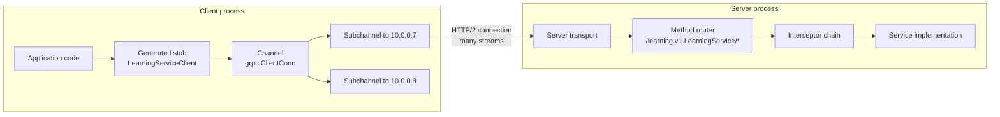

### 1.1 What gRPC Is and the Problem It Solves

gRPC is a remote procedure call framework. You describe a service and its messages in a `.proto` file, a code generator produces a typed client (the *stub*) and a server interface, and the runtime carries calls over HTTP/2 using Protocol Buffers as the default encoding. Calling a remote method looks like calling a local function that takes a `context.Context` and can fail with a status code.

Services inside a company talk to each other far more than browsers talk to them. At that volume, three costs of the typical REST/JSON stack add up: text encoding, a contract that lives in documentation instead of the type system, and HTTP/1.1's one-request-at-a-time connections. gRPC addresses each one.

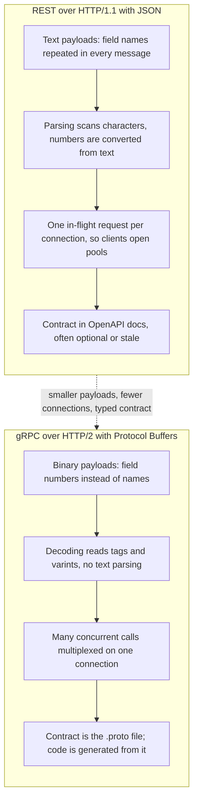

| Dimension | REST over HTTP/1.1 + JSON | gRPC over HTTP/2 + Protocol Buffers |
| :--- | :--- | :--- |
| **Payload encoding** | Text (UTF-8 JSON) | Binary Protocol Buffers by default; JSON or other codecs are possible |
| **Contract** | Implicit, or an OpenAPI document maintained alongside the code | The `.proto` file; client and server code are generated from it |
| **Transport** | HTTP/1.1, sometimes HTTP/2 | HTTP/2 only (HTTP/3 is experimental in some implementations) |
| **Connection model** | Pool of keep-alive connections, one request at a time each | One long-lived connection per backend carrying many concurrent streams |
| **Streaming** | Server-Sent Events or WebSockets bolted on | Server, client and bidirectional streaming are part of the model |
| **Payload size** | Baseline | Typically several times smaller for numeric and repeated data; similar for text-heavy data |
| **Errors** | HTTP status plus a body format each team invents | 17 status codes in trailers plus optional typed details |
| **Browser support** | Native | Needs gRPC-Web or Connect through a proxy or compatible server |
| **Human debugging** | `curl` and a text editor | `grpcurl`, reflection, or decoding with the `.proto` |

Payload savings depend on the data. A message full of small integers and repeated keys shrinks a lot; a message that is one long string barely changes. Measure your own messages before quoting a number.

**When not to use gRPC:** public APIs consumed by unknown clients and browsers, endpoints that benefit from HTTP caching by URL, and teams with no way to share `.proto` files. For those, REST or GraphQL is usually the better fit, and gRPC can still run behind them.

### 1.2 Core Vocabulary: Services, Stubs, Channels and Calls

Most gRPC confusion comes from mixing up the objects involved. The names below are the ones the specification and every implementation use.

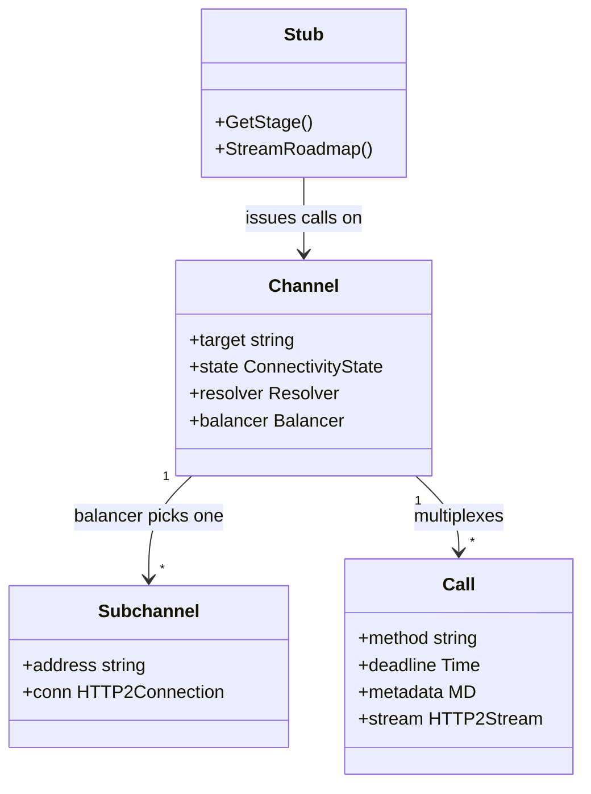

| Term | Go type | What it is | Lifetime |
| --- | --- | --- | --- |
| **Service** | `learningv1.LearningServiceServer` | A named group of methods declared in a `.proto` file (`service LearningService`). | Defined at compile time. |
| **Stub** | `learningv1.LearningServiceClient` | Generated client with one Go method per RPC. Holds no connection of its own. | Cheap; create as many as you like. |
| **Channel** | `*grpc.ClientConn` | A virtual connection to a *target*. Owns name resolution, load balancing and a set of subchannels. | Long-lived. Create once per target and share it. |
| **Subchannel** | internal | One HTTP/2 connection to one resolved address. | Reconnects with backoff when it drops. |
| **Call (RPC)** | the `ctx` + stream | One invocation of one method. Maps to exactly one HTTP/2 stream. | From request headers to trailers. |
| **Metadata** | `metadata.MD` | Key/value pairs carried as HTTP/2 headers and trailers. | Per call. |
| **Status** | `*status.Status` | A code (0-16), a message and optional details, sent in trailers. | End of each call. |

A channel has a connectivity state. It starts `IDLE`, moves to `CONNECTING` when the first RPC arrives, and becomes `READY` when at least one subchannel is up. If every subchannel fails it goes to `TRANSIENT_FAILURE` and RPCs fail with `UNAVAILABLE` (or wait, if the call set `WaitForReady(true)`). After a period with no RPCs it can drop back to `IDLE` and close its connections.

### 1.3 Installation & First Run

You need Go, and for regenerating code you need `buf`. `grpcurl` is the gRPC equivalent of `curl`.

```bash
# Go: install the current stable release from https://go.dev/dl/ then check it.
go version            # go1.26.x or newer

# buf (macOS / Linux with Homebrew)
brew install bufbuild/buf/buf
# or with Go
go install github.com/bufbuild/buf/cmd/buf@latest

# grpcurl
brew install grpcurl
# or with Go
go install github.com/fullstorydev/grpcurl/cmd/grpcurl@latest

# Windows: winget or scoop work too, e.g.
#   winget install GoLang.Go
#   scoop install buf grpcurl
```

The code generators (`protoc-gen-go`, `protoc-gen-go-grpc`) do not need a separate install. They are pinned in `go.mod` with Go's `tool` directive, and `buf generate` runs them through `go tool`.

Clone and run the starter:

```bash
git clone https://github.com/TheLearningHubOrg/learn-grpc.git
cd learn-grpc

go test -race ./...           # 22 tests, no network ports needed for most of them
go run ./cmd/server           # listens on 0.0.0.0:8080 (set PORT to change it)
```

In a second terminal:

```bash
curl -s localhost:8080/health
# {"status":"SERVING"}

grpcurl -plaintext localhost:8080 list
# grpc.health.v1.Health
# grpc.reflection.v1.ServerReflection
# grpc.reflection.v1alpha.ServerReflection
# learning.v1.LearningService

grpcurl -plaintext -d '{"stage_number": 1}' localhost:8080 learning.v1.LearningService/GetStage
# {
#   "stageNumber": 1,
#   "title": "Foundations: the RPC Model, HTTP/2 & the Wire",
#   ...
#   "track": "TRACK_FOUNDATIONS"
# }

go run ./cmd/client -addr localhost:8080
# unary:   stage 1 "Foundations: the RPC Model, HTTP/2 & the Wire"
# stream:  stage 1 ...
# client:  3 records, avg 16.58, min 7.25, max 30.00
# bidi:    ack client: hello
```

Or run the same image CI builds:

```bash
docker build -t learn-grpc .
docker run --rm -p 8080:8080 learn-grpc
```

`grpcurl` shows JSON because it converts protobuf to JSON with the canonical mapping (field names become `lowerCamelCase`, enums become their names). The server never sees JSON; the bytes on the wire are protobuf.

### 1.4 Line-by-Line Breakdown of the Starter Project

```text
learn-grpc/
├── proto/learning/v1/learning.proto   the contract: 1 service, 4 RPCs, 7 messages, 1 enum
├── buf.yaml, buf.gen.yaml             lint/breaking rules and code generation config
├── gen/learning/v1/                   generated Go code (committed, checked in CI)
├── internal/roadmap/                  in-memory data the service serves
├── internal/server/
│   ├── service.go                     the four RPC handlers
│   ├── interceptors.go                logging and panic recovery
│   ├── server.go                      grpc.Server, health, reflection, shared-port handler
│   ├── service_test.go                bufconn tests for every RPC pattern
│   └── http_test.go                   real-port tests: h2c gRPC and GET /health
├── internal/wire/                     hand-written varint and frame encoders, with tests
├── cmd/server/main.go                 process entry point, graceful shutdown
├── cmd/client/main.go                 calls each RPC once
└── Dockerfile, .github/workflows/     multi-stage image, CI
```

The entry point, [`cmd/server/main.go`](cmd/server/main.go), condensed:

```go
func run(logger *slog.Logger, port string) error {
	grpcServer, hs := server.NewGRPCServer(logger)
	httpServer := server.NewHTTPServer(net.JoinHostPort("0.0.0.0", port), server.NewHandler(grpcServer, hs))

	ctx, stop := signal.NotifyContext(context.Background(), os.Interrupt, syscall.SIGTERM)
	defer stop()

	errCh := make(chan error, 1)
	go func() { errCh <- httpServer.ListenAndServe() }()

	select {
	case err := <-errCh:
		if errors.Is(err, http.ErrServerClosed) {
			return nil
		}
		return err
	case <-ctx.Done():
	}

	hs.Shutdown()
	shutdownCtx, cancel := context.WithTimeout(context.Background(), 20*time.Second)
	defer cancel()
	if err := httpServer.Shutdown(shutdownCtx); err != nil {
		_ = httpServer.Close()
		return fmt.Errorf("graceful shutdown: %w", err)
	}
	grpcServer.Stop()
	return nil
}
```

| Line / API | Role | What happens at runtime |
| :--- | :--- | :--- |
| `server.NewGRPCServer(logger)` | Builds a `*grpc.Server` with interceptors, registers `LearningService`, the health service and reflection. | No socket yet. Registration fills a map from `/package.Service/Method` to handlers. |
| `net.JoinHostPort("0.0.0.0", port)` | Bind address. | `0.0.0.0` accepts connections from outside the container; `localhost` would not. |
| `server.NewHandler(grpcServer, hs)` | One `http.Handler` that sends gRPC requests to `grpcServer.ServeHTTP` and the rest to a mux. | Decided per request from HTTP version and `content-type`. |
| `signal.NotifyContext(..., SIGTERM)` | Turns the stop signal Kubernetes and Docker send into a cancelled context. | `ctx.Done()` closes on Ctrl+C or `docker stop`. |
| `httpServer.ListenAndServe()` | Opens the TCP listener and accepts HTTP/1.1 and h2c. | Blocks until `Shutdown` or `Close`; returns `http.ErrServerClosed` on a clean stop. |
| `hs.Shutdown()` | Sets every health status to `NOT_SERVING`. | `/health` now answers 503 and `Health/Check` returns `NOT_SERVING`, so load balancers stop sending new traffic. |
| `httpServer.Shutdown(shutdownCtx)` | Graceful drain. | Sends HTTP/2 `GOAWAY`, stops accepting connections, waits for in-flight streams until the 20 s deadline. |
| `grpcServer.Stop()` | Releases server resources. | Closes anything the gRPC server still tracks. |

The service registration in [`internal/server/server.go`](internal/server/server.go):

```go
srv := grpc.NewServer(
	grpc.ChainUnaryInterceptor(UnaryRecovery(logger), UnaryLogger(logger)),
	grpc.ChainStreamInterceptor(StreamRecovery(logger), StreamLogger(logger)),
)
learningv1.RegisterLearningServiceServer(srv, NewLearningService())

hs := health.NewServer()
hs.SetServingStatus(learningv1.LearningService_ServiceDesc.ServiceName, healthpb.HealthCheckResponse_SERVING)
healthpb.RegisterHealthServer(srv, hs)

reflection.Register(srv)
```

| Line / API | Role | What happens at runtime |
| :--- | :--- | :--- |
| `grpc.ChainUnaryInterceptor(a, b)` | Middleware for unary RPCs. | `a` runs first and wraps `b`, which wraps the handler. Covered in Stage 4. |
| `RegisterLearningServiceServer` | Generated function. | Adds four method handlers under the service name `learning.v1.LearningService`. |
| `health.NewServer()` | The standard `grpc.health.v1.Health` implementation. | Starts with `""` (the whole server) set to `SERVING`. |
| `SetServingStatus(ServiceName, SERVING)` | Per-service health. | `Check({service: "learning.v1.LearningService"})` returns `SERVING`. |
| `reflection.Register(srv)` | Serves the schema of every registered service. | Lets `grpcurl list` and `describe` work without the `.proto` file. |

### 1.5 HTTP/2 Transport: Multiplexing, Framing & Streams

gRPC runs on HTTP/2 because HTTP/2 gives it independent concurrent streams on one connection, binary framing, header compression, flow control and trailers. HTTP/1.1 has none of these except, awkwardly, trailers with chunked encoding.

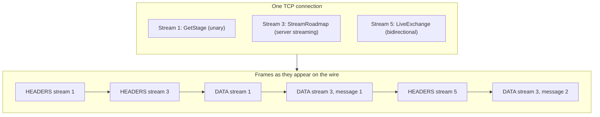

The primitives gRPC depends on:

1. **Binary framing.** Every unit on the connection is a frame with a 9-byte header: 24-bit length, 8-bit type, 8-bit flags, 31-bit stream ID. gRPC uses `HEADERS`, `CONTINUATION`, `DATA`, `RST_STREAM`, `SETTINGS`, `PING`, `GOAWAY` and `WINDOW_UPDATE`.
2. **Streams.** A stream is a numbered, bidirectional sequence of frames inside a connection. Client-initiated streams use odd IDs (1, 3, 5 …) and IDs only increase. HTTP/2 reserves even IDs for server push, which gRPC never uses, so in practice every gRPC stream has an odd ID. One RPC is exactly one stream.
3. **HPACK header compression.** Both ends keep a table of recently sent headers. A header repeated on every call (`content-type: application/grpc`, `:path`, `authorization`) is sent as a small index after the first time, so per-call header cost drops to a few bytes.
4. **Flow control.** Each stream and the connection as a whole have a receive window. A sender may only send that many `DATA` bytes until the receiver returns credit with `WINDOW_UPDATE`. This is what turns a slow consumer into backpressure on a fast producer ([3.8](#38-flow-control-and-backpressure-in-streams)).
5. **`END_STREAM` and trailers.** A `HEADERS` frame with the `END_STREAM` flag after the data carries the trailers, which is where gRPC puts the final status. The client half-closes the same way, by setting `END_STREAM` on its last `DATA` frame.
6. **`RST_STREAM` and `GOAWAY`.** `RST_STREAM` kills one stream (cancellation, deadline). `GOAWAY` tells the peer to start no new streams on this connection; existing ones may finish. Graceful shutdown and connection-age limits rely on it.

### 1.6 Anatomy of a gRPC Call on the Wire

Here is the unary call `GetStage({stage_number: 1})` with a two-second deadline, as frames. Header names are lowercase in HTTP/2; pseudo-headers start with a colon.

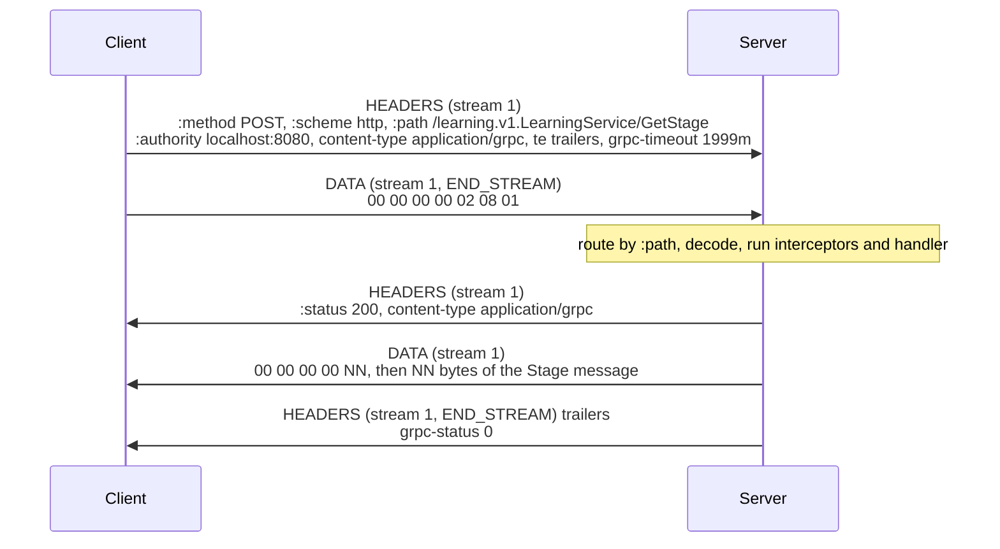

| Header | Sent by | Meaning |
| --- | --- | --- |
| `:method POST` | client | Every gRPC call is a POST, whatever it does. |
| `:path /learning.v1.LearningService/GetStage` | client | `/{package}.{Service}/{Method}`. This is the routing key; proxies can route on it. |
| `:authority` | client | The target host. Also used as the TLS SNI name. |
| `content-type application/grpc` | both | Required. Variants such as `application/grpc+proto` name the codec. |
| `te trailers` | client | Declares that the client understands trailers. Some proxies drop requests without it. |
| `grpc-timeout 1999m` | client | Time remaining until the deadline: a number of at most 8 digits and a unit (`H`, `M`, `S`, `m`, `u`, `n`). |
| `grpc-encoding gzip` | either | The message compression used, if any. |
| `grpc-accept-encoding` | either | Compressions the sender can decode. |
| `user-agent grpc-go/1.85.0` | client | Library and version. |
| `:status 200` | server | Always 200 for a well-formed gRPC response, even when the RPC fails. The RPC outcome is in `grpc-status`. |
| `grpc-status 0` | server, trailers | The status code, 0 for OK. |
| `grpc-message` | server, trailers | Percent-encoded error message, present on failure. |
| `grpc-status-details-bin` | server, trailers | Base64 `google.rpc.Status` with typed error details (Stage 4). |

Two consequences matter in production. First, HTTP-level tooling that only looks at `:status` sees every gRPC call as a success; monitor `grpc-status` instead. Second, if a call fails before the server sends any data, the server may send a single `HEADERS` frame with `END_STREAM` that carries both `:status` and `grpc-status`. This is called a *Trailers-Only* response, and every client must handle it.

### 1.7 gRPC Framing: the Length-Prefixed Message

Inside the `DATA` frames, gRPC adds its own framing so that it can find message boundaries. HTTP/2 can split one message across several `DATA` frames or pack several messages into one, so the frame boundaries carry no meaning.

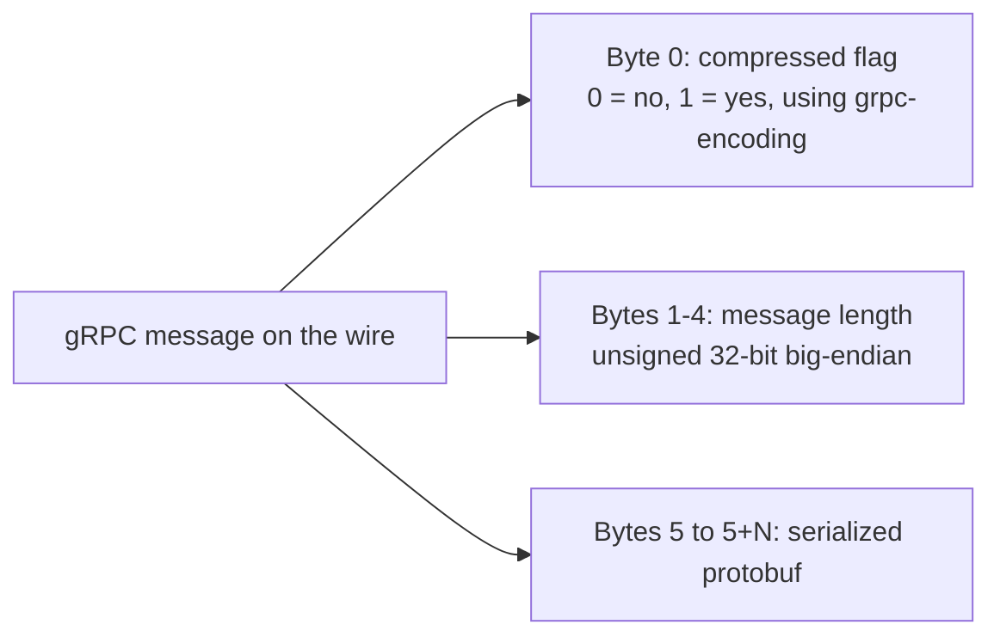

The starter has a hand-written encoder in [`internal/wire/wire.go`](internal/wire/wire.go) so you can see and test each byte:

```go
// Frame prefixes a serialized message the way gRPC does inside HTTP/2 DATA
// frames: 1 byte compressed flag, 4 bytes big-endian length, then payload.
func Frame(payload []byte, compressed bool) []byte {
	out := make([]byte, 5, 5+len(payload))
	if compressed {
		out[0] = 1
	}
	binary.BigEndian.PutUint32(out[1:5], uint32(len(payload)))
	return append(out, payload...)
}

// Unframe reads one length-prefixed message and returns the remaining bytes,
// which may hold further messages: one DATA frame can carry several.
func Unframe(b []byte) (payload []byte, compressed bool, rest []byte, err error) {
	if len(b) < 5 {
		return nil, false, b, ErrShortFrame
	}
	n := binary.BigEndian.Uint32(b[1:5])
	if uint64(len(b)-5) < uint64(n) {
		return nil, false, b, ErrShortFrame
	}
	end := 5 + int(n)
	return b[5:end], b[0] == 1, b[end:], nil
}
```

| Line / API | Role | What happens at runtime |
| :--- | :--- | :--- |
| `make([]byte, 5, 5+len(payload))` | Allocates the prefix with room for the payload. | One allocation; `append` does not grow the slice. |
| `out[0] = 1` | Compressed flag. | Set only when the message was compressed with the algorithm named in `grpc-encoding`. |
| `binary.BigEndian.PutUint32` | Message length. | Network byte order. The 4-byte field caps a message at 4 GiB, but default receive limits (4 MiB in grpc-go) are far lower. |
| `uint64(len(b)-5) < uint64(n)` | Bounds check in 64-bit arithmetic. | Avoids overflow on 32-bit platforms when `n` is close to 2^32. |
| `rest` | Remaining bytes. | A reader loops until `rest` is empty because one `DATA` frame can hold several messages. |

So the request in 1.6, `00 00 00 00 02 08 01`, reads as: not compressed, length 2, then the protobuf bytes `08 01` (field 1, varint, value 1). Stage 2 decodes those last two bytes.

The real runtime enforces the receive limit *before* allocating: if the prefix announces 5 MiB and the limit is 4 MiB, grpc-go fails the call with `RESOURCE_EXHAUSTED` without reading the payload. That is why the limit protects memory.

### 1.8 One Port for gRPC and HTTP: h2c and `ServeHTTP`

Containers and platform health checks usually expect an HTTP endpoint. The starter serves both on one port. [`internal/server/server.go`](internal/server/server.go):

```go
func NewHandler(grpcServer *grpc.Server, hs *health.Server) http.Handler {
	mux := http.NewServeMux()
	mux.HandleFunc("GET /health", func(w http.ResponseWriter, r *http.Request) {
		w.Header().Set("Content-Type", "application/json")
		resp, err := hs.Check(r.Context(), &healthpb.HealthCheckRequest{})
		if err != nil || resp.GetStatus() != healthpb.HealthCheckResponse_SERVING {
			w.WriteHeader(http.StatusServiceUnavailable)
			fmt.Fprint(w, `{"status":"NOT_SERVING"}`)
			return
		}
		fmt.Fprint(w, `{"status":"SERVING"}`)
	})

	return http.HandlerFunc(func(w http.ResponseWriter, r *http.Request) {
		if r.ProtoMajor == 2 && strings.HasPrefix(r.Header.Get("Content-Type"), "application/grpc") {
			grpcServer.ServeHTTP(w, r)
			return
		}
		mux.ServeHTTP(w, r)
	})
}

func NewHTTPServer(addr string, h http.Handler) *http.Server {
	var protocols http.Protocols
	protocols.SetHTTP1(true)
	protocols.SetUnencryptedHTTP2(true)
	return &http.Server{Addr: addr, Handler: h, Protocols: &protocols, ReadHeaderTimeout: 10 * time.Second}
}
```

| Line / API | Role | What happens at runtime |
| :--- | :--- | :--- |
| `"GET /health"` | Go 1.22+ method-aware pattern. | `POST /health` gets 405; other paths get 404. |
| `hs.Check(...)` | Reuses the gRPC health server as the source of truth. | HTTP and gRPC health can never disagree. |
| `r.ProtoMajor == 2` | gRPC requires HTTP/2. | An HTTP/1.1 request never reaches the gRPC server. |
| `HasPrefix(..., "application/grpc")` | Matches `application/grpc`, `+proto`, `+json`. | Plain HTTP/2 requests (for example `curl --http2-prior-knowledge`) still reach the mux. |
| `SetUnencryptedHTTP2(true)` | Accepts h2c with prior knowledge. | A gRPC client with insecure credentials opens the connection with the HTTP/2 preface directly; no `Upgrade` dance. |
| No `WriteTimeout` | Deliberate. | A write timeout would cut long-lived streams. Clients bound calls with deadlines instead. |

`grpc.Server` has two ways to accept traffic, and the choice is a real trade-off:

| | `grpcServer.Serve(lis)` (native transport) | `grpcServer.ServeHTTP` behind `net/http` |
| --- | --- | --- |
| HTTP/2 implementation | grpc-go's own | Go standard library |
| Throughput | Higher; tuned for gRPC | Lower; documented as experimental and slower |
| Server options honoured | All: keepalive enforcement, `MaxConcurrentStreams`, window sizes, `MaxConnectionAge` | Only per-RPC ones; connection-level settings come from `http.Server` |
| Same port as plain HTTP | No | Yes |
| `GracefulStop` | Drains connections | Does not manage these connections; use `http.Server.Shutdown` |
| Good for | High-traffic internal services | Small services, sidecar-free health endpoints, gradual migrations |

For a high-traffic service, run the native transport on one port and a tiny HTTP server for health and metrics on another, or use the gRPC health protocol with native Kubernetes probes (Stage 6). The starter uses `ServeHTTP` because one port keeps the Docker and CI setup simple and shows the protocol detection clearly.

### 1.9 Pitfalls

| Pitfall | Symptom | Fix |
| --- | --- | --- |
| Insecure client against a TLS port, or TLS client against a plaintext port | `code = Unavailable desc = connection error: ... error reading server preface` or a TLS `first record does not look like a TLS handshake` error | Match credentials on both sides: `insecure.NewCredentials()` only for plaintext, `credentials.NewTLS` for TLS. |
| HTTP/1.1-only proxy or load balancer in the path | `code = Unavailable` with `http2: frame too large`, or 502/505 from the proxy | Use a proxy that speaks HTTP/2 to the backend (Envoy, NGINX `grpc_pass`, cloud L7 balancers with HTTP/2 backends). |
| Monitoring HTTP status for gRPC errors | Dashboards show 100% success while clients see `NOT_FOUND` and `INTERNAL` | Alert on `grpc-status` (or `rpc.grpc.status_code` in OpenTelemetry), not `:status`. |
| Binding `localhost` in a container | `curl` from the host gets `connection reset`; the container logs show it listening | Bind `0.0.0.0` (the starter uses `net.JoinHostPort("0.0.0.0", port)`). |
| Creating a new `ClientConn` per request | Latency spikes, thousands of `TIME_WAIT` sockets, TLS handshakes on every call | Create one `ClientConn` per target at startup and share it. Stubs are cheap; channels are not. |
| `http.Server` with `WriteTimeout` in front of `ServeHTTP` | Streams die after N seconds with `code = Internal desc = stream terminated by RST_STREAM` | Remove `WriteTimeout`; bound calls with deadlines. |
| Treating `grpc-timeout` as a hard kill | Server keeps working after the client gave up | Check `ctx.Err()` or `<-ctx.Done()` in long handlers; pass `ctx` to every downstream call. |

### 1.10 Best Practices

- **One channel per target, shared**: the channel owns connections, resolution and load balancing; recreating it throws all of that away.
- **Always set a deadline**: a call without one can wait forever on a stuck backend and hold resources on both sides.
- **Keep `:path` stable**: package, service and method names are the URL; renaming any of them is a breaking change.
- **Bind `0.0.0.0` and read `PORT`**: containers and platforms assign ports and route from outside the loopback interface.
- **Expose health in the gRPC protocol first**: `grpc.health.v1` works with Kubernetes, Envoy and load balancers; an HTTP `/health` is a compatibility extra.
- **Monitor `grpc-status`, not HTTP status**: HTTP status is 200 for nearly every gRPC failure.

### 1.11 Hands-on Exercise

**Task.** Prove the byte layout from 1.6 and 1.7 yourself.

1. Write a test in `internal/wire` that marshals `&learningv1.GetStageRequest{StageNumber: 1}` with `proto.Marshal`, frames it with `Frame`, and asserts the result is `00 00 00 00 02 08 01`.
2. Start the server and call `GetStage` with `grpcurl -v -plaintext -d '{"stage_number": 1}' localhost:8080 learning.v1.LearningService/GetStage`. Find the request headers, the response headers and the trailers in the verbose output.
3. Call a method that does not exist: `grpcurl -plaintext localhost:8080 learning.v1.LearningService/Nope`.

**Expected output.** The test passes. The verbose `grpcurl` output lists `content-type: application/grpc` under the response headers and `(empty)` under the response trailers, because an OK status adds nothing beyond `grpc-status: 0`, which `grpcurl` reports separately. Step 3 fails inside `grpcurl` before any call is made: reflection tells it the service has no method named `Nope`. A generated client calling an unregistered method would instead reach the server and get `code = Unimplemented desc = unknown method Nope for service learning.v1.LearningService`.

**Solution.** `TestFrameRoundTrip` and `TestHandEncodingMatchesProtoMarshal` in [`internal/wire/wire_test.go`](internal/wire/wire_test.go) cover the same bytes.

[Back to top ⤴️](#-table-of-contents)

---

## 2. Stage 2: Protocol Buffers: Schema Design & Code Generation

The `.proto` file is the API. This stage covers the language, how each type is encoded on the wire, which changes keep old clients working, and the toolchain that turns `.proto` files into Go code and guards them in CI. Stage 1 is the only prerequisite. Afterwards you can design a schema, predict its encoded size, evolve it safely and run `buf` against it.

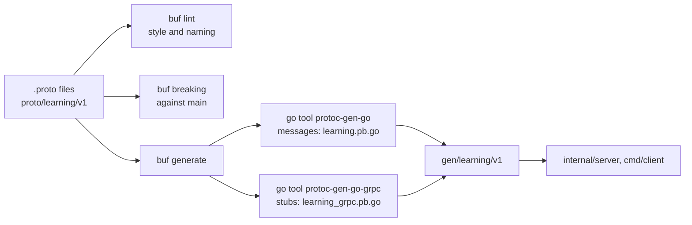

### 2.1 The `.proto` File: Syntax, Packages and Options

The starter contract, [`proto/learning/v1/learning.proto`](proto/learning/v1/learning.proto), abridged:

```protobuf
syntax = "proto3";

package learning.v1;

import "google/protobuf/timestamp.proto";

option go_package = "github.com/TheLearningHubOrg/learn-grpc/gen/learning/v1;learningv1";

service LearningService {
  rpc GetStage(GetStageRequest) returns (Stage);
  rpc StreamRoadmap(StreamRoadmapRequest) returns (stream Stage);
  rpc RecordMetrics(stream MetricRecord) returns (MetricSummary);
  rpc LiveExchange(stream ChatMessage) returns (stream ChatMessage);
}

enum Track {
  TRACK_UNSPECIFIED = 0;
  TRACK_FOUNDATIONS = 1;
  TRACK_PRODUCTION = 2;
  TRACK_CAREER = 3;
}

message Stage {
  reserved 5;
  reserved "difficulty";

  int32 stage_number = 1;
  string title = 2;
  string domain_focus = 3;
  repeated string key_concepts = 4;
  Track track = 6;
}
```

| Line | Role | Effect |
| :--- | :--- | :--- |
| `syntax = "proto3";` | Language version. | Implicit presence for scalars, open enums, packed repeated numerics. Editions replace this line ([2.8](#28-protobuf-editions)). |
| `package learning.v1;` | Protobuf namespace. | Becomes part of every full name: `learning.v1.Stage`, and the RPC path `/learning.v1.LearningService/GetStage`. The `v1` suffix is the API version. |
| `import "google/protobuf/timestamp.proto";` | Pulls in a well-known type. | `buf` and `protoc` ship these files; no download needed. |
| `option go_package = "path;name"` | Go import path and package name. | Generated files import as `learningv1 "github.com/.../gen/learning/v1"`. In this repo, `buf.gen.yaml` managed mode sets it too. |
| `service` / `rpc` | Method declarations. | `stream` before the request or response type selects the call shape (Stage 3). |
| `= 1`, `= 2` … | **Field numbers**. | The only thing that identifies a field on the wire. Names exist for code and JSON. |
| `reserved 5; reserved "difficulty";` | Retired number and name. | `protoc` and `buf` reject any future field that reuses either. |

Layout conventions that `buf lint` (STANDARD) enforces, and why:

| Rule | Example | Why |
| --- | --- | --- |
| Directory matches package | `proto/learning/v1/` for `learning.v1` | Import paths and package names stay predictable across languages. |
| Package ends in a version | `learning.v1`, `billing.v2beta1` | Lets a breaking redesign live next to the old API as `v2`. |
| Files `lower_snake_case.proto` | `learning.proto` | Some generators derive class names from file names. |
| Messages `PascalCase`, fields `lower_snake_case` | `MetricRecord.recorded_at` | Generators convert to each language's style (`RecordedAt` in Go, `recordedAt` in JSON). |
| Enum values prefixed with the enum name, zero value `_UNSPECIFIED` | `TRACK_UNSPECIFIED = 0` | Enum values share the enclosing scope (C++ rules), so two enums in one package cannot both have `UNKNOWN`. |
| Services end in `Service` | `LearningService` | Readability; avoids clashes with message names. |
| Each RPC has its own `<Method>Request` / `<Method>Response` | `GetStageRequest` / `GetStageResponse` | Each method can gain fields without affecting others. The starter disables this rule in [`buf.yaml`](buf.yaml) to stay small, with a comment explaining why. |

### 2.2 Scalar Types and How to Choose Them

Type choice changes the encoded size and, for negatives, can change it a lot.

| Proto type | Go type | Wire type | Encoding | Choose it when |
| --- | --- | --- | --- | --- |
| `int32`, `int64` | `int32`, `int64` | VARINT (0) | Varint of the two's-complement value; **negatives always take 10 bytes** | Values are usually non-negative (counts, IDs, sizes). |
| `uint32`, `uint64` | `uint32`, `uint64` | VARINT (0) | Varint | Values are never negative. |
| `sint32`, `sint64` | `int32`, `int64` | VARINT (0) | ZigZag, then varint | Values are often negative (deltas, offsets, temperatures). |
| `fixed32`, `fixed64` | `uint32`, `uint64` | I32 (5) / I64 (1) | Little-endian, always 4 / 8 bytes | Values are usually large (hashes, random IDs ≥ 2^28 / 2^56). |
| `sfixed32`, `sfixed64` | `int32`, `int64` | I32 / I64 | Little-endian two's complement | Large signed values. |
| `float`, `double` | `float32`, `float64` | I32 / I64 | IEEE 754 | Measurements. Never money. |
| `bool` | `bool` | VARINT | `0` or `1` | Flags. Consider an enum if a third state may appear. |
| `string` | `string` | LEN (2) | Length varint, then UTF-8 bytes | Text. Invalid UTF-8 fails to parse in proto3. |
| `bytes` | `[]byte` | LEN (2) | Length varint, then raw bytes | Binary blobs, opaque tokens, pre-serialized data. |

Money deserves its own rule: use integer minor units (`int64 amount_micros`) or `google.type.Money`, never `double`. `0.1 + 0.2` is not `0.3` in IEEE 754 and the error compounds over sums.

`int64` and `uint64` are also awkward in JavaScript, where numbers are doubles with 53 bits of integer precision. The canonical JSON mapping writes 64-bit integers as strings for this reason ([2.11](#211-json-mapping-and-protojson)).

### 2.3 The Binary Wire Format: Tags, Wire Types and Varints

A serialized message is a flat sequence of fields. Each field is a *tag* followed by a value. Names never appear.

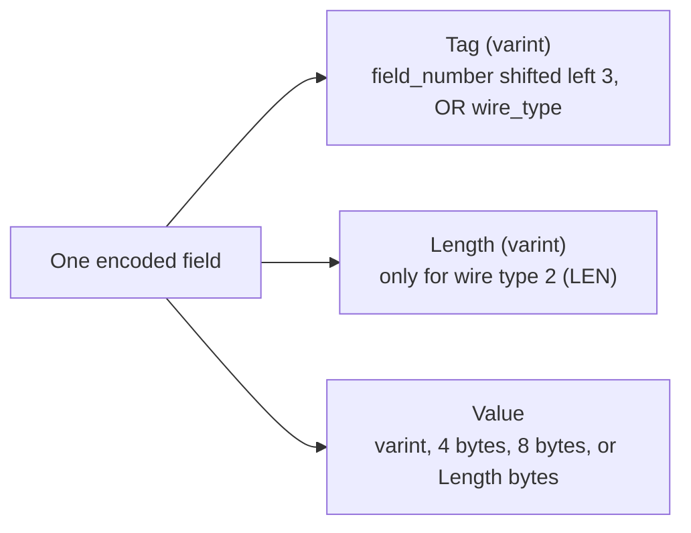

| Wire type | Name | Used by | Value layout |
| :--- | :--- | :--- | :--- |
| **0** | VARINT | `int32`, `int64`, `uint32`, `uint64`, `sint32`, `sint64`, `bool`, `enum` | 1-10 bytes; `sint*` are ZigZag-encoded first |
| **1** | I64 | `fixed64`, `sfixed64`, `double` | 8 bytes little-endian |
| **2** | LEN | `string`, `bytes`, embedded messages, packed repeated fields, map entries | Varint length, then that many bytes |
| **5** | I32 | `fixed32`, `sfixed32`, `float` | 4 bytes little-endian |

Wire types 3 and 4 (group start/end) are proto2 legacy and never appear in proto3 data.

**Varints.** Each byte carries 7 bits of the number, least significant group first. The high bit is 1 when more bytes follow. From [`internal/wire/wire.go`](internal/wire/wire.go):

```go
func AppendVarint(b []byte, v uint64) []byte {
	for v >= 0x80 {
		b = append(b, byte(v)|0x80)
		v >>= 7
	}
	return append(b, byte(v))
}
```

Encoding 150 (binary `1001 0110`):

1. `150 >= 128`, so emit the low 7 bits `001 0110` with the continuation bit: `1001 0110` = `0x96`. Shift: `150 >> 7 = 1`.
2. `1 < 128`, so emit `0000 0001` = `0x01`.
3. Result: `96 01`.

Values 0-127 take 1 byte, up to 16,383 take 2, up to about 2 million take 3. A `uint64` near the maximum takes 10.

**Tags.** `tag = field_number << 3 | wire_type`. Field 1 as a varint is `1<<3 | 0 = 8` = `0x08`. Because the tag itself is a varint, field numbers 1-15 fit in one byte (`15<<3 | 7 = 127`) and 16-2047 take two. Give the hottest fields the low numbers.

Decoding `GetStageRequest{stage_number: 150}` by hand:

```text
08 96 01
│  └──┴── varint 150
└──────── tag 0x08 = field 1, wire type 0 (VARINT)
```

And `ChatMessage{sender: "hi"}`:

```text
0a 02 68 69
│  │  └──┴── "hi"
│  └──────── length 2
└─────────── tag 0x0a = field 1 (1<<3 = 8), wire type 2 (LEN): 8|2 = 10
```

Both are asserted against `proto.Marshal` output in [`internal/wire/wire_test.go`](internal/wire/wire_test.go), so you can change a value and watch the bytes change:

```go
func TestHandEncodingMatchesProtoMarshal(t *testing.T) {
	want, err := proto.Marshal(&learningv1.GetStageRequest{StageNumber: 150})
	if err != nil {
		t.Fatal(err)
	}
	got := AppendVarint(AppendVarint(nil, Tag(1, TypeVarint)), 150)
	if !bytes.Equal(got, want) {
		t.Fatalf("hand encoding % x, proto.Marshal % x", got, want)
	}
}
```

**ZigZag.** `int32(-1)` is sign-extended to 64 bits before varint encoding, so it costs 10 bytes. ZigZag maps signed to unsigned so that small magnitudes stay small: 0→0, -1→1, 1→2, -2→3, 2→4.

```go
func ZigZag32(n int32) uint32 {
	return uint32(n<<1) ^ uint32(n>>31)
}
```

`n>>31` is an arithmetic shift: all zeros for non-negative `n`, all ones for negative `n`. XOR with `n<<1` therefore leaves positives as `2n` and turns negatives into `-2n-1`. `TestNegativeInt32TakesTenBytes` checks both sizes.

**Other wire facts that matter in practice:**

- **Order is not guaranteed.** Serializers usually write fields in number order but parsers must accept any order. Do not compare serialized bytes to test equality; use `proto.Equal`.
- **Last one wins.** If a non-repeated field appears twice, the parser keeps the last value. For embedded messages it merges them. Concatenating two encoded messages therefore merges them.
- **Unknown fields survive.** A parser that sees a field number it does not know keeps the raw bytes, and re-serializing writes them back. This is what lets an old proxy pass new fields through untouched.
- **Default values are not written.** In proto3, a scalar equal to its zero value is skipped entirely. `GetStageRequest{stage_number: 0}` encodes to zero bytes, which `TestDefaultValuesAreNotEncoded` checks.

### 2.4 Composite Types: Enums, Nested Messages, `repeated`, `map` and `oneof`

```protobuf
syntax = "proto3";

package catalog.v1;

message Course {
  enum Level {
    LEVEL_UNSPECIFIED = 0;
    LEVEL_BEGINNER = 1;
    LEVEL_ADVANCED = 2;
  }

  message Lesson {
    string title = 1;
    uint32 minutes = 2;
  }

  string id = 1;
  Level level = 2;
  repeated Lesson lessons = 3;          // repeated message: one LEN record per element
  repeated uint32 ratings = 4;          // repeated scalar: packed into one LEN record
  map<string, string> labels = 5;       // wire-equivalent to repeated entry {key = 1; value = 2;}

  oneof pricing {                       // at most one of these is set
    uint64 price_cents = 10;
    bool free = 11;
  }
}
```

| Construct | Wire encoding | Go representation | Rules |
| --- | --- | --- | --- |
| `enum` | VARINT of the number | Named `int32` type with constants `Course_LEVEL_BEGINNER` and a `String()` method | First value must be 0. proto3 enums are *open*: an unknown number is kept as that number, not rejected. |
| Nested `message` | LEN: length, then the inner message bytes | Pointer field `*Course_Lesson` | Nesting only scopes the name; it does not change encoding. |
| `repeated` message | One LEN record per element, same tag repeated | `[]*Course_Lesson` | Order is preserved. |
| `repeated` scalar numeric | **Packed**: one LEN record holding all values back to back | `[]uint32` | Packed by default in proto3. Parsers accept packed and unpacked forms. |
| `map<K, V>` | Repeated entry messages with `key = 1`, `value = 2` | `map[string]string` | Keys: integer types or `string` only. No ordering. Cannot be `repeated`. |
| `oneof` | Just the one field that is set | Interface field `Pricing isCourse_Pricing` with wrapper types `*Course_PriceCents`, `*Course_Free` | Setting one member clears the others. Members cannot be `repeated` or `map`. |

Using the `oneof` in Go:

```go
package main

import (
	"fmt"

	catalogv1 "example.com/gen/catalog/v1"
)

func describePrice(c *catalogv1.Course) string {
	switch p := c.GetPricing().(type) {
	case *catalogv1.Course_PriceCents:
		return fmt.Sprintf("%d.%02d", p.PriceCents/100, p.PriceCents%100)
	case *catalogv1.Course_Free:
		return "free"
	case nil:
		return "price not set"
	default:
		return "unknown pricing" // a newer schema added a member this binary does not know
	}
}

func main() {
	c := &catalogv1.Course{Id: "grpc-101", Pricing: &catalogv1.Course_PriceCents{PriceCents: 4900}}
	fmt.Println(describePrice(c)) // 49.00
	c.Pricing = &catalogv1.Course_Free{Free: true}
	fmt.Println(describePrice(c)) // free
}
```

A `oneof` is the right tool for "exactly one of these variants" (payment methods, event types, a request that targets a resource by ID *or* by name). It costs nothing extra on the wire and the type switch makes unhandled cases visible in code review.

### 2.5 Field Presence: Defaults, `optional`, Wrappers and Field Masks

In proto3, a plain scalar has *implicit presence*: the receiver cannot tell "set to 0" from "not set", because 0 is not written. That is fine for most fields and wrong for some, such as a discount that can legitimately be 0 or a partial update where "not sent" means "leave unchanged".

```protobuf
syntax = "proto3";

package profile.v1;

import "google/protobuf/field_mask.proto";
import "google/protobuf/wrappers.proto";

message Profile {
  string display_name = 1;                  // implicit presence: "" means unset
  optional uint32 age = 2;                  // explicit presence: unset differs from 0
  google.protobuf.StringValue nickname = 3; // wrapper message: nil differs from ""
}

message UpdateProfileRequest {
  Profile profile = 1;
  google.protobuf.FieldMask update_mask = 2; // paths: ["age", "nickname"]
}
```

```go
package main

import (
	"fmt"

	"google.golang.org/protobuf/proto"
	"google.golang.org/protobuf/types/known/wrapperspb"

	profilev1 "example.com/gen/profile/v1"
)

func main() {
	p := &profilev1.Profile{}
	fmt.Println(p.Age == nil, p.GetAge()) // true 0: not set, getter returns the default

	p.Age = proto.Uint32(0)
	fmt.Println(p.Age == nil, p.GetAge()) // false 0: explicitly set to zero

	p.Nickname = wrapperspb.String("")
	fmt.Println(p.GetNickname() != nil) // true: set to the empty string
}
```

| Technique | Wire cost | Go API | Use it for |
| --- | --- | --- | --- |
| Implicit presence (plain proto3 scalar) | Nothing when zero | Value field, `GetX()` | Fields where zero means "none" anyway. |
| `optional` scalar | Zero is written when set | Pointer field (`*uint32`), `proto.Uint32(v)` to set | Any scalar where "unset" must differ from zero. Prefer this over wrappers in new code. |
| Wrapper types (`StringValue`, `Int64Value` …) | An extra LEN record | `*wrapperspb.StringValue` | Older APIs written before `optional` returned to proto3. |
| Message fields | Always have presence | Pointer; `nil` means unset | Composite values. |
| `FieldMask` | List of paths | `*fieldmaskpb.FieldMask` | Partial updates (`PATCH` semantics): the server only touches listed paths. |

### 2.6 Well-Known Types

The protobuf distribution includes a set of messages that every language runtime understands and that the JSON mapping treats specially.

| Type | Go package | JSON form | Use it for |
| --- | --- | --- | --- |
| `google.protobuf.Timestamp` | `timestamppb` | `"2026-11-03T07:51:28.887Z"` (RFC 3339, UTC) | Points in time. Seconds plus nanoseconds since the Unix epoch. |
| `google.protobuf.Duration` | `durationpb` | `"1.500s"` | Time spans, timeouts, retry delays. |
| `google.protobuf.Empty` | `emptypb` | `{}` | RPCs with no input or output. A dedicated empty request message is often better because it can grow. |
| `google.protobuf.FieldMask` | `fieldmaskpb` | `"age,nickname"` | Partial reads and updates. |
| `google.protobuf.Any` | `anypb` | `{"@type": "type.googleapis.com/…", …}` | A message whose type is only known at runtime (error details, plugin payloads). |
| `google.protobuf.Struct`, `Value`, `ListValue` | `structpb` | Arbitrary JSON | Schemaless JSON-like data. Loses typing; use sparingly. |
| Wrappers (`Int32Value`, `StringValue` …) | `wrapperspb` | The bare value or `null` | Nullable scalars in older APIs. |

The starter uses `Timestamp` on `MetricRecord.recorded_at` and `ChatMessage.sent_at`:

```go
reply := &learningv1.ChatMessage{
	Sender:  "learn-grpc",
	Message: fmt.Sprintf("ack %s: %s", in.GetSender(), in.GetMessage()),
	SentAt:  timestamppb.New(s.now()), // time.Time -> *timestamppb.Timestamp
}

// On the other side:
t := reply.GetSentAt().AsTime() // *timestamppb.Timestamp -> time.Time (UTC)
if err := reply.GetSentAt().CheckValid(); err != nil {
	// seconds or nanos out of range: reject the input
}
```

`Any` packs a message with its type URL and needs the concrete type linked into the receiving binary to unpack:

```go
anyMsg, err := anypb.New(&learningv1.Stage{StageNumber: 2})
// anyMsg.TypeUrl == "type.googleapis.com/learning.v1.Stage"

var s learningv1.Stage
if err := anyMsg.UnmarshalTo(&s); err != nil {
	// wrong type, or corrupt bytes
}
```

### 2.7 Schema Evolution & Compatibility Rules

Old and new binaries will run side by side during every rollout, so every change must be readable by both. The field number is the contract.

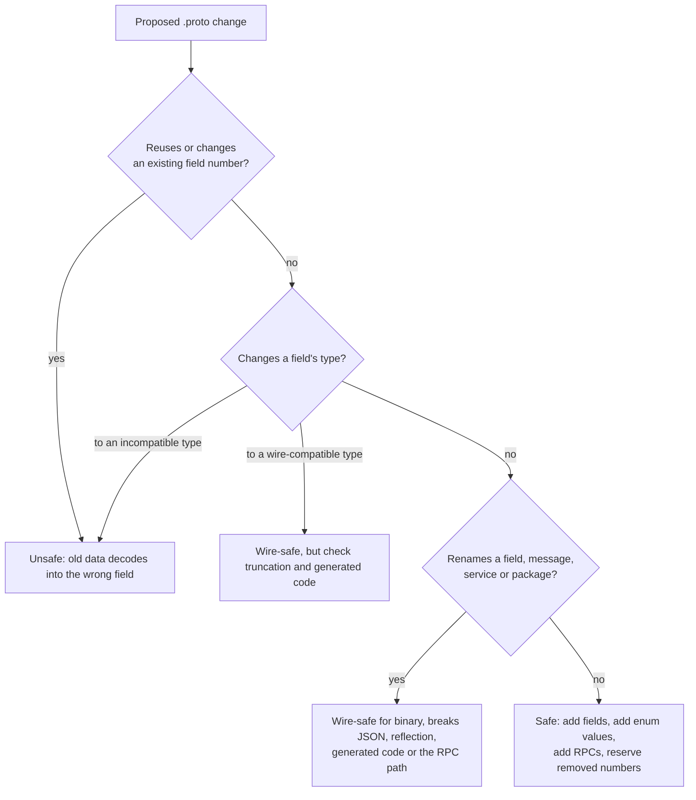

| Change | Binary wire | JSON | Generated code | Verdict |
| --- | --- | --- | --- | --- |
| Add a field with a new number | Safe: old readers skip it | Safe | Safe | Do it. |
| Remove a field and `reserved` its number and name | Safe | Safe: `protojson` skips reserved names instead of rejecting them | Breaks code that used it | Do it after callers stop using the field. |
| Remove a field **without** reserving | Safe today, corrupting tomorrow when the number is reused | — | — | Never. |
| Rename a field | Safe (numbers unchanged) | **Breaks**: JSON uses names | Breaks callers | Avoid in public APIs. |
| `int32` ↔ `int64` ↔ `uint32` ↔ `uint64` ↔ `bool` | Same wire type; values may be truncated | Changes quoting for 64-bit types | Changes Go types | Only if every value fits both. |
| `sint32` ↔ `sint64` | Compatible with each other | — | — | Safe within the pair. |
| `int32` ↔ `sint32` | Same wire type, **different meaning** (ZigZag) | — | — | Never: values silently change. |
| `string` ↔ `bytes` | Compatible if the bytes are valid UTF-8 | Breaks (`bytes` is base64 in JSON) | Changes types | Rarely worth it. |
| `fixed32` ↔ `sfixed32`, `fixed64` ↔ `sfixed64` | Compatible | — | — | Safe within the pair. |
| Scalar ↔ message | Incompatible | — | — | Never. Add a new field instead. |
| Move an existing field into a new `oneof` | Safe on the wire | Safe | Changes Go API | Safe only if no other existing field joins the `oneof`. |
| Add a value to an enum | Safe: proto3 enums are open | Old readers see the number, not the name | Unknown values reach your `switch` default | Always handle `default`. |
| Change a package, service or method name | — | — | — | **Breaks every client**: it changes `:path`. Add a new method instead. |
| Change an RPC from unary to streaming | — | — | — | Breaks every client. Add a new method. |

The starter's `Stage` message shows the removal pattern:

```protobuf
message Stage {
  // Field 5 once held a free-text difficulty. It is reserved so that no
  // future field can reuse the number or the name with a different type.
  reserved 5;
  reserved "difficulty";
  // ...
}
```

`buf breaking` (2.10) checks most of the rows above automatically against the previous version of the schema.

### 2.8 Protobuf Editions

Editions replace the `proto2` / `proto3` split with one language plus *features* that control behaviour. A file declares an edition, and features can be overridden per file, message, enum or field. The wire format does not change, so an edition file and a proto3 file with the same fields exchange data freely.

```protobuf
edition = "2023";

package learning.v2;

option go_package = "github.com/TheLearningHubOrg/learn-grpc/gen/learning/v2;learningv2";

// Edition 2023 defaults to explicit presence (like proto2 optional).
// This file-level line restores proto3 behaviour for every field...
option features.field_presence = IMPLICIT;

message Stage {
  int32 stage_number = 1;
  string title = 2;

  // ...and this field opts back into explicit presence, the editions
  // equivalent of proto3 "optional".
  int32 estimated_hours = 3 [features.field_presence = EXPLICIT];
}
```

| Feature | Edition 2023 default | proto3 behaviour | proto2 behaviour |
| --- | --- | --- | --- |
| `field_presence` | `EXPLICIT` | `IMPLICIT` for scalars | `EXPLICIT` |
| `enum_type` | `OPEN` | `OPEN` | `CLOSED` |
| `repeated_field_encoding` | `PACKED` | `PACKED` | `EXPANDED` |
| `utf8_validation` | `VERIFY` | `VERIFY` | `NONE` |
| `message_encoding` | `LENGTH_PREFIXED` | `LENGTH_PREFIXED` | `LENGTH_PREFIXED` (groups are `DELIMITED`) |
| `json_format` | `ALLOW` | `ALLOW` | `LEGACY_BEST_EFFORT` |

Language-specific features live in extensions, such as `features.(pb.go).api_level` for the Go Opaque API (see [V.3](#v3-whats-new-in-current-grpc-go-and-protobuf)).

`buf` can convert files for you, and `protoc` supports edition 2023 from v27 onward. Newer editions (2024) are supported by recent `protoc` and plugin releases; check your toolchain before adopting them.

**Should you migrate?** For a new API, proto3 is still fully supported and simpler to read. Editions pay off when you need per-field control (explicit presence on some scalars, closed enums for a legacy proto2 consumer) or when you maintain a mix of proto2 and proto3 files and want one set of rules.

### 2.9 Code Generation with `buf` and `protoc`

This repo generates code with `buf`, and runs the plugins through `go tool` so their versions are pinned in `go.mod`. [`buf.gen.yaml`](buf.gen.yaml):

```yaml
version: v2
managed:
  enabled: true
  override:
    - file_option: go_package_prefix
      value: github.com/TheLearningHubOrg/learn-grpc/gen
plugins:
  - local: ["go", "tool", "protoc-gen-go"]
    out: gen
    opt: paths=source_relative
  - local: ["go", "tool", "protoc-gen-go-grpc"]
    out: gen
    opt: paths=source_relative
clean: true
```

And the matching lines in [`go.mod`](go.mod), added with `go get -tool`:

```text
tool (
	google.golang.org/grpc/cmd/protoc-gen-go-grpc
	google.golang.org/protobuf/cmd/protoc-gen-go
)
```

| Setting | What it does |
| --- | --- |
| `managed.enabled` with `go_package_prefix` | Computes `go_package` for every file from its path, so the `.proto` files do not have to agree by hand. Well-known types are excluded automatically. |
| `local: ["go", "tool", …]` | Runs the plugin version recorded in `go.mod`. A teammate with a different global `protoc-gen-go` still produces identical output. |
| `opt: paths=source_relative` | Output mirrors the input layout: `proto/learning/v1/learning.proto` → `gen/learning/v1/learning.pb.go`. |
| `clean: true` | Deletes stale files in `gen/` before writing, so a removed `.proto` does not leave orphaned Go code. |

```bash
buf generate             # writes gen/learning/v1/learning.pb.go and learning_grpc.pb.go
git diff --exit-code gen # CI runs this: fails if someone edited a .proto without regenerating
```

The equivalent `protoc` command, for setups without `buf`:

```bash
protoc -I proto \
  --go_out=gen --go_opt=paths=source_relative \
  --go-grpc_out=gen --go-grpc_opt=paths=source_relative \
  learning/v1/learning.proto
```

`protoc` looks for plugins named `protoc-gen-<name>` on `PATH`, which is why it needs `go install` for each plugin, and why its output can drift between machines.

**What the two plugins generate:**

| File | Plugin | Contents |
| --- | --- | --- |
| `learning.pb.go` | `protoc-gen-go` | A struct per message, enum types and constants, nil-safe getters, the embedded file descriptor, and registration in the global type registry. |
| `learning_grpc.pb.go` | `protoc-gen-go-grpc` | `LearningServiceClient` interface and constructor, `LearningServiceServer` interface, `UnimplementedLearningServiceServer`, `RegisterLearningServiceServer`, the `ServiceDesc`, and full method name constants. |

Getters are safe on nil receivers, which removes a whole class of nil checks:

```go
// Generated:
func (x *GetStageRequest) GetStageNumber() int32 {
	if x != nil {
		return x.StageNumber
	}
	return 0
}

// So this never panics, even when req or req.Profile is nil:
age := req.GetProfile().GetAge()
```

Three rules for generated message structs:

1. **Never copy them by value.** They contain internal state and a no-copy marker; `go vet` reports `copylocks` violations. Use pointers and `proto.Clone` for a deep copy.
2. **Compare with `proto.Equal`**, or `cmp.Diff(a, b, protocmp.Transform())` in tests. `==` and `reflect.DeepEqual` compare internal caches.
3. **Do not edit generated files.** Regenerate. CI fails the build if `gen/` and the `.proto` files disagree.

### 2.10 Linting and Breaking-Change Detection with `buf`

[`buf.yaml`](buf.yaml) defines one module rooted at `proto/`, the lint rule set and the breaking-change rule set:

```yaml
version: v2
modules:
  - path: proto
lint:
  use:
    - STANDARD
  except:
    - RPC_REQUEST_RESPONSE_UNIQUE
    - RPC_REQUEST_STANDARD_NAME
    - RPC_RESPONSE_STANDARD_NAME
breaking:
  use:
    - FILE
```

```bash
buf lint                                        # style and naming rules
buf format --diff --exit-code                   # canonical formatting, like gofmt
buf breaking --against ".git#branch=main"       # compare with the main branch
buf breaking --against "buf.build/acme/learning" # or with a published module
```

A failed check reports one line per violation, roughly like this:

```text
proto/learning/v1/learning.proto:50:3:Field "2" with name "title" on message "Stage" changed type from "string" to "bytes".
proto/learning/v1/learning.proto:48:3:Previously present field "5" with name "estimated_hours" on message "Stage" was deleted without reserving the number "5".
```

| Breaking category | Checks | Choose it when |
| --- | --- | --- |
| `FILE` | Everything in `PACKAGE`, plus moving types between files. Strictest. | Generated code is imported by other teams (Go, Java, C++ care about file layout). |
| `PACKAGE` | Source compatibility per package: names, types, numbers. | Consumers regenerate but files move around. |
| `WIRE_JSON` | Binary and JSON compatibility only. Renames of fields break JSON. | You serve JSON (grpc-gateway, Connect) but own every client's code. |
| `WIRE` | Binary wire compatibility only. Renames allowed. | Internal services where every caller regenerates on each change. |

CI in this repo runs `buf lint`, `buf format`, `buf breaking` on pull requests, and the generated-code diff check. See the `proto` job in [`.github/workflows/ci.yml`](.github/workflows/ci.yml).

### 2.11 JSON Mapping and `protojson`

Protobuf has a canonical JSON mapping, used by `grpcurl`, grpc-gateway, Connect and the transcoding features of Envoy and cloud gateways. In Go it lives in `google.golang.org/protobuf/encoding/protojson`. Do not use `encoding/json` on generated structs: it ignores `json_name`, writes `oneof` wrappers wrongly and leaks internal fields.

```go
package main

import (
	"fmt"
	"log"

	"google.golang.org/protobuf/encoding/protojson"

	learningv1 "github.com/TheLearningHubOrg/learn-grpc/gen/learning/v1"
)

func main() {
	s := &learningv1.Stage{StageNumber: 2, Title: "Protocol Buffers", Track: learningv1.Track_TRACK_FOUNDATIONS}

	b, err := protojson.Marshal(s)
	if err != nil {
		log.Fatal(err)
	}
	fmt.Println(string(b))
	// {"stageNumber":2, "title":"Protocol Buffers", "track":"TRACK_FOUNDATIONS"}  (spacing varies)

	b, _ = protojson.MarshalOptions{EmitUnpopulated: true, UseProtoNames: true}.Marshal(s)
	fmt.Println(string(b))
	// {"stage_number":2, "title":"Protocol Buffers", "domain_focus":"", "key_concepts":[], "track":"TRACK_FOUNDATIONS"}

	var in learningv1.Stage
	err = protojson.UnmarshalOptions{DiscardUnknown: true}.Unmarshal([]byte(`{"stage_number": 3, "newField": true}`), &in)
	fmt.Println(in.GetStageNumber(), err) // 3 <nil>
}
```

| Proto | JSON | Gotcha |
| --- | --- | --- |
| Field `stage_number` | `"stageNumber"` (parsers accept both) | Renaming a field breaks JSON clients even though binary is fine. |
| `int64`, `uint64`, `fixed64` | String: `"9007199254740993"` | JavaScript would lose precision with a number. |
| `int32`, `double` | Number | `NaN` and `Infinity` are strings. |
| `enum` | Name string: `"TRACK_FOUNDATIONS"` | Unknown numbers are written as numbers. Parsers accept names or numbers. |
| `bytes` | Base64 string | |
| `Timestamp` | `"2026-11-03T07:51:28Z"` | Always UTC with a `Z`. |
| `Duration` | `"1.5s"` | |
| Zero values | Omitted by default | `EmitUnpopulated` writes them. |
| Unknown JSON fields | **Error** by default | Unlike binary parsing. Set `DiscardUnknown` for tolerant readers. Reserved names are always skipped. |

`protojson` output is deliberately unstable: it randomly varies whitespace between runs so that nobody depends on exact bytes. Compare parsed messages, never JSON strings, and use `protojson.Format` only for logs.

### 2.12 Pitfalls

| Pitfall | Symptom | Fix |
| --- | --- | --- |
| Reusing a deleted field number | No error; old clients read the new field's bytes as the old field. Wrong prices, wrong IDs. | `reserved` every removed number and name. Run `buf breaking` in CI. |
| `int32` for a value that is often negative | Payloads larger than expected; each negative costs 10 bytes | Use `sint32` / `sint64` from the start (changing later is not wire-compatible). |
| Relying on "unset" for a proto3 scalar | A client sends `0` to mean "set to zero" and the server treats it as "not provided" | Use `optional` or a `FieldMask`. |
| Missing `go_package` and no managed mode | `protoc-gen-go: unable to determine Go import path for "learning.proto"` | Add `option go_package` or enable `buf` managed mode. |
| Plugin not installed or not on `PATH` | `protoc-gen-go: program not found or is not executable` | Use `buf` with `local: ["go", "tool", …]`, or `go install` the plugin and add `$(go env GOPATH)/bin` to `PATH`. |
| Two copies of the same `.proto` compiled into one binary | Panic at init: `proto: file "learning/v1/learning.proto" is already registered` | Generate each file once, in one Go package, and import it everywhere. |
| `encoding/json` on a generated struct | Wrong field names, `oneof` written as nested wrapper objects, enums as numbers | Use `protojson`. |
| Comparing messages with `==` or `reflect.DeepEqual` | Tests fail intermittently on equal messages | `proto.Equal`, or `cmp.Diff` with `protocmp.Transform()`. |
| First enum value is a real state (`PENDING = 0`) | Unset and "pending" are indistinguishable; old clients default to pending | Make `0` the `_UNSPECIFIED` sentinel and reject it in validation. |
| Golden-file tests on `protojson` output | Tests pass locally and fail in CI with differences only in spaces | Unmarshal both sides and compare with `proto.Equal`. |
| Strict JSON parsing at an API edge | `proto: (line 1:20): unknown field "newField"` from older servers after clients upgrade | `protojson.UnmarshalOptions{DiscardUnknown: true}` for tolerant readers. |

### 2.13 Best Practices

- **Reserve, never reuse**: field numbers are permanent; `reserved` makes the compiler enforce that.
- **Put the version in the package**: `foo.v1` lets a redesign ship as `foo.v2` alongside it.
- **One request and response message per RPC**: each method can evolve without dragging others along.
- **Zero means unspecified for enums**: every enum's 0 value is `_UNSPECIFIED`, and servers reject it where a real value is required.
- **Use low field numbers for hot fields**: 1-15 cost one tag byte.
- **Prefer `optional` to wrappers in new schemas**: same semantics, less wire overhead, simpler generated code.
- **Pin generators and commit generated code**: `go tool` pins versions; committed code lets `go get` users build without `buf`.
- **Gate every pull request on `buf lint` and `buf breaking`**: compatibility mistakes are invisible in review and expensive in production.
- **Use `Timestamp` and `Duration`, not `int64` milliseconds**: the unit is in the type and the JSON is readable.

### 2.14 Hands-on Exercise

**Task.** Evolve the starter schema without breaking anything.

1. Add `optional uint32 estimated_hours = 7;` to `Stage`. Do not use number 5.
2. Add `TRACK_ELECTIVE = 4;` to `Track`.
3. Run `buf lint`, `buf breaking --against ".git#branch=main"` and `buf generate`.
4. Fill `estimated_hours` for stages 1-3 in `internal/roadmap/roadmap.go` with `proto.Uint32(...)` and add a test that stage 4 has `GetEstimatedHours() == 0` **and** `EstimatedHours == nil`.
5. Now try `uint32 difficulty = 8;` and run `buf lint`.

**Expected output.** Steps 1-4 pass lint and breaking checks, and `go test ./...` passes. Step 5 fails compilation with an error that the name `difficulty` is reserved.

**Solution.** The `Stage` message in [`proto/learning/v1/learning.proto`](proto/learning/v1/learning.proto) shows the `reserved` pattern, and `TestDefaultValuesAreNotEncoded` in [`internal/wire/wire_test.go`](internal/wire/wire_test.go) shows how to assert what is and is not on the wire.

[Back to top ⤴️](#-table-of-contents)

---

## 3. Stage 3: The Four RPC Patterns in Go

gRPC has four call shapes, all built on one HTTP/2 stream per call. This stage implements each one in the starter's `LearningService`, shows the client side, explains exactly how and when each side finishes, and covers the concurrency and flow-control rules that streaming code must follow. You need Stages 1 and 2. Afterwards you can write, call and test streaming services without leaking goroutines.

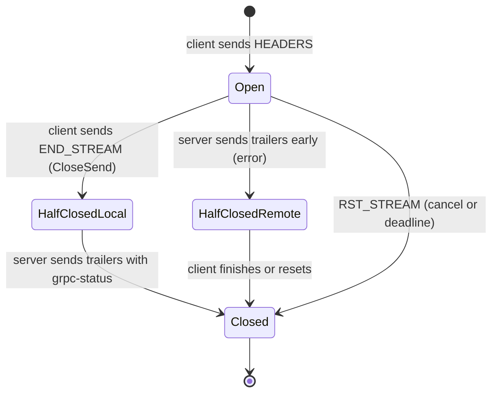

### 3.1 The Four RPC Interaction Models

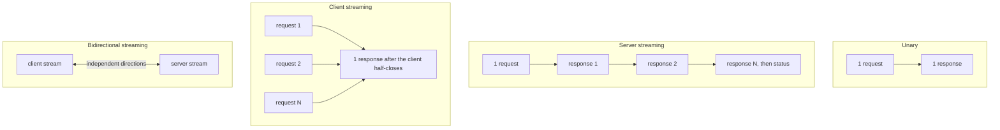

| Pattern | IDL | Client does | Server does | Typical uses |
| :--- | :--- | :--- | :--- | :--- |
| **Unary** | `rpc GetStage(GetStageRequest) returns (Stage);` | Sends 1 message | Returns 1 message or an error | Lookups, commands, CRUD. Most RPCs. |
| **Server streaming** | `rpc StreamRoadmap(StreamRoadmapRequest) returns (stream Stage);` | Sends 1 message, reads until EOF | Sends N messages, returns a status | Large result sets, change feeds, log tailing, progress updates. |
| **Client streaming** | `rpc RecordMetrics(stream MetricRecord) returns (MetricSummary);` | Sends N messages, half-closes, reads 1 | Reads until EOF, returns 1 message | Uploads in chunks, batched ingestion, aggregation. |
| **Bidirectional** | `rpc LiveExchange(stream ChatMessage) returns (stream ChatMessage);` | Sends and reads independently | Sends and reads independently | Chat, collaborative editing, game state, interactive control channels. |

Every shape gets the same features: deadlines, cancellation, metadata, status codes, interceptors. They differ only in how many messages flow and who decides when the call ends: **the server always ends the call** by returning from its handler, which sends the trailers.

**Pick unary unless you have a reason not to.** Streams pin to one connection and therefore one backend for their whole life, which defeats per-request load balancing; they are harder to retry; and a long-lived stream holds memory on both sides. Use streaming when the data is naturally a sequence, too large for one message, or pushed by the server.

### 3.2 Generated Go Server and Client Interfaces

`protoc-gen-go-grpc` turns the service into two interfaces. From [`gen/learning/v1/learning_grpc.pb.go`](gen/learning/v1/learning_grpc.pb.go):

```go
type LearningServiceServer interface {
	GetStage(context.Context, *GetStageRequest) (*Stage, error)
	StreamRoadmap(*StreamRoadmapRequest, grpc.ServerStreamingServer[Stage]) error
	RecordMetrics(grpc.ClientStreamingServer[MetricRecord, MetricSummary]) error
	LiveExchange(grpc.BidiStreamingServer[ChatMessage, ChatMessage]) error
	mustEmbedUnimplementedLearningServiceServer()
}

type LearningServiceClient interface {
	GetStage(ctx context.Context, in *GetStageRequest, opts ...grpc.CallOption) (*Stage, error)
	StreamRoadmap(ctx context.Context, in *StreamRoadmapRequest, opts ...grpc.CallOption) (grpc.ServerStreamingClient[Stage], error)
	RecordMetrics(ctx context.Context, opts ...grpc.CallOption) (grpc.ClientStreamingClient[MetricRecord, MetricSummary], error)
	LiveExchange(ctx context.Context, opts ...grpc.CallOption) (grpc.BidiStreamingClient[ChatMessage, ChatMessage], error)
}
```

| Pattern | Server parameter | Server methods | Client return | Client methods |
| --- | --- | --- | --- | --- |
| Unary | `ctx, *Req` | return `(*Resp, error)` | `(*Resp, error)` | — |
| Server streaming | `*Req, grpc.ServerStreamingServer[Resp]` | `Send(*Resp)`, `Context()` | `grpc.ServerStreamingClient[Resp]` | `Recv()`, `Header()`, `Trailer()` |
| Client streaming | `grpc.ClientStreamingServer[Req, Resp]` | `Recv()`, `SendAndClose(*Resp)` | `grpc.ClientStreamingClient[Req, Resp]` | `Send(*Req)`, `CloseAndRecv()` |
| Bidirectional | `grpc.BidiStreamingServer[Req, Resp]` | `Recv()`, `Send(*Resp)` | `grpc.BidiStreamingClient[Req, Resp]` | `Send(*Req)`, `Recv()`, `CloseSend()` |

The private `mustEmbedUnimplementedLearningServiceServer` method forces every implementation to embed `UnimplementedLearningServiceServer`. That is deliberate: when someone adds an RPC to the `.proto`, existing servers still compile and answer the new method with `UNIMPLEMENTED` until they implement it. Embed it **by value**:

```go
type LearningService struct {
	learningv1.UnimplementedLearningServiceServer // value, not pointer
	now func() time.Time
}
```

The generated `RegisterLearningServiceServer` calls a method on the embedded value at registration time, so a nil pointer embed panics at startup rather than on the first unimplemented call.

### 3.3 Unary RPC

The server handler from [`internal/server/service.go`](internal/server/service.go):

```go
func (s *LearningService) GetStage(_ context.Context, req *learningv1.GetStageRequest) (*learningv1.Stage, error) {
	n := req.GetStageNumber()
	if n < 1 {
		return nil, status.Errorf(codes.InvalidArgument, "stage_number must be >= 1, got %d", n)
	}
	stage, ok := roadmap.Find(n)
	if !ok {
		return nil, status.Errorf(codes.NotFound, "stage %d does not exist", n)
	}
	return stage, nil
}
```

And the client, from [`cmd/client/main.go`](cmd/client/main.go):

```go
ctx, cancel := context.WithTimeout(context.Background(), 5*time.Second)
defer cancel()

stage, err := client.GetStage(ctx, &learningv1.GetStageRequest{StageNumber: 1})
if err != nil {
	st := status.Convert(err)
	switch st.Code() {
	case codes.NotFound:
		// handle missing stage
	case codes.DeadlineExceeded, codes.Unavailable:
		// transient: maybe retry
	default:
		return fmt.Errorf("GetStage: %w", err)
	}
}
fmt.Println(stage.GetTitle())
```

| Line / API | Role | What happens at runtime |
| :--- | :--- | :--- |
| `req.GetStageNumber()` | Nil-safe getter. | Returns 0 if `req` were nil; the runtime never passes nil, but getters keep code uniform. |
| `status.Errorf(codes.InvalidArgument, …)` | Builds a gRPC error. | Becomes `grpc-status: 3` and `grpc-message` in the trailers. A plain `errors.New` would become `UNKNOWN` (code 2). |
| `return stage, nil` | Success. | The runtime marshals `stage`, writes `HEADERS`, one `DATA` frame and trailers with `grpc-status: 0`. |
| `context.WithTimeout(…, 5s)` | Client deadline. | Sent as `grpc-timeout`; the server's `ctx` expires at the same moment. |
| `status.Convert(err)` | Extracts code and message from any error. | Non-gRPC errors become `UNKNOWN`. |

Validation belongs at the top of the handler and must return `INVALID_ARGUMENT`, so clients know retrying the same request is pointless. The full status-code guide is in Stage 4.

### 3.4 Server-Streaming RPC

```go
func (s *LearningService) StreamRoadmap(req *learningv1.StreamRoadmapRequest, stream grpc.ServerStreamingServer[learningv1.Stage]) error {
	for _, stage := range roadmap.Stages() {
		if req.GetTrack() != learningv1.Track_TRACK_UNSPECIFIED && stage.GetTrack() != req.GetTrack() {
			continue
		}
		if err := stream.Context().Err(); err != nil {
			return status.FromContextError(err).Err()
		}
		if err := stream.Send(stage); err != nil {
			return err
		}
	}
	return nil
}
```

Client side:

```go
stream, err := client.StreamRoadmap(ctx, &learningv1.StreamRoadmapRequest{Track: learningv1.Track_TRACK_FOUNDATIONS})
if err != nil {
	return err
}
for {
	stage, err := stream.Recv()
	if errors.Is(err, io.EOF) {
		break // server returned OK; trailers are available via stream.Trailer()
	}
	if err != nil {
		return err // a real status: the server failed, or ctx was cancelled
	}
	fmt.Println(stage.GetTitle())
}
```

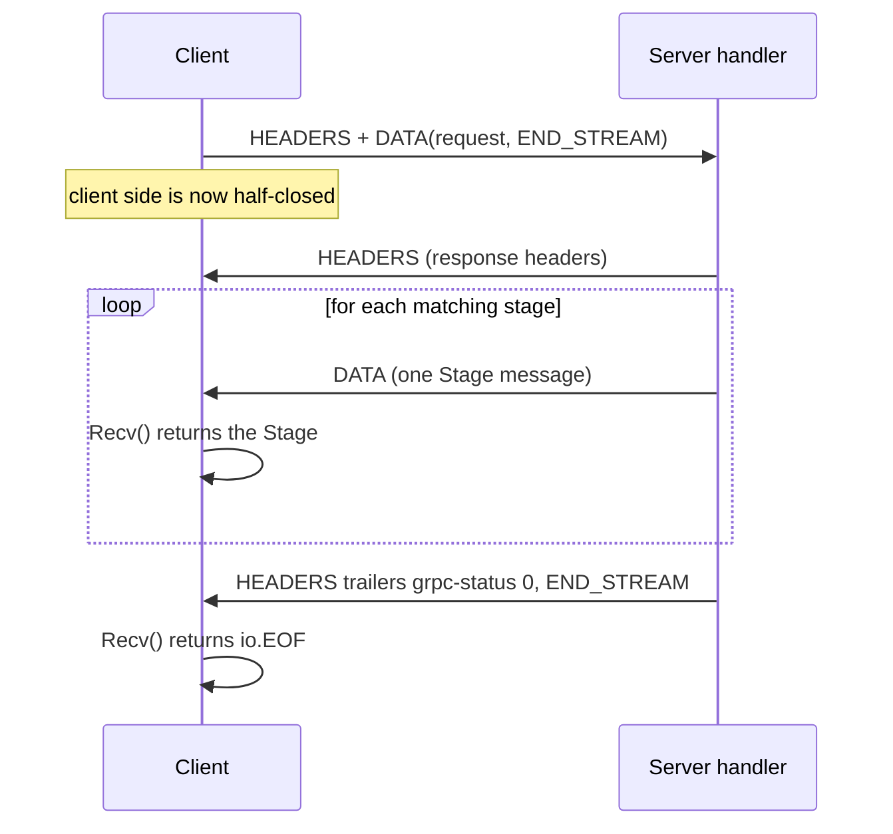

| Line / API | Role | What happens at runtime |
| :--- | :--- | :--- |
| `stream.Context().Err()` | Cheap cancellation check between messages. | Non-nil once the client cancels, its deadline passes, or the connection drops. Stops wasted work. |
| `status.FromContextError(err)` | Maps `context.Canceled` → `CANCELED`, `context.DeadlineExceeded` → `DEADLINE_EXCEEDED`. | The client usually sees its own cancellation first, but logs and metrics on the server get the right code. |
| `stream.Send(stage)` | Queues one message. | May block when the HTTP/2 flow-control window is exhausted ([3.8](#38-flow-control-and-backpressure-in-streams)). Returns an error once the stream is broken. |
| `return nil` | Ends the call with OK. | Trailers are written; the client's next `Recv` returns `io.EOF`. |
| `errors.Is(err, io.EOF)` | Normal end of stream. | `io.EOF` from `Recv` always means status OK. Any failure arrives as a status error instead. |

`TestStreamRoadmapCancelled` in [`service_test.go`](internal/server/service_test.go) covers the cancellation path: a context cancelled before the call produces `CANCELED` on the client.

### 3.5 Client-Streaming RPC

```go
func (s *LearningService) RecordMetrics(stream grpc.ClientStreamingServer[learningv1.MetricRecord, learningv1.MetricSummary]) error {
	var (
		count    int32
		sum      float64
		min, max = math.Inf(1), math.Inf(-1)
	)
	for {
		rec, err := stream.Recv()
		if errors.Is(err, io.EOF) {
			summary := &learningv1.MetricSummary{TotalRecords: count}
			if count > 0 {
				summary.AverageValue = sum / float64(count)
				summary.MinValue = min
				summary.MaxValue = max
			}
			return stream.SendAndClose(summary)
		}
		if err != nil {
			return err
		}
		if rec.GetName() == "" {
			return status.Error(codes.InvalidArgument, "metric name is required")
		}
		v := rec.GetValue()
		if math.IsNaN(v) || math.IsInf(v, 0) {
			return status.Errorf(codes.InvalidArgument, "metric %q has a non-finite value", rec.GetName())
		}
		count++
		sum += v
		min = math.Min(min, v)
		max = math.Max(max, v)
	}
}
```

Client side:

```go
stream, err := client.RecordMetrics(ctx)
if err != nil {
	return err
}
for _, v := range []float64{12.5, 7.25, 30} {
	if err := stream.Send(&learningv1.MetricRecord{Name: "latency_ms", Value: v, RecordedAt: timestamppb.Now()}); err != nil {
		if errors.Is(err, io.EOF) {
			break // the server already ended the call; CloseAndRecv has the real status
		}
		return err
	}
}
summary, err := stream.CloseAndRecv() // half-close, then wait for the single response
```

| Line / API | Role | What happens at runtime |
| :--- | :--- | :--- |
| `stream.Recv()` returning `io.EOF` | The client half-closed. | The client called `CloseAndRecv` (or `CloseSend`), which set `END_STREAM` on its side. |
| `stream.SendAndClose(summary)` | The single response. | Sends the message; the status is sent when the handler returns. Call it once, then return. |
| `return status.Error(InvalidArgument, …)` mid-stream | Early rejection. | The server ends the call immediately. Messages the client is still sending are discarded. |
| Client `Send` returns `io.EOF` | The call is already over. | `Send` cannot tell you why. Always follow with `CloseAndRecv` (or `RecvMsg`) to get the real status. |
| `CloseAndRecv()` | Half-close plus receive. | Returns the summary, or the error status the server returned. |

The `io.EOF`-from-`Send` rule is the most common client-streaming bug. `TestRecordMetricsRejectsBadRecords` shows the correct handling.

### 3.6 Bidirectional Streaming RPC

The server answers each message as it arrives:

```go
func (s *LearningService) LiveExchange(stream grpc.BidiStreamingServer[learningv1.ChatMessage, learningv1.ChatMessage]) error {
	for {
		in, err := stream.Recv()
		if errors.Is(err, io.EOF) {
			return nil
		}
		if err != nil {
			return err
		}
		reply := &learningv1.ChatMessage{
			Sender:  "learn-grpc",
			Message: fmt.Sprintf("ack %s: %s", in.GetSender(), in.GetMessage()),
			SentAt:  timestamppb.New(s.now()),
		}
		if err := stream.Send(reply); err != nil {
			return err
		}
	}
}
```

The client sends and receives on separate goroutines, because the two directions are independent and either side may send at any time:

```go
stream, err := client.LiveExchange(ctx)
if err != nil {
	return err
}

done := make(chan error, 1)
go func() { // the only goroutine that calls Recv
	for {
		msg, err := stream.Recv()
		if errors.Is(err, io.EOF) {
			done <- nil
			return
		}
		if err != nil {
			done <- err
			return
		}
		fmt.Println(msg.GetMessage())
	}
}()

for _, text := range []string{"hello", "how are streams closed?"} { // the only goroutine that calls Send
	if err := stream.Send(&learningv1.ChatMessage{Sender: "client", Message: text}); err != nil {
		return err
	}
}
if err := stream.CloseSend(); err != nil { // "I am done sending"
	return err
}
return <-done // wait for the server to finish and the reader to see io.EOF
```

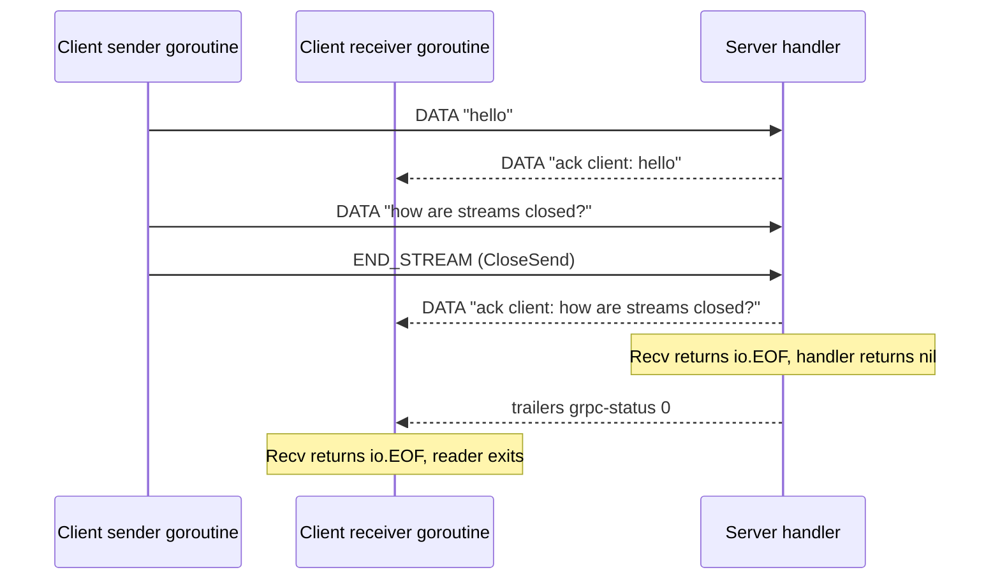

The ping-pong shape above (one reply per message) is just this server's choice. Other bidirectional designs:

| Design | Server loop | Example |
| --- | --- | --- |
| Ping-pong | `Recv` then `Send` in one loop | Request/acknowledge protocols, the starter's `LiveExchange`. |
| Independent push | One goroutine reads, another sends on a timer or event | Live price feed where the client also sends subscription changes. |
| Fan-in / fan-out | Reader feeds a hub; hub broadcasts to many streams | Chat rooms, collaborative editing. Needs per-stream send queues so one slow client does not block the others. |

### 3.7 Stream Lifecycle, Half-Close and Concurrency Rules

grpc-go streams have strict rules. Breaking them causes data races, panics or leaked goroutines, and the race detector (`go test -race`, which CI runs) catches many of them.

| Rule | Why | What breaks if you ignore it |
| --- | --- | --- |
| At most **one goroutine calls `Send`** (or `SendMsg`) at a time | Message writes are not synchronized | Interleaved or corrupted frames; race detector reports. Use a channel feeding one sender goroutine. |
| At most **one goroutine calls `Recv`** at a time | Same, for reads | Races, messages delivered to the wrong reader. |
| One `Send` goroutine and one `Recv` goroutine **may run concurrently** | The directions are independent | — this is the supported pattern. |
| Do not call `CloseSend` concurrently with `Send` | Both write to the send side | Race. Call `CloseSend` from the sender goroutine after its last `Send`. |
| A client stream must end: cancel `ctx`, read `Recv` until a non-nil error, or close the `ClientConn` | The stream's goroutines and buffers live until one of these happens | Goroutine and memory leak per abandoned stream; grows until OOM. |
| The server handler returning **is** the end of the call | Trailers are sent when it returns | `Send` from a goroutine after the handler returned fails or panics. Join every goroutine before returning. |
| Handle `io.EOF` from `Recv` as "peer finished sending", not as an error | It is the normal half-close signal | Servers that treat it as a failure return `UNKNOWN: EOF`. |
| Messages passed to `Send` must not be modified until `Send` returns | The message may be serialized inside `Send` | Corrupted payloads when a buffer is reused too early. |

A safe way to send from many producers is to funnel them through one goroutine:

```go
// outbox serializes Sends from many producers onto one stream.
func outbox(ctx context.Context, stream grpc.BidiStreamingServer[learningv1.ChatMessage, learningv1.ChatMessage], in <-chan *learningv1.ChatMessage) error {
	for {
		select {
		case <-ctx.Done():
			return status.FromContextError(ctx.Err()).Err()
		case msg, ok := <-in:
			if !ok {
				return nil
			}
			if err := stream.Send(msg); err != nil {
				return err
			}
		}
	}
}
```

Producers write to a buffered channel. If the channel is full, the producer decides: block, drop, or disconnect the slow client. Making that decision explicit is the point.

### 3.8 Flow Control and Backpressure in Streams

HTTP/2 flow control is credit-based. Each receiver advertises a window per stream and one for the whole connection. A sender subtracts every `DATA` byte from both windows and stops when either reaches zero. The receiver returns credit with `WINDOW_UPDATE` as the application consumes data.

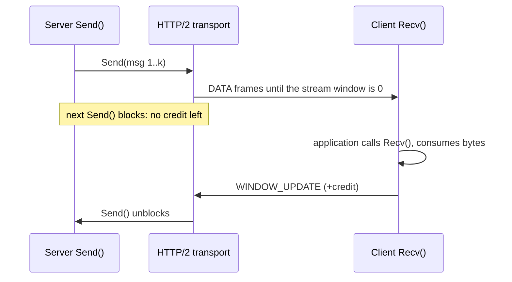

In practice:

- **A slow reader slows the writer.** Server `Send` blocks once the client stops calling `Recv` and the windows fill. This is backpressure, and it is usually what you want: memory stays bounded.
- **A blocked `Send` still respects the context.** If the client's deadline passes or it cancels, `Send` returns an error and the handler can exit.
- **Window sizes trade memory for throughput.** grpc-go starts at 64 KiB per stream and, by default, grows the windows dynamically with a bandwidth-delay-product (BDP) estimator. Setting `grpc.InitialWindowSize` / `grpc.InitialConnWindowSize` (server) or `grpc.WithInitialWindowSize` / `grpc.WithInitialConnWindowSize` (client) to a fixed value **disables** BDP estimation.
- **The connection window is shared.** One stream that never reads can only fill its own stream window, but many such streams can starve the connection window and stall everyone on that connection.
- **Buffers outside gRPC are your problem.** A fan-out hub that appends to an unbounded slice per subscriber moves the backpressure problem into your heap. Use bounded channels and a policy for full ones.

```go
// Fixed windows for a high-latency, high-bandwidth link (disables BDP probing).
srv := grpc.NewServer(
	grpc.InitialWindowSize(1<<20),     // 1 MiB per stream
	grpc.InitialConnWindowSize(4<<20), // 4 MiB per connection
)
```

Leave the defaults unless measurements show the windows are the bottleneck (throughput on a single stream far below link capacity on a long-RTT path).

### 3.9 Writing the Client: `grpc.NewClient`, Channels and Reuse

```go
package main

import (
	"context"
	"log"
	"time"

	"google.golang.org/grpc"
	"google.golang.org/grpc/credentials/insecure"

	learningv1 "github.com/TheLearningHubOrg/learn-grpc/gen/learning/v1"
)

func main() {
	// One ClientConn per target for the life of the process.
	conn, err := grpc.NewClient("dns:///learning.internal:8080",
		grpc.WithTransportCredentials(insecure.NewCredentials()),
	)
	if err != nil {
		log.Fatalf("create client: %v", err) // only fails on bad options or an unparsable target
	}
	defer conn.Close()

	client := learningv1.NewLearningServiceClient(conn) // cheap; share or create freely

	ctx, cancel := context.WithTimeout(context.Background(), 2*time.Second)
	defer cancel()
	if _, err := client.GetStage(ctx, &learningv1.GetStageRequest{StageNumber: 1}); err != nil {
		log.Printf("GetStage: %v", err) // connection problems surface here, as UNAVAILABLE
	}
}
```

| Concern | Behaviour of `grpc.NewClient` |
| --- | --- |
| When does it connect? | Lazily, on the first RPC (or on `conn.Connect()`). |
| What does it return an error for? | Invalid options or a target it cannot parse. Not for an unreachable server. |
| Default resolver | `dns`. `localhost:8080` and `dns:///localhost:8080` are equivalent. |
| What if the server is down? | RPCs fail fast with `UNAVAILABLE`, unless the call uses `grpc.WaitForReady(true)`, in which case it waits until ready or the deadline. |
| Reconnects | Automatic, with exponential backoff, per subchannel. |
| Thread safety | A `ClientConn` and stubs built on it are safe for concurrent use. |
| Cost | Resolver, balancer, connection(s), goroutines. Create once per target; never per request. |

The existing reference client for an order service, in the same style:

```go
package main

import (
	"context"
	"errors"
	"io"
	"log"
	"time"

	"google.golang.org/grpc"
	"google.golang.org/grpc/credentials/insecure"

	pb "github.com/enterprise/orders/v1"
)

func main() {
	conn, err := grpc.NewClient("localhost:50051", grpc.WithTransportCredentials(insecure.NewCredentials()))
	if err != nil {
		log.Fatalf("failed to create client: %v", err)
	}
	defer conn.Close()

	client := pb.NewOrderServiceClient(conn)
	ctx, cancel := context.WithTimeout(context.Background(), 5*time.Second)
	defer cancel()

	res, err := client.CreateOrder(ctx, &pb.CreateOrderRequest{
		CustomerId: "CUST-8812",
		Sku:        "SERVER-RACK-X",
		Quantity:   2,
		PriceUsd:   1299.99,
	})
	if err != nil {
		log.Fatalf("CreateOrder failed: %v", err)
	}
	log.Printf("order created: id=%s status=%s", res.OrderId, res.Status)

	stream, err := client.StreamOrderUpdates(ctx, &pb.OrderSubscription{CustomerId: "CUST-8812"})
	if err != nil {
		log.Fatalf("StreamOrderUpdates failed: %v", err)
	}
	for {
		update, err := stream.Recv()
		if errors.Is(err, io.EOF) {
			break
		}
		if err != nil {
			log.Fatalf("stream error: %v", err)
		}
		log.Printf("update: order=%s status=%s details=%s", update.OrderId, update.Status, update.Details)
	}
}
```

### 3.10 Polyglot Clients: Java and Node.js

Any language can call the Go server; only the generated code and runtime differ. Both examples below call the starter on `localhost:8080`.

**Java** (`grpc-java`, with `protoc-gen-grpc-java` or the Gradle/Maven protobuf plugin). Without `java_package` options, the classes land in package `learning.v1` with outer class `Learning`:

```java
import io.grpc.Grpc;
import io.grpc.InsecureChannelCredentials;
import io.grpc.ManagedChannel;
import io.grpc.StatusRuntimeException;
import java.util.Iterator;
import java.util.concurrent.TimeUnit;
import learning.v1.Learning.GetStageRequest;
import learning.v1.Learning.Stage;
import learning.v1.Learning.StreamRoadmapRequest;
import learning.v1.Learning.Track;
import learning.v1.LearningServiceGrpc;

public final class LearningClient {
  public static void main(String[] args) throws InterruptedException {
    ManagedChannel channel =
        Grpc.newChannelBuilder("localhost:8080", InsecureChannelCredentials.create()).build();
    try {
      var stub = LearningServiceGrpc.newBlockingStub(channel);

      Stage stage = stub.withDeadlineAfter(2, TimeUnit.SECONDS)
          .getStage(GetStageRequest.newBuilder().setStageNumber(1).build());
      System.out.println(stage.getTitle());

      Iterator<Stage> stages = stub.withDeadlineAfter(5, TimeUnit.SECONDS)
          .streamRoadmap(StreamRoadmapRequest.newBuilder().setTrack(Track.TRACK_FOUNDATIONS).build());
      stages.forEachRemaining(s -> System.out.println(s.getStageNumber() + " " + s.getTitle()));
    } catch (StatusRuntimeException e) {
      System.err.println(e.getStatus().getCode() + ": " + e.getStatus().getDescription());
    } finally {
      channel.shutdown().awaitTermination(5, TimeUnit.SECONDS);
    }
  }
}
```

**Node.js** (`@grpc/grpc-js` with `@grpc/proto-loader`, which loads the `.proto` at runtime instead of generating code):

```typescript
import * as grpc from '@grpc/grpc-js';
import * as protoLoader from '@grpc/proto-loader';

const definition = protoLoader.loadSync('proto/learning/v1/learning.proto', {
  keepCase: false, // stage_number becomes stageNumber
  longs: String,
  enums: String,
  defaults: true,
  oneofs: true,
});
const pkg = grpc.loadPackageDefinition(definition) as any;
const client = new pkg.learning.v1.LearningService('localhost:8080', grpc.credentials.createInsecure());

const deadline = new Date(Date.now() + 2000);

client.GetStage({ stageNumber: 1 }, { deadline }, (err: grpc.ServiceError | null, stage: any) => {
  if (err) {
    console.error(grpc.status[err.code], err.details);
    return;
  }
  console.log(stage.title);
});

const stream = client.StreamRoadmap({ track: 'TRACK_FOUNDATIONS' }, { deadline });
stream.on('data', (s: any) => console.log(s.stageNumber, s.title));
stream.on('error', (e: grpc.ServiceError) => console.error(grpc.status[e.code], e.details));
stream.on('end', () => console.log('roadmap complete'));
```

| | Go (`grpc-go`) | Java (`grpc-java`) | Node.js (`@grpc/grpc-js`) |
| --- | --- | --- | --- |
| Channel | `grpc.NewClient(target, opts...)` | `Grpc.newChannelBuilder(target, creds).build()` | `new Client(target, creds)` |
| Deadline | `context.WithTimeout` | `stub.withDeadlineAfter(…)` | `{ deadline: Date }` call option |
| Server streaming | `Recv()` loop until `io.EOF` | Blocking `Iterator`, or async `StreamObserver` | `'data'`, `'error'`, `'end'` events |
| Errors | `status.Convert(err).Code()` | `StatusRuntimeException.getStatus()` | `err.code` (numeric), `err.details` |
| Code generation | `protoc-gen-go` + `protoc-gen-go-grpc` | `protoc-gen-grpc-java` | Optional (`proto-loader` at runtime, or `ts-proto` / `protoc-gen-es` for types) |
| Shutdown | `conn.Close()` | `channel.shutdown().awaitTermination(…)` | `client.close()` |

### 3.11 Testing gRPC Services with `bufconn`

`google.golang.org/grpc/test/bufconn` provides an in-memory `net.Listener`. The real server, real interceptors and the real HTTP/2 transport run, but no port is opened, so tests are fast, parallel and never collide. From [`internal/server/service_test.go`](internal/server/service_test.go):

```go
func dialBufconn(t *testing.T) *grpc.ClientConn {
	t.Helper()
	lis := bufconn.Listen(1 << 20)
	srv, _ := NewGRPCServer(quietLogger())
	go func() { _ = srv.Serve(lis) }()
	t.Cleanup(srv.Stop)

	conn, err := grpc.NewClient("passthrough:///bufnet",
		grpc.WithContextDialer(func(ctx context.Context, _ string) (net.Conn, error) { return lis.DialContext(ctx) }),
		grpc.WithTransportCredentials(insecure.NewCredentials()),
	)
	if err != nil {
		t.Fatalf("NewClient: %v", err)
	}
	t.Cleanup(func() { _ = conn.Close() })
	return conn
}

func TestLiveExchange(t *testing.T) {
	t.Parallel()
	client := learningv1.NewLearningServiceClient(dialBufconn(t))

	stream, err := client.LiveExchange(testCtx(t))
	if err != nil {
		t.Fatal(err)
	}
	for _, m := range []string{"one", "two", "three"} {
		if err := stream.Send(&learningv1.ChatMessage{Sender: "test", Message: m}); err != nil {
			t.Fatalf("Send: %v", err)
		}
		reply, err := stream.Recv()
		if err != nil {
			t.Fatalf("Recv: %v", err)
		}
		if want := "ack test: " + m; reply.GetMessage() != want {
			t.Fatalf("reply = %q, want %q", reply.GetMessage(), want)
		}
	}
	if err := stream.CloseSend(); err != nil {
		t.Fatal(err)
	}
	if _, err := stream.Recv(); !errors.Is(err, io.EOF) {
		t.Fatalf("after CloseSend, Recv err = %v, want io.EOF", err)
	}
}
```

| Line / API | Role | What happens at runtime |
| :--- | :--- | :--- |
| `bufconn.Listen(1 << 20)` | In-memory listener with a 1 MiB buffer per direction. | `Accept` and `Dial` hand out connected pipes. |
| `NewGRPCServer(...)` | The production constructor. | Tests cover the same interceptors, health and reflection that ship. |
| `"passthrough:///bufnet"` | Target with the passthrough resolver. | `NewClient` defaults to DNS; passthrough hands the string to the dialer unchanged. |
| `WithContextDialer` | Replaces TCP dialing. | Every subchannel connection is a `bufconn` pipe. |
| `t.Cleanup(srv.Stop)` | Teardown in reverse order. | No goroutine leaks between tests. |
| `testCtx(t)` | 5 s deadline per test. | A hung stream fails the test instead of hanging CI. |

The suite covers every shape and the edge cases from this stage:

| Test | Proves |
| --- | --- |
| `TestGetStage`, `TestGetStageErrors` | Unary success, `INVALID_ARGUMENT` for 0 and negatives, `NOT_FOUND` for 99. |
| `TestStreamRoadmap` | All stages arrive in order; the track filter works. |
| `TestStreamRoadmapCancelled` | A cancelled context yields `CANCELED`. |
| `TestRecordMetrics`, `TestRecordMetricsEmptyStream` | Aggregation, and a zero summary for an empty upload. |
| `TestRecordMetricsRejectsBadRecords` | Mid-stream rejection reaches the client through `CloseAndRecv`, even when `Send` returned `io.EOF`. |
| `TestLiveExchange` | Ping-pong, half-close and `io.EOF` after the server returns. |
| `TestHealthService` | `grpc.health.v1` reports `SERVING`, and `NOT_FOUND` for an unknown service. |
| `TestUnaryRecovery` | A panic becomes `INTERNAL` instead of crashing the process. |
| `TestGRPCOverSharedPort`, `TestHealthEndpoint` ([`http_test.go`](internal/server/http_test.go)) | The h2c shared-port path on a real loopback socket, and `/health` returning 503 while draining. |

For pure handler logic you can also call the method directly (`svc.GetStage(ctx, req)`) without any transport. Streaming handlers are easier to test through `bufconn` than through hand-written fake streams.

### 3.12 Reference Implementation: An Order Service

The starter keeps its domain small. Here is a second, commercial-style example of all four patterns, useful as a template. The contract:

```protobuf
syntax = "proto3";

package enterprise.orders.v1;

option go_package = "github.com/enterprise/orders/v1;ordersv1";

service OrderService {
  rpc CreateOrder(CreateOrderRequest) returns (OrderResponse);
  rpc StreamOrderUpdates(OrderSubscription) returns (stream OrderStatusUpdate);
  rpc BulkUploadOrders(stream CreateOrderRequest) returns (BulkUploadSummary);
  rpc OrderNegotiation(stream NegotiationOffer) returns (stream NegotiationCounter);
}

message CreateOrderRequest {
  string customer_id = 1;
  string sku = 2;
  int32 quantity = 3;
  int64 price_cents = 4;   // integer minor units, never double, for money
}

message OrderResponse {
  string order_id = 1;
  string status = 2;
  int64 timestamp_ms = 3;
}

message OrderSubscription {
  string customer_id = 1;
}

message OrderStatusUpdate {
  string order_id = 1;
  string status = 2;
  string details = 3;
}

message BulkUploadSummary {
  int32 total_received = 1;
  int32 total_accepted = 2;
  int64 total_volume_cents = 3;
}

message NegotiationOffer {
  string order_id = 1;
  int64 offered_price_cents = 2;
}

message NegotiationCounter {
  string order_id = 1;
  int64 counter_price_cents = 2;
  bool is_accepted = 3;
}
```

The server:

```go
package main

import (
	"context"
	"errors"
	"fmt"
	"io"
	"log"
	"net"
	"time"

	"google.golang.org/grpc"
	"google.golang.org/grpc/codes"
	"google.golang.org/grpc/status"

	pb "github.com/enterprise/orders/v1"
)

type server struct {
	pb.UnimplementedOrderServiceServer
}

// Unary
func (s *server) CreateOrder(ctx context.Context, req *pb.CreateOrderRequest) (*pb.OrderResponse, error) {
	if req.GetCustomerId() == "" || req.GetQuantity() <= 0 {
		return nil, status.Error(codes.InvalidArgument, "customer_id is required and quantity must be > 0")
	}
	orderID := fmt.Sprintf("ORD-%d", time.Now().UnixNano())
	return &pb.OrderResponse{OrderId: orderID, Status: "CREATED", TimestampMs: time.Now().UnixMilli()}, nil
}

// Server streaming: one update every 500 ms until done or cancelled.
func (s *server) StreamOrderUpdates(req *pb.OrderSubscription, stream grpc.ServerStreamingServer[pb.OrderStatusUpdate]) error {
	ticker := time.NewTicker(500 * time.Millisecond)
	defer ticker.Stop()
	for _, st := range []string{"PROCESSING", "INVENTORY_RESERVED", "PACKAGED", "DISPATCHED"} {
		select {
		case <-stream.Context().Done():
			return status.FromContextError(stream.Context().Err()).Err()
		case <-ticker.C:
		}
		if err := stream.Send(&pb.OrderStatusUpdate{OrderId: "ORD-99124", Status: st, Details: "transitioned to " + st}); err != nil {
			return err
		}
	}
	return nil
}

// Client streaming
func (s *server) BulkUploadOrders(stream grpc.ClientStreamingServer[pb.CreateOrderRequest, pb.BulkUploadSummary]) error {
	var received, accepted int32
	var volume int64
	for {
		req, err := stream.Recv()
		if errors.Is(err, io.EOF) {
			return stream.SendAndClose(&pb.BulkUploadSummary{TotalReceived: received, TotalAccepted: accepted, TotalVolumeCents: volume})
		}
		if err != nil {
			return err
		}
		received++
		if req.GetQuantity() > 0 && req.GetPriceCents() > 0 {
			accepted++
			volume += int64(req.GetQuantity()) * req.GetPriceCents()
		}
	}
}

// Bidirectional: counter-offer 5% above anything under 100.00, accept the rest.
func (s *server) OrderNegotiation(stream grpc.BidiStreamingServer[pb.NegotiationOffer, pb.NegotiationCounter]) error {
	for {
		offer, err := stream.Recv()
		if errors.Is(err, io.EOF) {
			return nil
		}
		if err != nil {
			return err
		}
		accepted := offer.GetOfferedPriceCents() >= 10_000
		counter := offer.GetOfferedPriceCents()
		if !accepted {
			counter = counter * 105 / 100
		}
		if err := stream.Send(&pb.NegotiationCounter{OrderId: offer.GetOrderId(), CounterPriceCents: counter, IsAccepted: accepted}); err != nil {
			return err
		}
	}
}

func main() {
	lis, err := net.Listen("tcp", ":50051")
	if err != nil {
		log.Fatalf("listen: %v", err)
	}
	s := grpc.NewServer()
	pb.RegisterOrderServiceServer(s, &server{})
	log.Println("OrderService listening on :50051")
	if err := s.Serve(lis); err != nil {
		log.Fatalf("serve: %v", err)
	}
}
```

Compared with the starter, this server uses the native transport (`s.Serve(lis)`) on its own port, which is the right choice for a busy internal service ([1.8](#18-one-port-for-grpc-and-http-h2c-and-servehttp)). The stream types can also be written with the generated aliases, such as `pb.OrderService_StreamOrderUpdatesServer`; both names refer to the same type.

### 3.13 Pitfalls

| Pitfall | Symptom | Fix |
| --- | --- | --- |
| Treating `io.EOF` from `Recv` as an error | Server returns `rpc error: code = Unknown desc = EOF` for normal client half-close | `if errors.Is(err, io.EOF) { return … }` before the generic error check. |
| Using the error from client `Send` as the status | Client logs `EOF` and never sees the server's `INVALID_ARGUMENT` | After `Send` returns `io.EOF`, call `CloseAndRecv` or `RecvMsg` to get the status. |
| Calling `Send` from several goroutines | `WARNING: DATA RACE` under `-race`; garbled messages in production | Route all sends through one goroutine and a channel ([3.7](#37-stream-lifecycle-half-close-and-concurrency-rules)). |
| Abandoning a client stream without cancelling | Goroutine count and memory climb steadily; `pprof` shows goroutines parked in the transport | `defer cancel()` on the stream's context, or drain `Recv` to a non-nil error. |
| Spawning a goroutine that `Send`s after the handler returns | `rpc error: code = Internal` or a panic on a closed stream | Wait for helper goroutines (`errgroup`) before returning from the handler. |
| Embedding `*UnimplementedXServer` (pointer) | Panic with a nil pointer dereference inside `RegisterXServer` at startup | Embed the struct by value. |
| Forgetting `passthrough:///` with `bufconn` | Tests fail with `code = Unavailable desc = name resolver error: produced zero addresses` or DNS errors | Use `passthrough:///bufnet` as the target. |
| One huge unary message instead of a stream | `code = ResourceExhausted desc = grpc: received message larger than max (5242880 vs. 4194304)` | Stream chunks (client or server streaming) or raise `MaxRecvMsgSize` deliberately on both sides. |
| A long-lived stream with no deadline and no keepalive | Streams silently die behind NAT or load balancer idle timeouts; the client waits forever | Use keepalive pings (Masterclass M1) and application-level heartbeats, and reconnect on error. |
| Unbounded per-subscriber buffers in a broadcast hub | Memory grows with the slowest client | Bounded channels plus a drop or disconnect policy. |

### 3.14 Best Practices

- **Default to unary**: it balances per request, retries cleanly and is easiest to reason about.
- **Check `ctx` in every loop**: `stream.Context().Err()` stops work the caller no longer wants.
- **Return from the handler to finish**: never keep a stream alive from a detached goroutine.
- **One sender, one receiver per stream**: use channels to fan in work to the sender.
- **Always bound client streams**: a deadline or a cancel function on every stream context, released with `defer`.
- **Make the end of a stream explicit**: `CloseSend` when the client is done; return `nil` on the server when the work is complete.
- **Test every shape through `bufconn` with `-race`**: most streaming bugs are races that only the race detector sees.
- **Design for reconnects**: long-lived streams break during deploys; resume from a cursor or sequence number the client sends on reconnect.

### 3.15 Hands-on Exercise

**Task.** Add a fifth RPC that exercises independent bidirectional streaming.

1. Add to `learning.proto`:

   ```protobuf
   rpc Quiz(stream QuizAnswer) returns (stream QuizQuestion);
   message QuizQuestion { int32 id = 1; string text = 2; }
   message QuizAnswer { int32 question_id = 1; string answer = 2; }
   ```

2. Regenerate with `buf generate`. Note that the server still compiles before you implement `Quiz`, thanks to the embedded `UnimplementedLearningServiceServer`, and that a call returns `UNIMPLEMENTED`.
3. Implement `Quiz` so that the server **sends** one question per stage on its own goroutine while the handler loop **receives** answers, counting correct ones. Use `errgroup` so the handler returns only after both goroutines finish.
4. Write a `bufconn` test that answers every question and asserts the stream ends with `io.EOF`, and a second test that cancels the context halfway and asserts `CANCELED`.
5. Run `go test -race ./...`.

**Expected output.** Both tests pass with no race reports, and `go vet` is clean.

**Solution.** The patterns you need are in [`internal/server/service.go`](internal/server/service.go) (`LiveExchange` for the receive loop, `StreamRoadmap` for context checks) and in the outbox example in [3.7](#37-stream-lifecycle-half-close-and-concurrency-rules). The test helpers `dialBufconn` and `testCtx` are in [`internal/server/service_test.go`](internal/server/service_test.go).

[Back to top ⤴️](#-table-of-contents)

---

## 4. Stage 4: Interceptors, Metadata, Deadlines & Errors

Cross-cutting behaviour (auth, logging, tracing, recovery) belongs in interceptors, request context belongs in metadata, time budgets belong in deadlines, and failures belong in status codes with typed details. This stage covers all four. It builds on Stage 3's handlers.

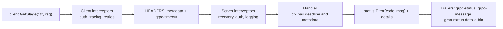

### 4.1 Interceptors: the gRPC Middleware Pipeline

Interceptors wrap RPC invocations on both sides, like HTTP middleware.

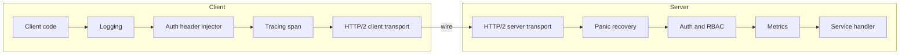

There are four interceptor types:

| Type | Go signature | Wraps |
| --- | --- | --- |
| Unary client | `grpc.UnaryClientInterceptor` | `invoker(ctx, method, req, reply, cc, opts...)`, the whole round trip |
| Stream client | `grpc.StreamClientInterceptor` | `streamer(ctx, desc, cc, method, opts...)`, which returns a `ClientStream` you can wrap |
| Unary server | `grpc.UnaryServerInterceptor` | `handler(ctx, req)` |
| Stream server | `grpc.StreamServerInterceptor` | `handler(srv, ss)`; wrap `ss` to observe messages |

### 4.2 Server Interceptors in Go

The starter's interceptors are in [`internal/server/interceptors.go`](internal/server/interceptors.go): logging and panic recovery for both unary and stream RPCs. Here is an authentication interceptor in the same style, plus the order rule.

```go
package server

import (
	"context"
	"crypto/subtle"
	"strings"

	"google.golang.org/grpc"
	"google.golang.org/grpc/codes"
	"google.golang.org/grpc/metadata"
	"google.golang.org/grpc/status"
)

// BearerAuth rejects calls without the expected token. Health checks stay open
// so that load balancers can probe without credentials.
func BearerAuth(expected string) grpc.UnaryServerInterceptor {
	return func(ctx context.Context, req any, info *grpc.UnaryServerInfo, handler grpc.UnaryHandler) (any, error) {
		if strings.HasPrefix(info.FullMethod, "/grpc.health.v1.Health/") {
			return handler(ctx, req)
		}
		md, _ := metadata.FromIncomingContext(ctx)
		values := md.Get("authorization") // keys are always lowercase
		if len(values) == 0 || !strings.HasPrefix(values[0], "Bearer ") {
			return nil, status.Error(codes.Unauthenticated, "missing bearer token")
		}
		token := strings.TrimPrefix(values[0], "Bearer ")
		if subtle.ConstantTimeCompare([]byte(token), []byte(expected)) != 1 {
			return nil, status.Error(codes.Unauthenticated, "invalid token")
		}
		return handler(ctx, req)
	}
}
```

```go
grpc.NewServer(
	grpc.ChainUnaryInterceptor(
		UnaryRecovery(logger), // outermost: catches panics from everything below
		UnaryLogger(logger),   // logs the final code, including auth failures
		BearerAuth(token),     // innermost: runs right before the handler
	),
)
```

With `ChainUnaryInterceptor(A, B, C)`, a request runs `A → B → C → handler` and the response unwinds `handler → C → B → A`. Put recovery first so it covers every other interceptor, and logging/metrics before auth so rejected calls are counted. An invalid token is `UNAUTHENTICATED` (16); `PERMISSION_DENIED` (7) is for a valid identity that lacks access.

To observe stream messages, wrap the `ServerStream`:

```go
type countingStream struct {
	grpc.ServerStream
	sent, received int
}

func (s *countingStream) SendMsg(m any) error {
	err := s.ServerStream.SendMsg(m)
	if err == nil {
		s.sent++
	}
	return err
}

func (s *countingStream) RecvMsg(m any) error {
	err := s.ServerStream.RecvMsg(m)
	if err == nil {
		s.received++
	}
	return err
}

func StreamCounter(logger *slog.Logger) grpc.StreamServerInterceptor {
	return func(srv any, ss grpc.ServerStream, info *grpc.StreamServerInfo, handler grpc.StreamHandler) error {
		cs := &countingStream{ServerStream: ss}
		err := handler(srv, cs)
		logger.Info("stream done", "method", info.FullMethod, "sent", cs.sent, "received", cs.received)
		return err
	}
}
```

To change the context a streaming handler sees (for example, to attach an authenticated user), override `Context()` on the wrapper and return the derived context.

### 4.3 Metadata & Context Propagation

Metadata is gRPC's name for headers: a `map[string][]string` sent in HTTP/2 `HEADERS` (and trailers on the way back).

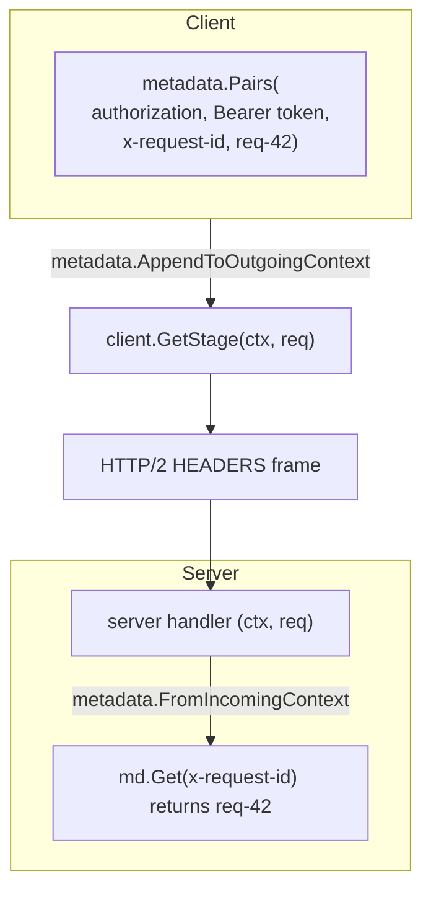

```go
// Client: attach metadata to one call.
ctx = metadata.AppendToOutgoingContext(ctx, "x-request-id", "req-42")
var header, trailer metadata.MD
stage, err := client.GetStage(ctx, req, grpc.Header(&header), grpc.Trailer(&trailer))

// Server: read it, and send some back.
md, _ := metadata.FromIncomingContext(ctx)
ids := md.Get("x-request-id") // []string{"req-42"}
_ = grpc.SetHeader(ctx, metadata.Pairs("x-served-by", "pod-7"))
grpc.SetTrailer(ctx, metadata.Pairs("x-cost-units", "3"))
```

Rules:

- **Keys are case-insensitive and stored lowercase.** `md.Get` lowercases its argument.
- **Keys starting with `grpc-` are reserved** for the protocol.
- **Binary values need a `-bin` suffix.** Header values must be printable ASCII. For a key ending in `-bin` (for example `trace-context-bin`), the runtime base64-encodes the bytes on send and decodes them on receipt.
- **Incoming metadata is not forwarded automatically.** A server that calls another service must copy what it wants (request IDs, auth on behalf of the user) into the outgoing context. Tracing libraries do this for trace headers.
- **Metadata versus fields:** put business data in the message, where it is typed and versioned; put request context (auth, tracing, routing hints, client version) in metadata, where interceptors and proxies can read it without decoding the payload.

### 4.4 Deadlines vs Timeouts & Distributed Propagation

A common failure mode is **zombie work**: A calls B calls C, A gives up after 2 seconds, and B and C keep burning CPU and connections on a request nobody is waiting for. Deadlines fix this.

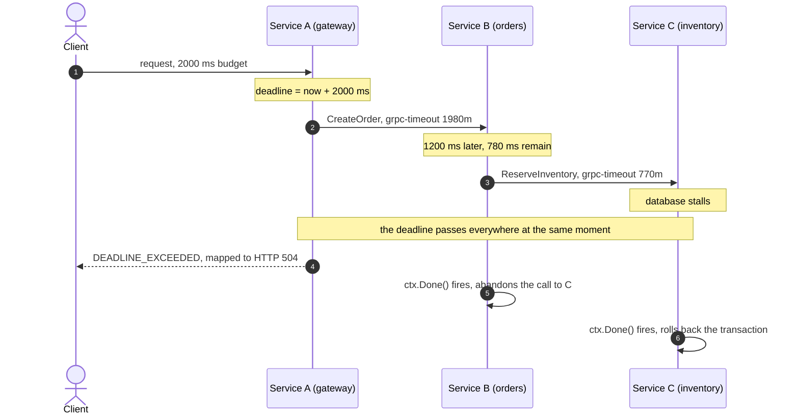

- A **timeout** is relative ("wait 5 s"). Passed down unchanged, every hop adds its own, and the total becomes the sum.
- A **deadline** is absolute ("finish by 12:00:02.000"). Each hop sends the *remaining* time in `grpc-timeout`, the server rebuilds an absolute deadline from it, and the budget shrinks monotonically down the chain.
- In Go, the deadline lives in `ctx`. Passing the incoming `ctx` to downstream calls propagates it automatically.

```go
// Client: set the budget once.
ctx, cancel := context.WithTimeout(context.Background(), 3*time.Second)
defer cancel()

resp, err := client.CreateOrder(ctx, req)
if status.Code(err) == codes.DeadlineExceeded {
	log.Println("gave up: deadline exceeded")
}

// Server: reserve time for your own work by shortening the downstream budget.
func (s *server) CreateOrder(ctx context.Context, req *pb.CreateOrderRequest) (*pb.OrderResponse, error) {
	if d, ok := ctx.Deadline(); ok && time.Until(d) < 50*time.Millisecond {
		return nil, status.Error(codes.DeadlineExceeded, "not enough time left to do useful work")
	}
	invCtx, cancel := context.WithTimeout(ctx, 300*time.Millisecond) // the smaller of this and the parent wins
	defer cancel()
	if _, err := s.inventory.Reserve(invCtx, &invpb.ReserveRequest{Sku: req.GetSku()}); err != nil {
		return nil, err
	}
	// ...
}
```

Deadlines are not propagated through goroutines you detach from `ctx` (for example `context.Background()` in a fire-and-forget task). That is sometimes intended (audit logging that must finish), but then give that work its own bounded timeout.

### 4.5 Cancellation & Graceful Teardown

```go
ctx, cancel := context.WithCancel(context.Background())

go func() {
	time.Sleep(time.Second) // user pressed "stop"
	cancel()
}()

stream, err := client.StreamOrderUpdates(ctx, &pb.OrderSubscription{CustomerId: "CUST-1"})
// ... the next Recv returns status CANCELED
```

When `cancel()` runs:

1. The client sends `RST_STREAM` with error code `CANCEL` (0x8) for that stream.
2. The server transport closes the stream and cancels the handler's context, so `ctx.Done()` closes.
3. A well-behaved handler notices (through `ctx.Err()`, a blocked `Send` returning, or a context-aware database call) and returns, releasing its resources.

The same path runs when the deadline expires, with the client reporting `DEADLINE_EXCEEDED` instead of `CANCELED`.

### 4.6 Status Codes

gRPC defines 17 status codes, 0 through 16. They are the contract for how a client should react, so choose them carefully.

```mermaid
flowchart TD
    subgraph ClientErrors["Caller's fault: do not retry unchanged"]
        C3["INVALID_ARGUMENT 3, HTTP 400"]
        C5["NOT_FOUND 5, HTTP 404"]
        C6["ALREADY_EXISTS 6, HTTP 409"]
        C7["PERMISSION_DENIED 7, HTTP 403"]
        C9["FAILED_PRECONDITION 9, HTTP 400"]
        C16["UNAUTHENTICATED 16, HTTP 401"]
    end

    subgraph ServerErrors["Server or network: may be retryable"]
        S4["DEADLINE_EXCEEDED 4, HTTP 504"]
        S8["RESOURCE_EXHAUSTED 8, HTTP 429"]
        S10["ABORTED 10, HTTP 409"]
        S13["INTERNAL 13, HTTP 500"]
        S14["UNAVAILABLE 14, HTTP 503, retry with backoff"]
    end

    OK["OK 0, HTTP 200"]
```

| Code | Value | Meaning and when to use it |
| :--- | :--- | :--- |
| **`OK`** | `0` | Success. |
| **`CANCELLED`** | `1` | The caller cancelled (in Go, `codes.Canceled`). |
| **`UNKNOWN`** | `2` | An error without a status, such as `errors.New` returned from a handler. Treat its appearance as a bug. |
| **`INVALID_ARGUMENT`** | `3` | The request is malformed regardless of system state (negative quantity, bad email). |
| **`DEADLINE_EXCEEDED`** | `4` | The deadline passed. The operation may or may not have completed. |
| **`NOT_FOUND`** | `5` | The requested entity does not exist. |
| **`ALREADY_EXISTS`** | `6` | Create of an entity that already exists. |
| **`PERMISSION_DENIED`** | `7` | Authenticated, but not allowed. |
| **`RESOURCE_EXHAUSTED`** | `8` | Quota or rate limit hit, or a message over the size limit. |
| **`FAILED_PRECONDITION`** | `9` | The system is not in the required state (account suspended, directory not empty). Retrying unchanged will not help. |
| **`ABORTED`** | `10` | Concurrency conflict, such as an optimistic-lock failure. Retry the whole read-modify-write. |
| **`OUT_OF_RANGE`** | `11` | Past the valid range, such as reading past end of file or a page token beyond the end. |
| **`UNIMPLEMENTED`** | `12` | The method is not implemented or not supported by this server. |
| **`INTERNAL`** | `13` | An invariant broke. Something is wrong on the server. |
| **`UNAVAILABLE`** | `14` | Transient: the service is down, restarting or unreachable. The standard retryable code. |
| **`DATA_LOSS`** | `15` | Unrecoverable data loss or corruption. |
| **`UNAUTHENTICATED`** | `16` | Missing or invalid credentials. |

### 4.7 The Rich Error Model (`google.rpc.Status`)

A code and a string are not enough when a client needs field-level validation errors or retry advice. The rich error model sends a `google.rpc.Status` message (code, message, and a list of `Any` details) in the `grpc-status-details-bin` trailer.

```mermaid
flowchart TD
    subgraph WireTrailer["Trailer: grpc-status-details-bin"]
        direction TB
        Code["code: 3 INVALID_ARGUMENT"]
        Msg["message: order validation failed"]
        subgraph DetailsAny["details: repeated google.protobuf.Any"]
            D1["google.rpc.BadRequest<br/>field price_cents: must be > 0"]
            D2["google.rpc.QuotaFailure<br/>subject client:acme, 100 req/min"]
            D3["google.rpc.RetryInfo<br/>retry_delay 2.5s"]
        end
        Code --- Msg --- DetailsAny
    end
```

```go
package main

import (
	"context"
	"log"
	"time"

	"google.golang.org/genproto/googleapis/rpc/errdetails"
	"google.golang.org/grpc/codes"
	"google.golang.org/grpc/status"
	"google.golang.org/protobuf/types/known/durationpb"

	pb "github.com/enterprise/orders/v1"
)

// Server: attach typed details.
func (s *server) CreateOrder(ctx context.Context, req *pb.CreateOrderRequest) (*pb.OrderResponse, error) {
	if req.GetPriceCents() <= 0 {
		st := status.New(codes.InvalidArgument, "order validation failed")
		withDetails, err := st.WithDetails(
			&errdetails.BadRequest{FieldViolations: []*errdetails.BadRequest_FieldViolation{
				{Field: "price_cents", Description: "must be greater than 0"},
			}},
		)
		if err != nil {
			return nil, st.Err() // fall back to the plain status
		}
		return nil, withDetails.Err()
	}
	return &pb.OrderResponse{OrderId: "ORD-1"}, nil
}

// Server: tell a rate-limited client when to come back.
func rateLimited() error {
	st, _ := status.New(codes.ResourceExhausted, "rate limit exceeded").
		WithDetails(&errdetails.RetryInfo{RetryDelay: durationpb.New(2 * time.Second)})
	return st.Err()
}

// Client: read the details.
func handleClientError(err error) {
	st := status.Convert(err)
	log.Printf("RPC failed: code=%s message=%s", st.Code(), st.Message())
	for _, detail := range st.Details() {
		switch d := detail.(type) {
		case *errdetails.BadRequest:
			for _, v := range d.GetFieldViolations() {
				log.Printf("  field %s: %s", v.GetField(), v.GetDescription())
			}
		case *errdetails.RetryInfo:
			log.Printf("  retry after %v", d.GetRetryDelay().AsDuration())
		}
	}
}
```

The trailer is just base64 of the serialized `google.rpc.Status`, so every language's gRPC library can read it, and proxies pass it through untouched. Clients that do not know about details still get the code and message.

### 4.8 Pitfalls

| Pitfall | Symptom | Fix |
| --- | --- | --- |
| Returning `errors.New` or a wrapped Go error from a handler | Clients see `code = Unknown` for everything | Return `status.Error`/`status.Errorf`, or map domain errors in an interceptor. |
| `INTERNAL` for bad input | Clients retry requests that can never succeed; alerts fire for user mistakes | `INVALID_ARGUMENT` / `FAILED_PRECONDITION` for caller faults. |
| Not propagating `ctx` downstream | Zombie work after the caller gave up; connection pools exhausted under load | Pass the handler's `ctx` to every downstream call and DB query. |
| A fresh `context.Background()` per downstream call | No deadline below the first hop | Derive from the incoming `ctx`. |
| Binary data in a metadata key without `-bin` | `rpc error: code = Internal desc = header key "x-token" contains value with non-printable ASCII characters` | Name the key `x-token-bin`. |
| Interceptor order wrong | Panics in auth crash the server; rejected calls missing from metrics | Recovery first, then logging/metrics, then auth. |
| Leaking internal error text to clients | Stack traces or SQL in `grpc-message` | Log details server-side; return a generic message with a request ID. |

### 4.9 Best Practices

- **Set a deadline on every outbound call**: there is no default, and an unbounded call is an outage waiting for a slow dependency.
- **Map errors to codes at the boundary**: one interceptor or helper turns domain errors into status codes consistently.
- **Use `RetryInfo` for rate limits**: it tells well-behaved clients exactly how long to back off.
- **Forward request IDs and trace context explicitly**: metadata is per hop.
- **Keep interceptors small and ordered**: one concern each, recovery outermost.

### 4.10 Hands-on Exercise

**Task.** Add `BearerAuth` from 4.2 to the starter behind an `AUTH_TOKEN` environment variable (disabled when empty). Add a unary client interceptor in `cmd/client` that attaches the token with `metadata.AppendToOutgoingContext`. Make `GetStage` with `stage_number: 0` return `INVALID_ARGUMENT` with a `BadRequest` detail.

**Expected output.** Without a token, `grpcurl ... GetStage` returns `Unauthenticated`; with `-H 'authorization: Bearer <token>'` it succeeds; health checks work without a token; the invalid stage shows a field violation for `stage_number` in `grpcurl` output.

**Solution.** Interceptor layout follows [`internal/server/interceptors.go`](internal/server/interceptors.go); wire it into `grpc.ChainUnaryInterceptor` in [`internal/server/server.go`](internal/server/server.go) and add a `bufconn` test next to `TestUnaryRecovery`.

[Back to top ⤴️](#-table-of-contents)

---

## 5. Stage 5: Resilience, Name Resolution & Load Balancing

Long-lived HTTP/2 connections change how retries and load balancing work. This stage covers the service config, retry and hedging policies, the resolver and balancer inside every channel, the L4 load-balancing trap, and bridging browsers through gRPC-Web. It builds on Stages 3 and 4.

```mermaid
flowchart LR
    Target["dns:///orders.svc:8080"] --> Resolver["Resolver<br/>returns addresses + service config"]
    Resolver --> Balancer["Load balancer policy<br/>pick_first or round_robin"]
    Balancer --> SC1["Subchannel 10.0.0.7"]
    Balancer --> SC2["Subchannel 10.0.0.8"]
    Balancer --> SC3["Subchannel 10.0.0.9"]
    Picker["Picker: chooses a READY subchannel per RPC"] --> SC1
    Picker --> SC2
    Picker --> SC3
```

### 5.1 Service Config and Retry Policies

Instead of hand-written retry loops, gRPC clients accept a declarative **service config** in JSON, either set by the client (`grpc.WithDefaultServiceConfig`) or delivered by the resolver (DNS TXT records or xDS).

```json
{
  "methodConfig": [
    {
      "name": [{ "service": "enterprise.orders.v1.OrderService", "method": "GetOrder" }],
      "timeout": "2s",
      "retryPolicy": {
        "maxAttempts": 4,
        "initialBackoff": "0.1s",
        "maxBackoff": "1s",
        "backoffMultiplier": 2.0,
        "retryableStatusCodes": ["UNAVAILABLE"]
      }
    }
  ],
  "retryThrottling": { "maxTokens": 10, "tokenRatio": 0.1 }
}
```

```go
conn, err := grpc.NewClient("dns:///orders.internal:8080",
	grpc.WithTransportCredentials(insecure.NewCredentials()),
	grpc.WithDefaultServiceConfig(serviceConfigJSON),
)
```

How the backoff works (gRFC A6): before retry *n*, the client waits a **random** duration between 0 and `min(initialBackoff × backoffMultiplier^(n-1), maxBackoff)`. With the config above:

| Retry | Upper bound | Actual wait |
| --- | --- | --- |
| 1st | min(0.1 × 2⁰, 1) = 0.1 s | random 0-0.1 s |
| 2nd | min(0.1 × 2¹, 1) = 0.2 s | random 0-0.2 s |
| 3rd | min(0.1 × 2², 1) = 0.4 s | random 0-0.4 s |

Full jitter spreads retries out so a fleet of clients does not retry in lockstep. `maxAttempts` counts the original call (4 = 1 call + 3 retries) and is capped at 5. `retryThrottling` stops retries when too many recent calls failed: each failure costs a token, each success returns `tokenRatio`, and retries are allowed only while more than half the tokens remain. That prevents retry storms from multiplying load on a struggling backend.

Retries only happen **before the response headers arrive** (the call has not been "committed"), and the whole retry sequence stays inside the call's deadline.

> [!WARNING]
> Only retry idempotent methods, or methods that take an idempotency key. Retrying `ChargeCard` after a timeout can charge twice, because a timeout does not tell you whether the server finished.

### 5.2 Hedging Policies for Tail Latency

Retries are sequential; **hedging** sends extra copies in parallel when the first is slow and keeps the first success.

```mermaid
sequenceDiagram
    autonumber
    actor Client as Client with hedging
    participant Pod1 as Pod 1 (GC pause)
    participant Pod2 as Pod 2 (healthy)

    Client->>Pod1: attempt 1
    Note over Client: hedgingDelay 20 ms passes with no response
    Client->>Pod2: attempt 2 on another subchannel
    Pod2-->>Client: response after 5 ms
    Client->>Pod1: RST_STREAM cancels attempt 1
    Note over Client: about 25 ms total instead of waiting on the slow pod
```

```json
{
  "methodConfig": [
    {
      "name": [{ "service": "enterprise.orders.v1.OrderService", "method": "GetOrder" }],
      "hedgingPolicy": {
        "maxAttempts": 3,
        "hedgingDelay": "0.02s",
        "nonFatalStatusCodes": ["UNAVAILABLE"]
      }
    }
  ]
}
```

A method has either a `retryPolicy` or a `hedgingPolicy`, not both. Hedging multiplies load, so it is for cheap, idempotent reads with a tail-latency problem. Support varies: `grpc-java` and C-core implement hedging, while `grpc-go` implements retries but not hedging. Check your runtime before relying on it.

### 5.3 The L4 vs L7 Load-Balancing Problem

Migrating from REST to gRPC on Kubernetes often ends with one pod at 100% CPU and the rest idle.

```mermaid
flowchart TD
    subgraph L4Failure["L4: Kubernetes ClusterIP, AWS NLB"]
        direction TB
        ClientL4["gRPC client"] -->|"one TCP connection"| L4LB["L4 balancer"]
        L4LB -->|"every RPC"| Pod1["Pod 1, overloaded"]
        L4LB -.->|"nothing"| Pod2["Pod 2, idle"]
        L4LB -.->|"nothing"| Pod3["Pod 3, idle"]
    end

    subgraph L7Solution["L7: Envoy or client-side balancing"]
        direction TB
        ClientL7["gRPC client"] --> L7LB["L7 balancer"]
        L7LB -->|"RPC 1"| PodA["Pod 1"]
        L7LB -->|"RPC 2"| PodB["Pod 2"]
        L7LB -->|"RPC 3"| PodC["Pod 3"]
    end

    L4Failure -.->|"fix"| L7Solution
```

An L4 balancer picks a backend per **TCP connection**. HTTP/1.1 clients open many connections, so connection-level balancing roughly spreads requests. A gRPC channel opens one connection per backend address and sends every RPC on it, so behind a single virtual IP all RPCs from that client land on one pod, forever, and new pods added by autoscaling get nothing from existing clients.

| Approach | How it works | Added latency | Operational cost | Best fit |
| :--- | :--- | :--- | :--- | :--- |
| **Client-side balancing** | Resolver returns every pod IP; the channel opens a subchannel to each and round-robins RPCs. | None | Low infra, but every client language needs the config | Internal services in languages with mature gRPC libraries. |
| **L7 proxy** (Envoy, NGINX, cloud L7 LB) | Client connects to the proxy; the proxy balances individual streams to backends. | One hop, typically sub-millisecond to a millisecond | Proxy fleet to run and scale | Ingress, polyglot clients, TLS termination. |
| **Service mesh sidecar** | Each pod's sidecar proxy does L7 balancing transparently. | Two hops | Mesh control plane plus sidecars | Organisations already running a mesh. |
| **Proxyless xDS** | The gRPC library talks to the mesh control plane directly (Masterclass M2). | None | Control plane; library support | Large fleets that want mesh features without sidecars. |
| **Server-side `MaxConnectionAge`** | Servers periodically `GOAWAY` connections so clients reconnect and rebalance. | None | Tiny | A mitigation for L4 setups, not a fix. |

### 5.4 Client-Side Load Balancing with Kubernetes Headless Services

A headless Service (`clusterIP: None`) makes cluster DNS return one A record per ready pod instead of a single virtual IP.

```yaml
apiVersion: v1
kind: Service
metadata:
  name: order-service-headless
  namespace: microservices
spec:
  clusterIP: None
  selector:
    app: order-service
  ports:
    - name: grpc
      port: 8080
      targetPort: 8080
```

```go
package main

import (
	"log"

	"google.golang.org/grpc"
	"google.golang.org/grpc/credentials/insecure"
)

func main() {
	const target = "dns:///order-service-headless.microservices.svc.cluster.local:8080"
	const serviceConfig = `{"loadBalancingConfig": [{"round_robin": {}}]}`

	conn, err := grpc.NewClient(target,
		grpc.WithTransportCredentials(insecure.NewCredentials()),
		grpc.WithDefaultServiceConfig(serviceConfig),
	)
	if err != nil {
		log.Fatalf("create client: %v", err)
	}
	defer conn.Close()
	// The channel opens a subchannel per pod IP and spreads RPCs across the READY ones.
}
```

Three details make this work in practice:

1. **The default policy is `pick_first`**, which uses one address. Without the service config above, a headless Service changes nothing.
2. **DNS is re-resolved when connections fail or receive `GOAWAY`**, not on a timer. To pick up new pods, set `MaxConnectionAge` on servers so connections recycle (Masterclass M1).
3. **Readiness gates DNS.** Pods that fail readiness drop out of the A records, so health checking (Stage 6) and balancing work together.

### 5.5 gRPC-Web: Bridging Browsers to gRPC

Browsers cannot speak native gRPC: `fetch` and `XMLHttpRequest` give JavaScript no control over HTTP/2 framing and no reliable access to trailers, which carry `grpc-status`. **gRPC-Web** is a variant protocol that browsers can use: trailers move into the body as a final length-prefixed frame with the high bit of the flag byte set (`0x80`), and it works over HTTP/1.1 or HTTP/2.

```mermaid
flowchart LR
    Browser["Browser<br/>gRPC-Web client"] -->|"POST /enterprise.orders.v1.OrderService/CreateOrder<br/>content-type application/grpc-web+proto"| Envoy["Envoy<br/>grpc_web filter"]
    Envoy -->|"native gRPC over HTTP/2"| Backend["gRPC backend"]
```

An Envoy configuration that translates gRPC-Web to gRPC:

```yaml
static_resources:
  listeners:
    - name: grpc_web_listener
      address:
        socket_address: { address: 0.0.0.0, port_value: 8081 }
      filter_chains:
        - filters:
            - name: envoy.filters.network.http_connection_manager
              typed_config:
                "@type": type.googleapis.com/envoy.extensions.filters.network.http_connection_manager.v3.HttpConnectionManager
                stat_prefix: grpc_web
                codec_type: AUTO
                route_config:
                  name: local_route
                  virtual_hosts:
                    - name: backend
                      domains: ["*"]
                      routes:
                        - match: { prefix: "/" }
                          route: { cluster: grpc_backend, timeout: 0s }
                      typed_per_filter_config:
                        envoy.filters.http.cors:
                          "@type": type.googleapis.com/envoy.extensions.filters.http.cors.v3.CorsPolicy
                          allow_origin_string_match:
                            - exact: "https://app.example.com"
                          allow_methods: "POST, OPTIONS"
                          allow_headers: "content-type,x-grpc-web,x-user-agent,grpc-timeout,authorization"
                          expose_headers: "grpc-status,grpc-message,grpc-status-details-bin"
                          max_age: "1728000"
                http_filters:
                  - name: envoy.filters.http.grpc_web
                    typed_config:
                      "@type": type.googleapis.com/envoy.extensions.filters.http.grpc_web.v3.GrpcWeb
                  - name: envoy.filters.http.cors
                    typed_config:
                      "@type": type.googleapis.com/envoy.extensions.filters.http.cors.v3.Cors
                  - name: envoy.filters.http.router
                    typed_config:
                      "@type": type.googleapis.com/envoy.extensions.filters.http.router.v3.Router
  clusters:
    - name: grpc_backend
      connect_timeout: 0.25s
      type: STRICT_DNS
      lb_policy: ROUND_ROBIN
      typed_extension_protocol_options:
        envoy.extensions.upstreams.http.v3.HttpProtocolOptions:
          "@type": type.googleapis.com/envoy.extensions.upstreams.http.v3.HttpProtocolOptions
          explicit_http_config:
            http2_protocol_options: {}
      load_assignment:
        cluster_name: grpc_backend
        endpoints:
          - lb_endpoints:
              - endpoint:
                  address:
                    socket_address: { address: learning, port_value: 8080 }
```

Two changes from older examples matter: the cluster sets HTTP/2 through `typed_extension_protocol_options` (the cluster-level `http2_protocol_options` field is deprecated), and CORS is configured per route with an explicit origin rather than a wildcard regex. `timeout: 0s` disables Envoy's default 15-second route timeout, which would otherwise cut server streams; rely on gRPC deadlines instead. Masterclass M3 compares gRPC-Web with Connect and grpc-gateway, which avoid the proxy.

### 5.6 Pitfalls

| Pitfall | Symptom | Fix |
| --- | --- | --- |
| gRPC behind a ClusterIP Service or NLB | One pod hot, others idle; new pods get no traffic | Headless Service + `round_robin`, or an L7 proxy. |
| Headless Service but default `pick_first` | Same as above | Set `loadBalancingConfig` to `round_robin`. |
| Retrying non-idempotent methods | Duplicate orders or charges after timeouts | Scope `retryPolicy` by method; add idempotency keys. |
| Retrying `DEADLINE_EXCEEDED` | Retries cannot fit in the remaining budget; load amplification | Retry `UNAVAILABLE` only, unless you set per-attempt timeouts deliberately. |
| Envoy route timeout left at default | Server streams cut at 15 s with `upstream request timeout` | `timeout: 0s` on gRPC routes. |
| CORS missing `grpc-status` in `expose_headers` | Browser client reports unknown errors even on success | Expose `grpc-status`, `grpc-message`, `grpc-status-details-bin`. |

### 5.7 Best Practices

- **Balance per RPC, not per connection**: client-side or L7, never plain L4, for gRPC.
- **Configure retries in the service config, per method**: declarative, consistent across languages, throttled.
- **Retry `UNAVAILABLE`, back off with jitter, cap attempts**: the defaults in gRFC A6 exist for good reasons.
- **Recycle connections with `MaxConnectionAge`**: otherwise rebalancing waits for failures.
- **Treat browsers as a separate edge**: gRPC-Web or Connect at the edge, native gRPC inside.

### 5.8 Hands-on Exercise

**Task.** Run three copies of the starter on ports 8081-8083 and point a client at all of them through a static resolver: `grpc.NewClient("passthrough:///unused", ...)` is not enough, so use the `manual` resolver (`google.golang.org/grpc/resolver/manual`) with three addresses and `round_robin`. Call `GetStage` 30 times and count which server answered by reading a `x-served-by` header that each server sets with `grpc.SetHeader`.

**Expected output.** About 10 calls per server. Switching the service config to `pick_first` sends all 30 to one server.

**Solution.** Add the header in a unary interceptor next to [`internal/server/interceptors.go`](internal/server/interceptors.go); read it on the client with `grpc.Header(&md)`.

[Back to top ⤴️](#-table-of-contents)

---

## 6. Stage 6: Security, Health, Observability & Deployment

Production gRPC needs authenticated, encrypted transport, a health protocol that load balancers and Kubernetes understand, a way to inspect services without their `.proto` files, and telemetry that reports gRPC status codes rather than HTTP ones. This stage covers each, using the starter's health and reflection setup as the base.

```mermaid
flowchart TD
    subgraph Handshake["Connection level: mutual TLS"]
        ServerCert["Server presents a certificate signed by the internal CA"]
        ClientCert["Client presents its own certificate"]
        Verify["Both verify the chain; TLS 1.3 session established"]
        ServerCert <--> ClientCert --> Verify
    end

    subgraph PerRPCAuth["Call level: per-RPC credentials"]
        JWT["PerRPCCredentials adds a bearer token to each call"]
        Handler["Server interceptor validates claims and permissions"]
        JWT --> Handler
    end

    Verify --> PerRPCAuth
```

### 6.1 Transport Security: TLS and Mutual TLS

```go
package main

import (
	"crypto/tls"
	"crypto/x509"
	"fmt"
	"os"

	"google.golang.org/grpc"
	"google.golang.org/grpc/credentials"
)

func NewSecureServer() (*grpc.Server, error) {
	serverCert, err := tls.LoadX509KeyPair("certs/server.crt", "certs/server.key")
	if err != nil {
		return nil, fmt.Errorf("load server key pair: %w", err)
	}
	caPEM, err := os.ReadFile("certs/ca.crt")
	if err != nil {
		return nil, fmt.Errorf("read CA: %w", err)
	}
	pool := x509.NewCertPool()
	if !pool.AppendCertsFromPEM(caPEM) {
		return nil, fmt.Errorf("no certificates found in CA file")
	}
	tlsConfig := &tls.Config{
		Certificates: []tls.Certificate{serverCert},
		ClientAuth:   tls.RequireAndVerifyClientCert, // this line makes it mutual TLS
		ClientCAs:    pool,
		MinVersion:   tls.VersionTLS13,
	}
	return grpc.NewServer(grpc.Creds(credentials.NewTLS(tlsConfig))), nil
}

func NewSecureClient(target string) (*grpc.ClientConn, error) {
	clientCert, err := tls.LoadX509KeyPair("certs/client.crt", "certs/client.key")
	if err != nil {
		return nil, err
	}
	caPEM, err := os.ReadFile("certs/ca.crt")
	if err != nil {
		return nil, err
	}
	pool := x509.NewCertPool()
	pool.AppendCertsFromPEM(caPEM)
	creds := credentials.NewTLS(&tls.Config{
		Certificates: []tls.Certificate{clientCert},
		RootCAs:      pool,
		MinVersion:   tls.VersionTLS13,
	})
	return grpc.NewClient(target, grpc.WithTransportCredentials(creds))
}
```

Inside a handler, the verified client identity is available from the peer:

```go
p, ok := peer.FromContext(ctx)
if ok {
	if info, ok := p.AuthInfo.(credentials.TLSInfo); ok && len(info.State.VerifiedChains) > 0 {
		leaf := info.State.VerifiedChains[0][0]
		_ = leaf.URIs // e.g. spiffe://cluster.local/ns/prod/sa/payments
	}
}
```

In a mesh (Istio, Linkerd) the sidecars do mTLS for you and the application listens in plaintext on localhost; in proxyless setups, grpc-go can obtain certificates from xDS (Masterclass M2). Certificates must be rotated without restarts: load them through `tls.Config.GetCertificate` / `GetConfigForClient` or the `advancedtls` package rather than once at startup.

### 6.2 Per-RPC Credentials

Transport credentials authenticate the connection (a workload). Call credentials authenticate each request (often a user or a token for a workload).

```go
type tokenAuth struct{ token string }

func (t tokenAuth) GetRequestMetadata(ctx context.Context, uri ...string) (map[string]string, error) {
	return map[string]string{"authorization": "Bearer " + t.token}, nil
}

// RequireTransportSecurity returning true makes grpc-go refuse to send the token over plaintext.
func (tokenAuth) RequireTransportSecurity() bool { return true }

conn, err := grpc.NewClient(target,
	grpc.WithTransportCredentials(creds),
	grpc.WithPerRPCCredentials(tokenAuth{token: os.Getenv("API_TOKEN")}),
)
```

`google.golang.org/grpc/credentials/oauth` provides ready-made implementations for OAuth2 token sources and Google service accounts.

### 6.3 The Standard gRPC Health Checking Protocol

`grpc.health.v1.Health` is the standard health service. Load balancers, Envoy and Kubernetes all understand it.

```protobuf
syntax = "proto3";

package grpc.health.v1;

message HealthCheckRequest {
  string service = 1;
}

message HealthCheckResponse {
  enum ServingStatus {
    UNKNOWN = 0;
    SERVING = 1;
    NOT_SERVING = 2;
    SERVICE_UNKNOWN = 3; // only used by Watch
  }
  ServingStatus status = 1;
}

service Health {
  rpc Check(HealthCheckRequest) returns (HealthCheckResponse);
  rpc Watch(HealthCheckRequest) returns (stream HealthCheckResponse);
}
```

`Check` is a unary probe; `Watch` streams status changes, which client-side health checking in the channel can use to stop picking a backend the moment it reports `NOT_SERVING`. Recent versions of `health.proto` also define a `List` RPC that returns the status of every registered service.

The starter registers it in [`internal/server/server.go`](internal/server/server.go):

```go
hs := health.NewServer() // "" (whole server) starts as SERVING
hs.SetServingStatus(learningv1.LearningService_ServiceDesc.ServiceName, healthpb.HealthCheckResponse_SERVING)
healthpb.RegisterHealthServer(srv, hs)

// On shutdown (cmd/server/main.go):
hs.Shutdown() // every service becomes NOT_SERVING, so probes fail before connections close
```

`Check` for an unregistered service name returns `NOT_FOUND`, which `TestHealthService` asserts. Native Kubernetes probes (beta in 1.24, GA in 1.27) call `Check` directly:

```yaml
spec:
  containers:
    - name: learning
      image: ghcr.io/thelearninghuborg/learn-grpc:1.0.0
      ports:
        - name: grpc
          containerPort: 8080
      readinessProbe:
        grpc:
          port: 8080
          service: learning.v1.LearningService # optional; "" checks the whole server
        periodSeconds: 5
      livenessProbe:
        grpc:
          port: 8080
        initialDelaySeconds: 10
        periodSeconds: 15
```

The kubelet probe uses plaintext and does not support TLS, so for TLS-only servers expose health on a separate plaintext port, or use an HTTP probe on an endpoint like the starter's `/health`. Readiness should reflect dependencies (database pool exhausted → `NOT_SERVING`); liveness should only detect a wedged process, or a dependency outage will restart every pod at once.

### 6.4 The gRPC Server Reflection Protocol

Reflection lets tools ask a server for its schema at runtime, so they can encode requests without the `.proto` file.

```mermaid
flowchart LR
    DevCLI["grpcurl, Postman, grpcui"] -->|"grpc.reflection.v1.ServerReflection/ServerReflectionInfo"| ReflectionSvc["Reflection service"]
    ReflectionSvc -->|"FileDescriptorProtos"| DevCLI
    DevCLI -->|"JSON to protobuf and back"| Output["Interactive calls"]
```

```go
import "google.golang.org/grpc/reflection"

reflection.Register(grpcServer) // serves v1 and v1alpha
```

```bash
grpcurl -plaintext localhost:8080 list
grpcurl -plaintext localhost:8080 describe learning.v1.LearningService
grpcurl -plaintext localhost:8080 describe learning.v1.Stage
grpcurl -plaintext -d '{"stage_number": 2}' localhost:8080 learning.v1.LearningService/GetStage
grpcurl -plaintext -d '{"track": "TRACK_PRODUCTION"}' localhost:8080 learning.v1.LearningService/StreamRoadmap

# Without reflection, point grpcurl at the .proto files instead:
grpcurl -plaintext -import-path proto -proto learning/v1/learning.proto \
  -d '{"stage_number": 1}' localhost:8080 learning.v1.LearningService/GetStage
```

Reflection exposes your full schema, including internal methods. Enable it on internal listeners, or guard it with the same auth interceptor as everything else.

### 6.5 Distributed Tracing & Metrics with OpenTelemetry

OpenTelemetry instruments gRPC through *stats handlers* in grpc-go (`otelgrpc.NewServerHandler`, `otelgrpc.NewClientHandler` from `go.opentelemetry.io/contrib/instrumentation/google.golang.org/grpc/otelgrpc`). They inject and extract W3C `traceparent` metadata, create a span per RPC, and record duration and message metrics.

```mermaid
flowchart TD
    subgraph SvcA["Gateway"]
        TraceStart["Root span: HTTP POST /orders, trace a1b2c3"]
    end
    TraceStart -->|"traceparent in gRPC metadata"| SpanB
    subgraph SvcB["OrderService"]
        SpanB["Span: learning.v1.OrderService/CreateOrder, child of root"]
    end
    SpanB -->|"traceparent"| SpanC["Span: inventory.v1.Inventory/Reserve"]
    SpanB --> APM[("Tracing backend: Jaeger, Tempo, vendor APM")]
```

```go
import (
	"go.opentelemetry.io/contrib/instrumentation/google.golang.org/grpc/otelgrpc"
	"google.golang.org/grpc"
)

srv := grpc.NewServer(grpc.StatsHandler(otelgrpc.NewServerHandler()))
conn, err := grpc.NewClient(target,
	grpc.WithTransportCredentials(creds),
	grpc.WithStatsHandler(otelgrpc.NewClientHandler()),
)
```

Stats handlers replaced the older otelgrpc interceptors, which are deprecated. grpc-go also ships its own OpenTelemetry metrics plugin (`google.golang.org/grpc/stats/opentelemetry`) that emits the metric names defined by gRFC A66, such as `grpc.server.call.duration` and `grpc.client.attempt.duration`, labelled with `grpc.method` and `grpc.status`.

What to alert on:

1. **Error ratio by status code.** Rate of calls with status `UNAVAILABLE`, `INTERNAL`, `UNKNOWN` or `DEADLINE_EXCEEDED`, divided by all calls, per method. Exclude caller faults (`INVALID_ARGUMENT`, `NOT_FOUND`) from paging alerts.
2. **Latency percentiles per method.** p99 of server call duration against the SLO.
3. **Client attempt vs call duration.** A growing gap means retries are hiding a problem.
4. **Streams.** Messages sent and received per stream and active stream counts, which reveal stuck consumers.

Legacy Prometheus exporters (`go-grpc-prometheus`) use names like `grpc_server_handled_total` and `grpc_server_handling_seconds`; the same signals apply.

### 6.6 Graceful Shutdown

The starter's shutdown sequence in [`cmd/server/main.go`](cmd/server/main.go):

1. Receive `SIGTERM`.
2. `hs.Shutdown()`: health becomes `NOT_SERVING`, readiness fails, endpoints controllers and balancers stop sending new calls.
3. `httpServer.Shutdown(ctx)` with a 20 s budget: `GOAWAY` to clients, wait for in-flight RPCs.
4. Force-close whatever is left.

With the native transport, the equivalent is `grpcServer.GracefulStop()` with a timer that calls `grpcServer.Stop()`. Set Kubernetes `terminationGracePeriodSeconds` longer than your drain budget, and long-lived streams must expect to be cut and reconnect.

### 6.7 Pitfalls

| Pitfall | Symptom | Fix |
| --- | --- | --- |
| Tokens over plaintext | Credentials visible on the network | `RequireTransportSecurity() true`; grpc-go then fails with `grpc: the credentials require transport level security`. |
| Server certificate without the right SAN | `transport: authentication handshake failed: tls: failed to verify certificate: x509: certificate is valid for a, not b` | Issue certificates with the DNS name clients dial, or set `ServerName` in `tls.Config`. |
| Liveness probe tied to dependencies | A database blip restarts every pod | Dependencies drive readiness only. |
| Kubernetes `grpc` probe on a TLS-only port | Probe always fails | Separate plaintext health port, or an HTTP probe. |
| Reflection open on a public listener | Schema of internal methods exposed | Register reflection only on internal listeners or behind auth. |
| Alerting on HTTP 5xx | No alerts during gRPC outages | Alert on gRPC status codes. |

### 6.8 Best Practices

- **mTLS between services, tokens for users**: transport identity and caller identity are different questions.
- **Rotate certificates without restarts**: load them dynamically.
- **Implement `grpc.health.v1` and flip it on shutdown**: it drives probes and drains.
- **Instrument with stats handlers**: one line per server and client, standard metric names.
- **Page on error ratio and latency per method**: and keep caller errors out of pages.

### 6.9 Hands-on Exercise

**Task.** Add a `-tls` mode to the starter: generate a CA, a server certificate for `localhost` and a client certificate (with `openssl` or `step`), serve with `RequireAndVerifyClientCert`, and connect `cmd/client` with its certificate. Then add `otelgrpc` stats handlers with a stdout exporter.

**Expected output.** `grpcurl -plaintext` fails; `grpcurl -cacert ca.crt -cert client.crt -key client.key localhost:8080 list` works; the client prints spans whose names are the full method names, with a shared trace ID across client and server.

**Solution.** Start from 6.1 and 6.5; keep the `/health` endpoint on plaintext by moving it to a second `http.Server` on another port, as discussed in [1.8](#18-one-port-for-grpc-and-http-h2c-and-servehttp).

[Back to top ⤴️](#-table-of-contents)

---

## M1. Masterclass: HTTP/2 Transport Internals, Keepalive & Connection Lifecycle

Most hard gRPC incidents are connection incidents: streams dying behind a NAT, a pod that never sheds load, a client disconnected for pinging too often. This masterclass explains the connection lifecycle and the knobs that control it.

### M1.1 How the Transport Manages a Connection

```mermaid
stateDiagram-v2
    [*] --> Handshake: TCP connect, TLS, HTTP/2 preface, SETTINGS
    Handshake --> Active: SETTINGS acknowledged
    Active --> Active: streams open and close, PING and WINDOW_UPDATE
    Active --> Idle: no active streams
    Idle --> Active: new RPC
    Idle --> Draining: MaxConnectionIdle reached, server sends GOAWAY
    Active --> Draining: MaxConnectionAge reached, or GracefulStop
    Draining --> Closed: in-flight streams finish or MaxConnectionAgeGrace expires
    Active --> Closed: keepalive PING not acknowledged within Timeout
    Closed --> [*]
```

| Mechanism | Who sends it | Purpose |
| --- | --- | --- |
| `SETTINGS` | Both, at start and later | Announce `MAX_CONCURRENT_STREAMS`, initial window size, max frame size, header list size. |
| `PING` | Either | Keepalive (detect dead peers, keep NAT entries alive) and BDP estimation in grpc-go. |
| `GOAWAY` | Either, usually the server | "Open no new streams here." Carries the last stream ID the sender will process; the client retries newer streams elsewhere. |
| `GOAWAY` with `ENHANCE_YOUR_CALM` and debug data `too_many_pings` | Server | The client violated the server's keepalive enforcement policy. The client backs off by doubling its ping interval. |
| `MAX_CONCURRENT_STREAMS` | Server | Caps open streams per connection. Further RPCs queue on the client until a stream closes. grpc-go servers default to no practical limit; many proxies use 100. |

### M1.2 Worked Example: Keepalive and Connection Age in Go

```go
package main

import (
	"time"

	"google.golang.org/grpc"
	"google.golang.org/grpc/credentials/insecure"
	"google.golang.org/grpc/keepalive"
)

func newServer() *grpc.Server {
	return grpc.NewServer(
		grpc.KeepaliveParams(keepalive.ServerParameters{
			MaxConnectionIdle:     5 * time.Minute,  // GOAWAY idle connections
			MaxConnectionAge:      30 * time.Minute, // GOAWAY every connection eventually, so clients rebalance
			MaxConnectionAgeGrace: 30 * time.Second, // then give in-flight RPCs this long
			Time:                  2 * time.Minute,  // server pings an idle client after this
			Timeout:               20 * time.Second, // and closes if no ack arrives
		}),
		grpc.KeepaliveEnforcementPolicy(keepalive.EnforcementPolicy{
			MinTime:             20 * time.Second, // allow client pings this often (default is 5 minutes)
			PermitWithoutStream: true,             // allow pings with no active RPCs
		}),
		grpc.MaxConcurrentStreams(1000),
	)
}

func newClient(target string) (*grpc.ClientConn, error) {
	return grpc.NewClient(target,
		grpc.WithTransportCredentials(insecure.NewCredentials()),
		grpc.WithKeepaliveParams(keepalive.ClientParameters{
			Time:                30 * time.Second, // ping after 30 s without activity (grpc-go minimum is 10 s)
			Timeout:             10 * time.Second, // treat the connection as dead without an ack
			PermitWithoutStream: true,
		}),
	)
}
```

The client's `Time` (30 s) must be at least the server's `MinTime` (20 s). If it is lower, the server answers with `GOAWAY ENHANCE_YOUR_CALM` and the client logs `transport: Got too many pings from the client, closing the connection` on the server side and `too_many_pings` on the client. Note that the server-side default `MinTime` of 5 minutes is far higher than most client settings, so set enforcement explicitly whenever you enable client keepalive.

These options apply to the native transport (`grpcServer.Serve`). Behind `ServeHTTP`, as in the starter, the connection is owned by `net/http`, so configure `http.Server` and its HTTP/2 settings instead.

### M1.3 Trade-offs

| Setting | Too low | Too high | Starting point |
| --- | --- | --- | --- |
| Client keepalive `Time` | Ping storms; `too_many_pings` disconnects | Dead connections undetected behind NAT or idle-timeout balancers (often 350 s on cloud NAT) | 30-60 s, below every idle timeout on the path |
| `MaxConnectionAge` | Reconnect churn, TLS handshakes, cold caches | New pods starved after scale-out | 15-60 min |
| `MaxConnectionAgeGrace` | Long streams cut mid-flight | Draining takes forever during deploys | Longer than your longest normal unary call; streams must reconnect anyway |
| `MaxConcurrentStreams` | RPCs queue on the client under load | One connection monopolises a server's workers | Leave unlimited unless a server must cap per-client concurrency |
| Fixed flow-control windows | Throughput capped on long-RTT links | Memory per stream and per connection grows | Leave BDP estimation on (the default) |

### M1.4 Production Checklist

- [ ] Client keepalive `Time` is below every idle timeout on the network path and at least the server's `MinTime`.
- [ ] Servers set `MaxConnectionAge` and a grace period so traffic rebalances after scaling.
- [ ] `PermitWithoutStream` agrees between clients and servers.
- [ ] Long-lived streams reconnect with backoff and resume from a cursor.
- [ ] Dashboards track connection count per pod and `GOAWAY` reasons.
- [ ] Flow-control windows are left dynamic unless a benchmark proves otherwise.

[Back to top ⤴️](#-table-of-contents)

---

## M2. Masterclass: Proxyless gRPC with xDS

Proxyless gRPC lets the gRPC library itself act as the service-mesh data plane. Instead of a sidecar proxy, the client and server fetch routing, load-balancing, security and endpoint configuration from an xDS control plane (Istio, Traffic Director, or a custom control plane built with `go-control-plane`).

### M2.1 How xDS Configures a Channel

```mermaid
sequenceDiagram
    participant App as Client app
    participant Ch as gRPC channel, xds resolver
    participant CP as xDS control plane
    participant B as Backends
    App->>Ch: grpc.NewClient("xds:///learning.example.com")
    Ch->>CP: ADS stream: LDS for learning.example.com
    CP-->>Ch: Listener with route configuration
    Ch->>CP: RDS, CDS, EDS
    CP-->>Ch: routes, clusters, endpoints with weights and locality
    App->>Ch: GetStage(...)
    Ch->>B: RPC to an endpoint picked by the configured policy
    CP-->>Ch: endpoint update when pods change
```

| xDS resource | What it configures in gRPC |
| --- | --- |
| LDS (Listener) | Which route config applies to a target; on servers, which filters and security apply to a port. |
| RDS (Route) | Path and header matching, weighted clusters for canaries, per-route timeouts and retry policies, fault injection. |
| CDS (Cluster) | Load-balancing policy (`round_robin`, `ring_hash`, `least_request`, weighted round robin), circuit-breaking limits, outlier detection, mTLS settings. |
| EDS (Endpoints) | Addresses, health, locality and weights. |

### M2.2 Worked Example

The bootstrap file tells the library where the control plane is. Point to it with `GRPC_XDS_BOOTSTRAP=/etc/grpc/bootstrap.json` (or inline it with `GRPC_XDS_BOOTSTRAP_CONFIG`):

```json
{
  "xds_servers": [
    {
      "server_uri": "xds-control-plane.mesh.svc:15010",
      "channel_creds": [{ "type": "insecure" }],
      "server_features": ["xds_v3"]
    }
  ],
  "node": {
    "id": "learning-client-7f9c",
    "locality": { "zone": "europe-west1-b" }
  }
}
```

```go
package main

import (
	"context"
	"log"
	"time"

	"google.golang.org/grpc"
	"google.golang.org/grpc/credentials/insecure"
	_ "google.golang.org/grpc/xds" // registers the xds resolver, balancers and filters

	learningv1 "github.com/TheLearningHubOrg/learn-grpc/gen/learning/v1"
)

func main() {
	conn, err := grpc.NewClient("xds:///learning.example.com",
		grpc.WithTransportCredentials(insecure.NewCredentials()), // or xds credentials for mesh mTLS
	)
	if err != nil {
		log.Fatal(err)
	}
	defer conn.Close()

	ctx, cancel := context.WithTimeout(context.Background(), 2*time.Second)
	defer cancel()
	stage, err := learningv1.NewLearningServiceClient(conn).GetStage(ctx, &learningv1.GetStageRequest{StageNumber: 1})
	if err != nil {
		log.Fatal(err)
	}
	log.Println(stage.GetTitle())
}
```

On the server, `xds.NewGRPCServer` (from `google.golang.org/grpc/xds`) replaces `grpc.NewServer` so that the control plane can push server-side security and filter configuration. For mesh mTLS, `xdscredentials.NewClientCredentials` / `NewServerCredentials` take certificates from the providers named in the bootstrap file.

### M2.3 Trade-offs: Sidecar Mesh vs Proxyless vs Plain Client-Side

| | Sidecar proxy (Envoy) | Proxyless xDS | DNS + `round_robin` |
| --- | --- | --- | --- |
| Latency | Two extra hops per call | None | None |
| CPU and memory | A proxy per pod | Inside the app | Inside the app |
| Language support | Any | Languages whose gRPC library implements xDS (Go, Java, C++, Python and others) | Any gRPC library |
| Features | Everything Envoy does, also for non-gRPC traffic | gRPC traffic only; feature set follows the library's xDS support | Basic balancing only |
| Upgrades | Mesh operators upgrade proxies | Every service must update its gRPC library | — |
| Debugging | Proxy admin and logs | Client-side channelz and xDS client logs | Simple |

### M2.4 Production Checklist

- [ ] Bootstrap file generated per pod (node ID, locality) by an injector or init container.
- [ ] Control plane reachable and highly available; clients keep their last good config if it goes away.
- [ ] `GRPC_GO_LOG_SEVERITY_LEVEL=info` and channelz available for diagnosing xDS state.
- [ ] Gradual rollout: weighted routes to new versions, verified with per-cluster metrics.
- [ ] Mixed fleets planned: services without xDS support still reachable through a gateway.

[Back to top ⤴️](#-table-of-contents)

---

## M3. Masterclass: Browsers and HTTP Clients: gRPC-Web, Connect & grpc-gateway

Native gRPC needs HTTP/2 trailers, which browsers do not expose. Three approaches serve gRPC services to browsers and plain HTTP clients, each with a different cost.

### M3.1 How Each Bridge Works

```mermaid
flowchart LR
    subgraph Web["gRPC-Web"]
        B1["Browser gRPC-Web client"] --> P1["Envoy grpc_web filter"] --> G1["gRPC server"]
    end
    subgraph Connect["Connect protocol"]
        B2["Browser or curl"] -->|"Connect, gRPC-Web or gRPC"| G2["connect-go handler on net/http"]
    end
    subgraph Gateway["grpc-gateway / transcoding"]
        B3["REST client JSON"] --> P3["Generated reverse proxy<br/>or Envoy transcoder"] --> G3["gRPC server"]
    end
```

| | gRPC-Web | Connect | grpc-gateway / JSON transcoding |
| --- | --- | --- | --- |
| Wire format | gRPC framing, trailers in the body | Unary: plain HTTP POST with JSON or binary body; streaming: enveloped messages | REST with JSON bodies, URLs from `google.api.http` annotations |
| Needs a proxy | Yes (Envoy, or an in-process wrapper) | No; handlers speak Connect, gRPC and gRPC-Web on one port | gateway process or Envoy filter |
| Streaming from browsers | Server streaming only | Server streaming; client and bidi need HTTP/2 end to end | Server streaming as newline-delimited JSON (gateway) |
| `curl`-friendly | No | Yes for unary | Yes |
| Schema in URLs | No | No | Yes: `GET /v1/stages/{stage_number}` |
| Best for | Existing gRPC backends adding a web client | New services that want one handler for every client type | Public REST APIs backed by gRPC |

### M3.2 Worked Example: A Connect Handler for `LearningService`

Add the Connect plugin to `buf.gen.yaml` (for example `local: ["go", "tool", "protoc-gen-connect-go"]` after `go get -tool connectrpc.com/connect/cmd/protoc-gen-connect-go`), regenerate, and serve:

```go
package main

import (
	"context"
	"fmt"
	"log"
	"net/http"

	"connectrpc.com/connect"

	learningv1 "github.com/TheLearningHubOrg/learn-grpc/gen/learning/v1"
	"github.com/TheLearningHubOrg/learn-grpc/gen/learning/v1/learningv1connect"
	"github.com/TheLearningHubOrg/learn-grpc/internal/roadmap"
)

type learningHandler struct {
	learningv1connect.UnimplementedLearningServiceHandler
}

func (learningHandler) GetStage(ctx context.Context, req *connect.Request[learningv1.GetStageRequest]) (*connect.Response[learningv1.Stage], error) {
	stage, ok := roadmap.Find(req.Msg.GetStageNumber())
	if !ok {
		return nil, connect.NewError(connect.CodeNotFound, fmt.Errorf("stage %d does not exist", req.Msg.GetStageNumber()))
	}
	return connect.NewResponse(stage), nil
}

func main() {
	mux := http.NewServeMux()
	path, handler := learningv1connect.NewLearningServiceHandler(learningHandler{})
	mux.Handle(path, handler)

	var p http.Protocols // h2c so native gRPC clients work too
	p.SetHTTP1(true)
	p.SetUnencryptedHTTP2(true)
	log.Fatal((&http.Server{Addr: ":8080", Handler: mux, Protocols: &p}).ListenAndServe())
}
```

```bash
# Connect unary call with plain curl and JSON
curl -s -H 'Content-Type: application/json' -d '{"stageNumber": 1}' \
  http://localhost:8080/learning.v1.LearningService/GetStage

# The same handler answers native gRPC
grpcurl -plaintext -import-path proto -proto learning/v1/learning.proto \
  -d '{"stage_number": 1}' localhost:8080 learning.v1.LearningService/GetStage
```

### M3.3 Trade-offs

Choose gRPC-Web when the backend is already a gRPC server you do not want to touch and Envoy is already at the edge. Choose Connect for new Go or TypeScript services where one handler should serve browsers, `curl` and gRPC clients, accepting a different handler API from `grpc-go`. Choose grpc-gateway or transcoding when the public contract must be resource-oriented REST with stable URLs, accepting a second generated layer and the `google.api.http` annotations in your `.proto` files.

### M3.4 Production Checklist

- [ ] CORS allows only known origins and exposes `grpc-status`, `grpc-message` and `grpc-status-details-bin`.
- [ ] Route timeouts disabled at the proxy for streaming methods; deadlines set by clients.
- [ ] Request size limits at the edge match server `MaxRecvMsgSize`.
- [ ] Auth tokens travel in headers, never URLs.
- [ ] Browser-facing methods are a reviewed subset, not every internal RPC.

[Back to top ⤴️](#-table-of-contents)

---

## M4. Masterclass: Performance Engineering for gRPC Services

gRPC is fast by default; most performance problems come from message design, connection layout and allocation, not from the framework.

### M4.1 Where the Time Goes in One Call

```mermaid
flowchart LR
    A["Client: build request"] --> B["Marshal protobuf"]
    B --> C["Compress (optional)"]
    C --> D["HTTP/2 framing, flow control"]
    D --> E["Network RTT"]
    E --> F["Server: decompress, unmarshal"]
    F --> G["Interceptors"]
    G --> H["Handler work, downstream calls"]
    H --> I["Marshal response, trailers"]
```

For small messages on a fast network, handler work and downstream calls dominate. Serialization matters for large messages and high fan-out; compression matters on slow or metered links; connection count matters when one channel saturates.

### M4.2 Worked Example: Measure, Then Tune

Benchmark the starter with `ghz`, which uses server reflection when no `.proto` file is given:

```bash
go run ./cmd/server &

ghz --insecure \
  --call learning.v1.LearningService.GetStage \
  -d '{"stage_number": 1}' \
  -c 50 -n 20000 \
  localhost:8080
# Prints requests/sec, latency histogram, p50/p90/p99, and status code counts.
```

Write a Go benchmark against `bufconn` to separate code cost from network cost:

```go
func BenchmarkGetStage(b *testing.B) {
	lis := bufconn.Listen(1 << 20)
	srv, _ := NewGRPCServer(slog.New(slog.NewTextHandler(io.Discard, nil)))
	go func() { _ = srv.Serve(lis) }()
	defer srv.Stop()

	conn, _ := grpc.NewClient("passthrough:///bufnet",
		grpc.WithContextDialer(func(ctx context.Context, _ string) (net.Conn, error) { return lis.DialContext(ctx) }),
		grpc.WithTransportCredentials(insecure.NewCredentials()))
	defer conn.Close()
	client := learningv1.NewLearningServiceClient(conn)
	req := &learningv1.GetStageRequest{StageNumber: 1}

	b.ReportAllocs()
	for b.Loop() {
		if _, err := client.GetStage(context.Background(), req); err != nil {
			b.Fatal(err)
		}
	}
}
```

Then apply only the changes the numbers justify:

```go
import "google.golang.org/grpc/encoding/gzip" // importing registers the codec on both sides

// Compress every call from this client (useful for large, compressible payloads on slow links).
conn, err := grpc.NewClient(target,
	grpc.WithTransportCredentials(creds),
	grpc.WithDefaultCallOptions(grpc.UseCompressor(gzip.Name)),
)

// Raise the receive limit only where large messages are expected, on both sides.
srv := grpc.NewServer(grpc.MaxRecvMsgSize(16 << 20))
```

### M4.3 Trade-offs

| Technique | Helps when | Costs |
| --- | --- | --- |
| gzip compression | Text-heavy payloads over slow or metered links | CPU on both sides; little gain on small or already-compressed data |
| Streaming instead of one large message | Payloads beyond a few MiB, or data produced incrementally | More complex error handling and retries |
| Larger `MaxRecvMsgSize` | Occasional large messages | Memory per in-flight message; a misbehaving client can force big allocations |
| Several channels to the same target | One connection saturates (very high RPS, or `MAX_CONCURRENT_STREAMS` limits from a proxy) | More connections, more server memory |
| `sint`/`fixed` types, low field numbers, `oneof` instead of `Any` | Hot paths with many small messages | Schema decisions that are hard to change later |
| Unix domain sockets (`unix:///path`) | Sidecar or same-host traffic | Same host only |

### M4.4 Production Checklist

- [ ] A `ghz` or `bufconn` benchmark exists for the hottest methods and runs before releases.
- [ ] p99 latency per method is tracked, not only averages.
- [ ] Message size limits are explicit and consistent across clients, proxies and servers.
- [ ] Compression is enabled per client or per call where payloads justify it, not globally by habit.
- [ ] Allocation profiles (`go test -bench . -benchmem`, `pprof`) are checked after schema changes.

[Back to top ⤴️](#-table-of-contents)

---

## M5. Masterclass: Flagship Blueprint: A Production gRPC Platform

This blueprint combines every stage into one deployable design, using the starter's `LearningService` as the first service.

### M5.1 Architecture

```mermaid
flowchart TD
    Browser["Browser app"] -->|"Connect / gRPC-Web"| Edge["Edge: Envoy or gateway<br/>TLS, CORS, auth, rate limits"]
    Partner["Partner REST client"] -->|"JSON"| Edge
    Edge -->|"gRPC over mTLS"| Learn["learning.v1.LearningService<br/>3+ pods, headless Service"]
    Learn -->|"gRPC, deadline propagated"| Progress["progress.v1.ProgressService"]
    Learn --> Cache[("Cache")]
    Progress --> DB[("Database")]
    Learn -.->|"OTel traces and metrics"| Obs["Collector, tracing, metrics, alerts"]
    Progress -.-> Obs
    Registry["Schema registry: buf lint and buf breaking in CI"] -.-> Learn
    Registry -.-> Progress
```

### M5.2 Build Steps

1. **Contract first.** Each service owns `proto/<domain>/v1/*.proto`, linted and checked with `buf breaking` on every pull request ([2.10](#210-linting-and-breaking-change-detection-with-buf)). Generated code is committed and pinned with `go tool` ([2.9](#29-code-generation-with-buf-and-protoc)).
2. **Service skeleton.** Copy the starter layout: `cmd/server`, `internal/server` with recovery and logging interceptors, health and reflection, `bufconn` tests for every RPC ([3.11](#311-testing-grpc-services-with-bufconn)).
3. **Cross-cutting interceptors.** Add auth, request IDs and error mapping in that order after recovery ([4.2](#42-server-interceptors-in-go)). Every outbound call derives its context from the incoming one ([4.4](#44-deadlines-vs-timeouts--distributed-propagation)).
4. **Resilience.** Per-method service config with retries on `UNAVAILABLE` for idempotent reads and retry throttling ([5.1](#51-service-config-and-retry-policies)).
5. **Balancing.** Headless Services with `round_robin`, or proxyless xDS for larger fleets ([5.4](#54-client-side-load-balancing-with-kubernetes-headless-services), [M2](#m2-masterclass-proxyless-grpc-with-xds)). Servers set `MaxConnectionAge` ([M1](#m1-masterclass-http2-transport-internals-keepalive--connection-lifecycle)).
6. **Security.** mTLS between services from the mesh or certificate provider; user tokens validated at the edge and again in the service interceptor ([6.1](#61-transport-security-tls-and-mutual-tls)).
7. **Operations.** Native `grpc` readiness probes, health flipped on `SIGTERM`, graceful drain longer than the longest call, OpenTelemetry stats handlers, alerts on error ratio and p99 per method ([6.3](#63-the-standard-grpc-health-checking-protocol), [6.5](#65-distributed-tracing--metrics-with-opentelemetry)).
8. **Edge.** Connect or gRPC-Web for the browser and transcoding for partner REST, exposing only reviewed methods ([M3](#m3-masterclass-browsers-and-http-clients-grpc-web-connect--grpc-gateway)).
9. **Delivery.** Multi-stage distroless image, CI that runs lint, tests with `-race`, the generated-code check, a container smoke test and a `grpcurl` call, exactly as [`.github/workflows/ci.yml`](.github/workflows/ci.yml) does.

### M5.3 Trade-offs

| Decision | Option A | Option B | Choose A when |
| --- | --- | --- | --- |
| Service-to-service balancing | Client-side `round_robin` | Mesh sidecars | Few languages, platform team prefers fewer moving parts |
| Browser access | Connect handlers | Envoy gRPC-Web | You control the service code and want `curl`-able endpoints |
| Schema distribution | Monorepo of `.proto` files | Schema registry (BSR or similar) | One repository and one build system |
| Health endpoint | gRPC health on the main port | Separate plaintext admin port | No TLS on the service port, or a mesh handles TLS |
| Streaming | Server streaming with resume cursors | Polling unary calls | Clients need sub-second updates and can reconnect |

### M5.4 Production Checklist

- [ ] Every `.proto` change passes `buf lint` and `buf breaking`; generated code is in sync.
- [ ] Every RPC has a client deadline, and servers propagate it.
- [ ] Retries are limited to idempotent methods with throttling enabled.
- [ ] Traffic is balanced per RPC; servers recycle connections.
- [ ] mTLS between services; tokens never sent over plaintext; reflection not public.
- [ ] Health reflects readiness, flips on shutdown, and drives probes.
- [ ] Error ratio and p99 latency per method are dashboarded and alerted.
- [ ] Load tests (`ghz`) run against release candidates.
- [ ] Runbooks exist for `UNAVAILABLE` spikes, `DEADLINE_EXCEEDED` cascades and hot pods.

[Back to top ⤴️](#-table-of-contents)

---

## 7. Stage 7: Staff gRPC Platform Engineer Interview Handbook & Cheatsheet

Fifty questions that staff-level interviews for platform, backend and infrastructure roles draw on, grouped from fundamentals to production debugging. Each answer links back to the section that covers it in depth where one exists. The cheatsheet in 7.5 condenses the guide to one table.

### 7.1 Core Concepts (Q1-Q10)

#### Q1. What exact technical mechanisms make gRPC significantly faster than REST over HTTP/1.1?
1. **Binary Protobuf vs Textual JSON**: Protobuf uses compact Tag-Length-Value binary encoding with variable-length varints. It skips field keys and string delimiters, reducing payload size by 60–80% and drastically reducing CPU serialization/deserialization time.
2. **HTTP/2 Multiplexing**: Multiple concurrent RPCs are interleaved as binary frames across a single long-lived TCP connection, eliminating the TCP handshake and TLS negotiation latency for subsequent calls.
3. **HPACK Header Compression**: Maintains a synchronized stateful compression table on client and server. Repeated HTTP headers (e.g. `user-agent`, `authorization`, `content-type`) are compressed into 1-byte indices.
4. **Length-Prefixed Framing**: gRPC frames each message with a 5-byte header (1 compression flag byte + 4 message length bytes), so the reader knows each message's size before reading it and never scans for delimiters.

#### Q2. Explain the relationship between a Connection, a Stream, and a Frame in HTTP/2.
- **Connection**: A single physical, bidirectional TCP socket between client and server (e.g., port 50051).
- **Stream**: A logical, bidirectional byte channel within an active connection. Each gRPC RPC invocation occupies exactly one stream. Streams have unique integer IDs. Client-initiated streams use odd numbers (1, 3, 5 …); even IDs are reserved for server push, which gRPC never uses, so every gRPC stream has an odd ID.
- **Frame**: The smallest atomic unit of communication in HTTP/2. A stream consists of multiple frames (`HEADERS`, `DATA`, `RST_STREAM`, `WINDOW_UPDATE`). Frames from different concurrent streams are interleaved across the single TCP connection and reassembled by stream ID on the receiving end.

#### Q3. How does gRPC handle flow control at both the stream level and the connection level?
HTTP/2 provides **credit-based flow control** using `WINDOW_UPDATE` frames:
1. Each receiver advertises an initial window size (default: 65,535 bytes).
2. When the sender transmits a `DATA` frame, it decrements its available window by the payload length.
3. If the window drops to 0, the sender must halt transmission.
4. As the receiving application consumes bytes from its OS/application buffer, it emits a `WINDOW_UPDATE` frame granting additional byte credits to the sender.
This operates independently at the **stream level** (preventing a single runaway streaming RPC from exhausting memory) and at the **connection level** (preventing the aggregate TCP buffer from overflowing).

#### Q4. What is the purpose of the 5-byte length-prefix in gRPC message framing?
In HTTP/2, a single Protobuf message can be split across multiple `DATA` frames, or multiple small Protobuf messages can be packed into a single `DATA` frame.
The 5-byte header prepended to every gRPC message provides:
- **Byte 0 (Compression Flag)**: `0` for uncompressed, `1` for compressed (e.g. gzip, snappy).
- **Bytes 1–4 (Length)**: 32-bit big-endian unsigned integer indicating the exact byte length $L$ of the serialized Protobuf payload that follows.
The gRPC framer reads the 5 bytes, allocates exactly $L$ bytes, reads the payload, and dispatches it directly to the Protobuf deserializer.

#### Q5. What is HTTP/2 Head-of-Line (HoL) blocking and does gRPC suffer from it?
HTTP/2 solves **Application-Layer HoL blocking**: multiple independent RPCs share the connection, so a slow RPC no longer blocks subsequent requests.
However, because all streams multiplex over a single TCP connection, gRPC still suffers from **Transport-Layer (TCP) HoL blocking**: if a single TCP packet drops on a lossy network, the OS TCP stack pauses delivery of all subsequent packets for *all* multiplexed streams until the dropped packet is retransmitted. 
HTTP/3 (QUIC) removes transport-level head-of-line blocking because its streams are independent at the transport layer, but gRPC over HTTP/3 is still experimental or absent in most implementations.

#### Q6. How does Varint encoding serialize small integers in a single byte?
Varint uses 7 bits per byte to store the binary integer and the Most Significant Bit (MSB, 8th bit) as a **continuation flag**:
- If MSB = `1`, more bytes follow.
- If MSB = `0`, this is the final byte of the integer.
For example, the integer `42` (binary `0101010`):
- Fits in 7 bits: `0101010`.
- MSB is set to `0`: `00101010` (`0x2A`). It encodes in exactly 1 byte.
Numbers up to 127 encode in 1 byte, up to 16,383 in 2 bytes, etc.

#### Q7. What is ZigZag encoding and why is it necessary for negative numbers (`sint32`/`sint64`)?
In two's complement, negative numbers (e.g. `-1`) have their highest bit set. In a standard 64-bit varint, `-1` requires sign extension across all 64 bits, taking **10 bytes** of storage.
**ZigZag encoding** maps signed numbers to unsigned integers by interleaving positive and negative values:
$$0 \rightarrow 0,\ -1 \rightarrow 1,\ 1 \rightarrow 2,\ -2 \rightarrow 3,\ 2 \rightarrow 4$$
Mathematical formula:
$$\text{ZigZag}(n) = (n \ll 1) \oplus (n \gg 31)$$
This maps small negative numbers to small positive integers, allowing `-1` to be stored in **a single byte** (`0x01`).

#### Q8. What is the Tag-Length-Value (TLV) structure of Protobuf on the wire?
Every field on the wire begins with a **Key Tag** encoded as a varint:
$$\text{Key Tag} = (\text{Field Number} \ll 3) \mid \text{Wire Type}$$
- The 3 least significant bits store the **Wire Type** ($0=\text{Varint}, 1=64\text{-bit}, 2=\text{Length-delimited}, 5=32\text{-bit}$).
- The remaining bits store the **Field Number**.
For wire types 0, 1, and 5, the value immediately follows the tag. For wire type 2 (strings, embedded sub-messages), a varint specifying the payload byte length follows the tag, followed by the raw bytes.

#### Q9. Why are field tag numbers 1 through 15 more efficient than tag numbers 16 and above?
Because the key tag is encoded as a varint where the lower 3 bits are the wire type:
- If the field number is $\le 15$, $(\text{field\_num} \ll 3)$ fits within 7 bits ($15 \ll 3 = 120 < 128$). Therefore, the entire key tag consumes **only 1 byte** on the wire.
- For field numbers $\ge 16$, the value exceeds 127, requiring **2 or more bytes** for the tag alone.
**Best Practice**: Reserve field tags 1 through 15 for the most frequently transmitted fields in your data model.

#### Q10. Why are default values in proto3 not serialized over the wire?
In proto3, if a field holds its default value (`0`, `""`, `false`, empty list), the serializer omits the field entirely from the payload.
- **Advantage**: Saves bandwidth; sparse messages with dozens of unset fields serialize to zero bytes.
- **Consequence**: The receiver cannot distinguish between a field explicitly set to `0` and a field that was unset/omitted. To differentiate, developers must wrap fields in `google.protobuf.Int32Value` wrappers or use the `optional` keyword introduced in modern proto3.

### 7.2 Internals & Performance (Q11-Q20)

#### Q11. In a Bidirectional Streaming RPC, how do the client and server coordinate stream termination?
In Bidi streaming, the client and server send independent streams over the same HTTP/2 stream ID:
1. The client sends messages via `stream.Send()`.
2. When finished sending, the client calls `stream.CloseSend()`, which emits an HTTP/2 `DATA` frame with the `END_STREAM` flag set (`0x01`).
3. The server's `stream.Recv()` returns `io.EOF`, signaling that client input has ended.
4. The server can continue sending messages to the client as long as necessary.
5. When the server finishes, it returns `nil` (or error) from the handler, which sends HTTP/2 `HEADERS` with `grpc-status` and `END_STREAM`, cleanly closing the stream in both directions.

#### Q12. What happens if a client in a Server-Streaming RPC reads slower than the server produces?
HTTP/2 flow control kicks in:
1. The client's TCP socket buffer and HTTP/2 stream receive window fill up.
2. The client stops emitting `WINDOW_UPDATE` frames.
3. The server's outbound HTTP/2 buffer reaches its limit.
4. On the server, `stream.Send()` blocks synchronously.
5. If the server does not handle blocking gracefully, server memory can grow or worker goroutines become backpressured until the client catches up or the context deadline expires.

#### Q13. When should you choose Server-Streaming RPC over WebSocket?
- **Choose Server-Streaming gRPC**: For internal backend-to-backend services, microservices event feeds, and mobile apps. Provides strong Protobuf typing, automatic code generation, HTTP/2 multiplexing over existing channels, and native deadline/cancellation propagation.
- **Choose WebSocket**: For public browser clients that require legacy HTTP/1.1 compatibility, or where arbitrary non-HTTP/2 proxies sit in the network path.

#### Q14. How does Client-Streaming handle server errors that occur before the client finishes uploading?
If the server encounters a validation failure or internal error while the client is still streaming chunks:
1. The server can immediately return an error status code (e.g. `codes.InvalidArgument`).
2. The server writes trailers with that status and ends the stream; in-flight client messages are discarded.
3. On the client, the next `stream.Send()` returns `io.EOF`. That error carries no status, so the client must call `CloseAndRecv()` (or `RecvMsg`) to learn the real code, then stop uploading instead of wasting bandwidth.

#### Q15. How does Deadline propagation prevent cascading microservice failures?
When Service A calls Service B with a 2-second timeout:
1. Service A converts the timeout into an absolute UTC timestamp ($T_{\text{now}} + 2000\text{ms}$).
2. Service A calculates remaining time and sends it in the `grpc-timeout` header (e.g. `2000m`).
3. Service B receives the header, creates a child context with that remaining deadline, and makes a downstream call to Service C with the remaining fraction (e.g. `1400m`).
4. If Service C hangs, the deadline expires across the entire chain at the exact same instant ($T_{\text{now}} + 2000\text{ms}$). All intermediate services abort processing simultaneously via `ctx.Done()`, preventing thread starvation and cascading resource exhaustion.

#### Q16. What is the execution order when multiple Unary Server Interceptors are chained?
Chained interceptors execute in an **onion/nested pipeline order**:
```go
grpc.ChainUnaryInterceptor(Int1, Int2, Int3)
```
1. Inbound Request: `Int1 (pre) -> Int2 (pre) -> Int3 (pre) -> Service Handler`
2. Outbound Response: `Service Handler -> Int3 (post) -> Int2 (post) -> Int1 (post) -> Client`
Panics caught in `Int1` can recover failures that occurred in `Int2`, `Int3`, or the handler.

#### Q17. What is the difference between gRPC Metadata and Protobuf message fields?
- **Protobuf Fields**: The typed domain data payload (e.g. `order_id`, `amount_usd`) serialized inside the HTTP/2 `DATA` frame.
- **Metadata**: Out-of-band operational context (e.g. authentication Bearer tokens, distributed tracing trace IDs, client version, routing tags) transmitted inside HTTP/2 `HEADERS` frames (initial headers and trailers). Separating metadata from payloads allows infrastructure interceptors to inspect routing/auth without deserializing the business payload.

#### Q18. What happens on the wire when a client cancels an RPC via `context.WithCancel`?
1. The client application calls `cancel()`.
2. The client gRPC transport immediately sends an HTTP/2 **`RST_STREAM` frame** with error code `CANCEL` (`0x08`) over the active stream ID.
3. The server's HTTP/2 framer reads the `RST_STREAM` frame and closes the server-side context channel (`ctx.Done()`).
4. The server handler unblocks from `<-ctx.Done()`, aborts in-flight work (e.g. rolling back a database transaction), and terminates the goroutine.

#### Q19. Why does a standard Kubernetes ClusterIP Service cause all gRPC traffic to route to a single pod?
Kubernetes `ClusterIP` uses **Layer 4 (L4) load balancing** implemented via Linux IPTables/IPVS. L4 operates at the TCP layer: when a client dials the service IP, IPTables picks one pod and routes the TCP handshake to it.
Because gRPC uses HTTP/2, **all subsequent RPCs are multiplexed over that single long-lived TCP connection**. Even if 100 new pods spin up, the TCP connection remains pinned to the original pod, causing a single pod to handle 100% of the load while other pods idle.

#### Q20. How does Client-Side Load Balancing with a Headless Service solve this?
1. In a **Headless Service** (`clusterIP: None`), Kubernetes DNS does not return a single virtual IP; it returns an **A record containing the individual IP addresses of all healthy pods**.
2. The gRPC client's internal name resolver (`dns:///`) resolves these IPs.
3. The client's channel manager opens and maintains distinct TCP connections (**subchannels**) to *every* pod IP.
4. When an RPC is invoked, the client-side load balancing policy (`round_robin`) distributes individual RPCs across the open subchannels in memory, achieving perfect load distribution with zero intermediate proxy latency.

### 7.3 Architecture & Design (Q21-Q30)

#### Q21. What are the trade-offs of Client-Side Load Balancing vs Envoy Proxy-Based Load Balancing?
- **Client-Side Balancing**:
  - *Pros*: Zero network hop latency; direct pod-to-pod communication; no proxy infrastructure to deploy or manage.
  - *Cons*: Client binary must include gRPC resolver/balancer logic; complex to configure in polyglot teams; subchannel connection counts multiply quadratically ($M\text{ clients} \times N\text{ servers}$).
- **Proxy-Based (Envoy)**:
  - *Pros*: Decoupled architecture; polyglot clients need no special libraries; centralized TLS termination, rate limiting, and observability.
  - *Cons*: Extra network hop adds 0.5–1.5ms latency; Envoy pods require CPU/memory provisioning and autoscaling.

#### Q22. What is the xDS Protocol in gRPC service mesh architectures?
xDS (eXtended Discovery Service) is the control plane protocol pioneered by Envoy. In modern gRPC (**Proxyless gRPC**), the gRPC client library speaks directly to the control plane (e.g. Istio) via xDS:
- **LDS (Listener Discovery)**: Discovers virtual ports and routes.
- **RDS (Route Discovery)**: Discovers dynamic path matching and canary weighting.
- **CDS (Cluster Discovery)**: Discovers upstream backend clusters.
- **EDS (Endpoint Discovery)**: Discovers live pod IPs and health states.
The client gains advanced service mesh capabilities (traffic splitting, canary deployments, mTLS) without the latency overhead of running sidecar proxy containers.

#### Q23. Why should applications never return generic `codes.Internal` or `codes.Unknown` for validation errors?
Returning generic error codes prevents automated client resilience:
- Automated retry interceptors rely on specific status codes (e.g. `codes.Unavailable`) to safely retry requests.
- If a server returns `codes.Internal` for a client-side invalid parameter, the client cannot programmatically distinguish between a buggy database connection (which might recover on retry) and an invalid email string (which will never succeed).
- Always use `codes.InvalidArgument` for client input bugs, and `codes.FailedPrecondition` for invalid state.

#### Q24. What is the difference between Retrying and Hedging in gRPC client resilience?
- **Retrying**: Sequential. Attempt 1 fails $\rightarrow$ wait backoff delay $\rightarrow$ issue Attempt 2. Minimizes extra cluster load, but increases overall request latency.
- **Hedging**: Parallel. Attempt 1 is issued $\rightarrow$ if no reply after `hedgingDelay` (e.g. 25ms), issue Attempt 2 concurrently to a *different* pod without waiting for Attempt 1 to fail. Cuts p99 tail latency, at the cost of duplicate load during slowdowns. Only grpc-java and C-core based libraries implement hedging; grpc-go implements retries but not hedging.

#### Q25. How does the `grpc-status-details-bin` trailing header transmit the Rich Error Model?
Standard gRPC status codes and error messages travel in plaintext HTTP/2 trailers: `grpc-status: 3` and `grpc-message: Invalid argument`.
For rich errors, the server serializes a `google.rpc.Status` Protobuf message (which contains an array of `google.protobuf.Any` objects holding `BadRequest`, `RetryInfo`, etc.) into raw binary, **Base64-encodes** the binary bytes, and places them into the **`grpc-status-details-bin`** trailer header. The client interceptor decodes and unmarshals this trailer.

#### Q26. What is Mutual TLS (mTLS) and how does it prevent Man-in-the-Middle (MITM) attacks?
In standard TLS, only the server presents a certificate to prove its identity to the client.
In **Mutual TLS (mTLS)**:
1. The server presents a certificate; the client verifies it against an internal CA truststore.
2. The client *also* presents its own x509 certificate to the server during the TLS handshake.
3. The server cryptographically validates that the client's certificate was signed by the enterprise Certificate Authority and extracts the client's identity from the Subject Alternative Name (SAN, e.g. `spiffe://cluster.local/ns/prod/sa/payment-service`).
A client without a certificate signed by the trusted CA, and the matching private key, cannot complete the TLS handshake.

#### Q27. What is the difference between Channel Credentials and Call Credentials in gRPC?
- **Channel Credentials (Transport Level)**: Governs the physical TCP connection (e.g. `credentials.NewTLS(...)`). Encrypts all traffic on the wire and performs mutual TLS identity verification. Established once per connection.
- **Call Credentials (Per-RPC Level)**: Governs individual RPC requests (e.g. `oauth2.TokenSource` or `PerRPCCredentials`). Injects dynamic user tokens (JWT, OAuth2 Bearer tokens) into the metadata headers of specific RPCs, verified on every invocation.

#### Q28. How does the standard gRPC Health Checking Protocol prevent cascading deployment failures?
The `grpc.health.v1.Health` service exposes two methods:
- **`Check`**: Unary RPC returning `SERVING` or `NOT_SERVING`.
- **`Watch`**: Server-streaming RPC that pushes immediate status updates when internal dependencies fail.
During rolling updates, Kubernetes readiness probes query `Check`. If a pod's database connection pool fails, the service transitions to `NOT_SERVING`, causing Kubernetes to immediately stop routing ingress traffic to that pod before users experience 500 errors.

#### Q29. What is the default gRPC maximum message receive size and how do you handle larger payloads?
The default maximum message receive size is **4 MB** (`4194304` bytes). Attempting to receive a message exceeding 4 MB fails the call with `code = ResourceExhausted desc = grpc: received message larger than max (X vs. 4194304)`.
To configure larger limits:
```go
grpc.NewServer(grpc.MaxRecvMsgSize(20 * 1024 * 1024)) // 20 MB
```
**Architectural Guidance**: Sending 50 MB Protobuf blobs is an anti-pattern because it consumes excessive memory during unmarshaling. Use **Client-Streaming** to chunk large files into 64 KB fragments, or use the **Claim-Check Pattern** (upload to S3/GCS and pass the URI).

#### Q30. Why should you never use `grpc.Dial` in modern Go applications?
`grpc.Dial` and `grpc.DialContext` have been deprecated since `google.golang.org/grpc` v1.63 because they suffered from complex, blocking connection semantics and inconsistent resolver behaviors.
Developers should use **`grpc.NewClient`**, which creates a client handle with non-blocking lazy connection semantics, full support for modern name resolvers (`dns:///`), and explicit service config integration.

### 7.4 Scenario & Debugging Questions (Q31-Q50)

#### Q31. How do you prevent connection churn when clients send bursty, infrequent RPCs?
By configuring **Client Keepalive Parameters**:
```go
var keepaliveParams = keepalive.ClientParameters{
    Time:                30 * time.Second, // Send PING if no activity for 30s
    Timeout:             10 * time.Second, // Wait 10s for PING ACK before closing
    PermitWithoutStream: true,             // Allow PINGs even when no active RPCs exist
}
```
This sends lightweight HTTP/2 `PING` frames to keep intermediate firewalls and NAT gateways from silently terminating idle TCP sockets, preventing expensive TLS renegotiations on the next user request.

#### Q32. What is the purpose of the `grpc-web` translation filter in Envoy?
The `envoy.filters.http.grpc_web` filter bridges browser clients to native gRPC:
1. It inspects incoming HTTP/1.1 or HTTP/2 `POST` requests with `Content-Type: application/grpc-web`.
2. It strips the gRPC-Web envelope and transforms it into native gRPC wire format.
3. Downstream, when the backend server returns HTTP/2 trailing headers (`grpc-status`), Envoy serializes the trailers into a special final data frame with bit-flag `0x80` and streams it back to the browser JavaScript client.

#### Q33. How do you gracefully shut down a gRPC server without dropping in-flight streaming requests?
Invoke **`grpcServer.GracefulStop()`**:
1. The server stops accepting new connections on its listener.
2. The server sends HTTP/2 `GOAWAY` frames to all active connections, informing clients not to send new RPCs.
3. The server waits for all active unary RPCs and streaming RPCs to complete naturally.
4. If requests exceed a graceful deadline (e.g. 30 seconds), the application invokes `grpcServer.Stop()` to forcefully terminate remaining connections.

#### Q34. What is the performance cost of Protobuf `Any` fields and when should they be avoided?
A `google.protobuf.Any` message stores an arbitrary serialized binary message along with a type URL string (`type.googleapis.com/packagename.MessageName`).
- *Cost*: It requires **two deserialization passes** (first deserializing the outer message, then parsing the `Any` bytes into the concrete struct using reflection).
- *Guidance*: Avoid `Any` in high-throughput hot paths. Use Protobuf **`oneof`** structures instead, which provide type safety and single-pass binary decoding.

#### Q35. How does connection pooling operate in gRPC, and when should multiple channels be opened?
In gRPC, a single `ClientConn` multiplexes hundreds or thousands of concurrent RPCs over a single TCP connection. However:
- A single TCP socket is limited by a single OS kernel send/receive buffer and can saturate a single CPU core handling network interrupts.
- HTTP/2 servers and proxies may cap `MAX_CONCURRENT_STREAMS` (100 is a common proxy default; grpc-go servers default to no practical limit). If concurrency exceeds this limit, new RPCs block waiting for streams to open.
**When to Pool Channels**: If an application requires more than 50,000 requests per second or pushes $>500\text{ MB/s}$ of throughput, establish a client-side channel pool (e.g. 4 to 8 distinct `ClientConn` instances) and round-robin RPCs across them.

#### Q36. What is the purpose of `MAX_CONNECTION_AGE` and `MAX_CONNECTION_AGE_GRACE`?
Because gRPC connections are long-lived, new pods added during horizontal autoscaling may receive zero traffic if existing clients never disconnect.
- **`MAX_CONNECTION_AGE` (e.g. 15m to 1h)**: The maximum time a server allows a connection to remain open before sending an HTTP/2 `GOAWAY` frame.
- **`MAX_CONNECTION_AGE_GRACE` (e.g. 30s)**: Grace period allowing active in-flight RPCs to complete before forcefully terminating the TCP connection.
When `GOAWAY` is received, the client opens a fresh connection, which re-resolves DNS and distributes load evenly across newly scaled pods.

#### Q37. How does gRPC communicate over UNIX Domain Sockets (UDS) for IPC?
For microservices running on the same host or containers sharing a pod volume in Kubernetes:
```go
// Server listening on UDS
lis, err := net.Listen("unix", "/tmp/grpc-engine.sock")

// Client connecting to UDS
conn, err := grpc.NewClient("unix:///tmp/grpc-engine.sock", grpc.WithTransportCredentials(insecure.NewCredentials()))
```
UDS bypasses the TCP/IP stack (no checksums, no loopback routing), which lowers per-call latency and CPU for same-host traffic such as app-to-sidecar calls. Measure the gain for your workload; it is largest for small, frequent RPCs.

#### Q38. How do you design backward-compatible Enums in proto3?
1. **Always reserve the 0 value for an `UNSPECIFIED` sentinel**: `STATUS_UNSPECIFIED = 0`. In proto3, if no value is set, it defaults to tag 0. If tag 0 is a business state (e.g. `PENDING = 0`), clients cannot tell if the value was explicitly set to pending or merely default-initialized.
2. **Never change existing enum integer values**.
3. In modern Protobuf, unknown enum values sent by newer servers are preserved in the unrecognized field set rather than crashing older client deserializers.

#### Q39. What is the `grpc-gateway` and how does it provide dual REST/JSON and gRPC endpoints?
`grpc-gateway` is a compiler plugin for `protoc` that reads custom Google HTTP API annotations in `.proto` files:
```protobuf
rpc GetOrder(OrderRequest) returns (OrderResponse) {
  option (google.api.http) = {
    get: "/v1/orders/{order_id}"
  };
}
```
It generates a reverse-proxy server that translates incoming RESTful JSON HTTP/1.1 requests into native binary gRPC requests, allowing organizations to maintain a single gRPC backend that simultaneously serves legacy REST clients and public web browsers.

#### Q40. What are Protobuf Field Masks (`google.protobuf.FieldMask`) and how do they implement partial updates?
In REST APIs, partial updates are implemented via HTTP `PATCH`. In gRPC, Protobuf default values make it impossible to tell if a field was omitted or intentionally set to an empty string.
**FieldMask** solves this:
```protobuf
message UpdateOrderRequest {
  Order order = 1;
  google.protobuf.FieldMask update_mask = 2; // e.g. paths: ["status", "shipping_address"]
}
```
The server inspects `update_mask.Paths` and updates *only* the specific fields explicitly listed by the client, leaving all other database columns unchanged.

#### Q41. How do you unit-test gRPC services in CI/CD without binding to real TCP network ports?
Use the **in-memory listener** (`google.golang.org/grpc/test/bufconn` in Go):
```go
const bufSize = 1024 * 1024
lis := bufconn.Listen(bufSize)
grpcServer := grpc.NewServer()
pb.RegisterOrderServiceServer(grpcServer, &server{})
go grpcServer.Serve(lis)

// Dial the in-memory buffer
conn, err := grpc.NewClient("passthrough://bufnet",
    grpc.WithContextDialer(func(context.Context, string) (net.Conn, error) {
        return lis.Dial()
    }),
    grpc.WithTransportCredentials(insecure.NewCredentials()),
)
```
Tests execute with microsecond latency without port collision risks in parallel CI test pipelines.

#### Q42. What causes `GOAWAY ENHANCE_YOUR_CALM` (`too_many_pings`) errors and how do you configure keepalive enforcement?
If aggressive clients send frequent HTTP/2 `PING` frames (e.g. every 1 second), it can overwhelm server CPU.
The server protects itself with **Keepalive Enforcement Policies**:
```go
var kaep = keepalive.EnforcementPolicy{
    MinTime:             5 * time.Second, // Minimum wait time between client pings
    PermitWithoutStream: false,           // Forbid pings when no active streams exist
}
```
If a client pings more often than `MinTime`, the server sends `GOAWAY` with error code `ENHANCE_YOUR_CALM` and debug data `too_many_pings`, then closes the connection. The grpc-go default `MinTime` is 5 minutes, so any client keepalive below that needs an explicit enforcement policy on the server (see [M1.2](#m12-worked-example-keepalive-and-connection-age-in-go)).

#### Q43. How does Protobuf `oneof` manage memory and enforce exclusivity?
A `oneof` block ensures that **at most one field** in the set can be populated at any given time:
```protobuf
message PaymentMethod {
  oneof method {
    CreditCard credit_card = 1;
    BankTransfer bank_transfer = 2;
    CryptoWallet crypto_wallet = 3;
  }
}
```
- In memory: Generated structs use a union or interface pointer, allocating memory only for the active variant.
- Setting any one field automatically clears all other fields in the `oneof`.
- On the wire: Only the single active field tag and its payload are serialized.

#### Q44. What is the difference between `grpc.MaxRecvMsgSize` and `grpc.MaxSendMsgSize`?
- `MaxRecvMsgSize` (default: 4 MB): The maximum message payload length the server or client is willing to read from the wire. Exceeding it returns `ResourceExhausted`.
- `MaxSendMsgSize` (default: unlimited / math.MaxInt32): The maximum message payload length the application will serialize and transmit. Both can be adjusted independently to protect against memory exhaustion.

#### Q45. How do you implement a token bucket rate limiter in a gRPC server interceptor?
Wrap the `UnaryServerInterceptor`:
1. Extract the client identifier from metadata (`authorization` header or client IP).
2. Query a token bucket rate limiter (e.g. Redis or in-memory `golang.org/x/time/rate.Limiter`).
3. If tokens are available, deduct one and invoke `handler(ctx, req)`.
4. If the bucket is empty, immediately return `status.Errorf(codes.ResourceExhausted, "rate limit exceeded: try again in 5 seconds")`.

#### Q46. How do you trace a gRPC call across multiple microservices with OpenTelemetry?
OpenTelemetry gRPC interceptors automatically extract and inject the W3C TraceContext:
1. In Client Interceptor: Injects `traceparent` (Trace ID, Span ID, Trace Flags) into outgoing metadata headers.
2. Across Wire: Headers travel inside the HTTP/2 `HEADERS` frame.
3. In Server Interceptor: Reads `traceparent` from incoming metadata and attaches it as the parent span of the server's local OpenTelemetry context.
The entire cross-service call tree is unified into a single visual distributed trace in Jaeger, Tempo, or Datadog.

#### Q47. What is the purpose of the `authority` header in gRPC and how does it relate to TLS SNI?
In HTTP/2, the `:authority` pseudo-header replaces the HTTP/1.1 `Host` header. It specifies the target virtual host. During TLS handshakes, this value is passed as the Server Name Indication (SNI), allowing reverse proxies like Envoy to present the correct TLS certificate and route traffic to the intended backend service.

#### Q48. How do you handle serialization of timestamps in Protobuf?
Never use raw integer milliseconds or string ISO-8601 timestamps. Use Google's standardized well-known type: **`google.protobuf.Timestamp`**:
```protobuf
import "google/protobuf/timestamp.proto";

message AuditLog {
  google.protobuf.Timestamp event_time = 1;
}
```
It encodes time as UTC seconds since the Unix epoch (int64) plus sub-second nanoseconds (int32), avoiding timezone ambiguity and floating-point rounding errors across different programming languages.

#### Q49. What is the difference between client-side interceptors `Invoker` and `Streamer`?
- **`grpc.UnaryInvoker`**: Function signature `func(ctx, method, req, reply, cc, ...)` that performs the actual network round-trip for a unary RPC. The unary client interceptor wraps this invoker.
- **`grpc.Streamer`**: Function signature `func(ctx, desc, cc, method, ...)` that initializes a new `ClientStream`. The streaming client interceptor wraps the streamer to return a customized stream wrapper.

#### Q50. What is the single most critical architectural principle for engineering fault-tolerant gRPC systems at scale?
**Enforce Immutable Schema Evolution, End-to-End Deadlines, and L7 Transport Load Balancing**.
1. **Schema**: Never mutate existing Protobuf field tags; treat `.proto` definitions as inviolable binary contracts.
2. **Resilience**: Every RPC must carry an absolute deadline propagated via context; retries must be restricted strictly to idempotent methods with exponential backoff and jitter.
3. **Transport**: Deploy L7 client-side load balancing (via Kubernetes headless services) or Envoy proxies to prevent HTTP/2 long-lived multiplexed connections from pinning traffic to single pods.

### 7.5 Staff Cheatsheet

| Need | gRPC answer | Gotcha |
| --- | --- | --- |
| Create a client | `grpc.NewClient(target, grpc.WithTransportCredentials(creds))` once per target | Lazy: errors surface on the first RPC, not here. |
| Bound a call | `context.WithTimeout(ctx, d)` | No deadline means no limit. Propagate the incoming `ctx` downstream. |
| Return an error | `status.Errorf(codes.X, ...)` | Plain Go errors become `UNKNOWN`. |
| Typed error details | `status.New(...).WithDetails(&errdetails.BadRequest{...})` | Sent in `grpc-status-details-bin`; clients that ignore it still see the code. |
| Read request headers | `metadata.FromIncomingContext(ctx)` | Keys are lowercase; not forwarded to downstream calls automatically. |
| Send binary metadata | Key ending in `-bin` | Without the suffix, non-ASCII values fail the call. |
| Middleware | `grpc.ChainUnaryInterceptor(a, b, c)` | `a` is outermost: put recovery first. |
| End a server stream | `return nil` from the handler | Client `Recv` gets `io.EOF`. |
| End a client stream | `CloseSend()` / `CloseAndRecv()` | After `Send` returns `io.EOF`, get the real status from `CloseAndRecv`. |
| Avoid stream leaks | Cancel the stream context or read until error | Abandoned client streams leak goroutines. |
| Concurrency on a stream | One `Send` goroutine + one `Recv` goroutine | Never two senders. |
| Balance across pods | `dns:///headless-svc:port` + `round_robin` | Default `pick_first` uses one backend. |
| Retries | `retryPolicy` in service config, `UNAVAILABLE` only | Only for idempotent methods; max 5 attempts. |
| Rebalance after scale-out | Server `MaxConnectionAge` + grace | Without it, clients stay on old pods. |
| Keepalive | Client `Time` ≥ server `MinTime` | Otherwise `GOAWAY ENHANCE_YOUR_CALM too_many_pings`. |
| Large payloads | Stream chunks, or raise `MaxRecvMsgSize` on both sides | Default receive limit is 4 MiB. |
| Health | `grpc.health.v1` + Kubernetes `grpc:` probes | Kubelet probes are plaintext only. |
| Inspect a server | `reflection.Register(s)` + `grpcurl list/describe` | Do not expose reflection publicly. |
| Tracing | `grpc.StatsHandler(otelgrpc.NewServerHandler())` | Interceptor-based otelgrpc is deprecated. |
| Schema safety | `buf lint` + `buf breaking` in CI | Reuse of a field number is silent corruption. |
| Browser clients | Connect, or gRPC-Web through Envoy | Expose `grpc-status` in CORS. |
| In-memory tests | `bufconn` + `passthrough:///bufnet` | `NewClient` defaults to DNS. |

```bash
# Everyday commands
buf lint && buf breaking --against ".git#branch=main" && buf generate
go test -race ./...
grpcurl -plaintext localhost:8080 list
grpcurl -plaintext -d '{"stage_number": 1}' localhost:8080 learning.v1.LearningService/GetStage
grpcurl -plaintext -d '{"service": ""}' localhost:8080 grpc.health.v1.Health/Check
ghz --insecure --call learning.v1.LearningService.GetStage -d '{"stage_number": 1}' -c 50 -n 20000 localhost:8080
GRPC_GO_LOG_VERBOSITY_LEVEL=99 GRPC_GO_LOG_SEVERITY_LEVEL=info go run ./cmd/client   # transport-level logs
```

[Back to top ⤴️](#-table-of-contents)

---

## 🧪 Example Projects

| Project | Builds on | What you practise | Stretch goal |
| --- | --- | --- | --- |
| [Starter project: `LearningService`](./cmd/server) (in this repo) | [Stages 1-3](#1-stage-1-foundations-the-rpc-model-http2--the-wire) | All four RPC shapes, health, reflection, shared h2c port, `bufconn` tests, distroless image | Add the `Quiz` RPC from [3.15](#315-hands-on-exercise). |
| Protobuf wire decoder CLI | [2.3](#23-the-binary-wire-format-tags-wire-types-and-varints), [`internal/wire`](./internal/wire) | Decode arbitrary protobuf bytes into field number / wire type / value without a schema | Accept a descriptor set and print field names. |
| Chunked file upload service | [3.5](#35-client-streaming-rpc), [3.8](#38-flow-control-and-backpressure-in-streams) | Client streaming, 64 KiB chunks, checksums, `RESOURCE_EXHAUSTED` limits | Resumable uploads keyed by an upload ID. |
| Chat room with fan-out | [3.6](#36-bidirectional-streaming-rpc), [3.7](#37-stream-lifecycle-half-close-and-concurrency-rules) | Bidirectional streams, one sender goroutine per client, bounded queues | Slow-consumer detection that disconnects with `RESOURCE_EXHAUSTED`. |
| Auth and rate-limit interceptors | [4.2](#42-server-interceptors-in-go), [4.7](#47-the-rich-error-model-googlerpcstatus) | Bearer tokens, per-client token buckets, `RetryInfo` details | Per-method quotas loaded from config. |
| Three-tier deadline demo | [4.4](#44-deadlines-vs-timeouts--distributed-propagation) | Gateway → orders → inventory with propagated deadlines and cancellation | OpenTelemetry traces showing where the budget went. |
| Kubernetes deployment | [5.4](#54-client-side-load-balancing-with-kubernetes-headless-services), [6.3](#63-the-standard-grpc-health-checking-protocol) | Headless Service, `round_robin`, `grpc` probes, graceful drain | `MaxConnectionAge` tuning measured during a scale-out. |
| Connect edge for the browser | [M3](#m3-masterclass-browsers-and-http-clients-grpc-web-connect--grpc-gateway) | One handler serving Connect, gRPC-Web and gRPC; `curl` calls | A TypeScript web client generated with `protoc-gen-es`. |

## 📝 Cheat Sheets

### CLI / Commands

```bash
# Code generation
buf generate                                    # uses buf.gen.yaml
buf lint                                        # style rules from buf.yaml
buf format -w                                   # rewrite .proto files in canonical format
buf breaking --against ".git#branch=main"       # compatibility check
protoc -I proto --go_out=gen --go_opt=paths=source_relative \
  --go-grpc_out=gen --go-grpc_opt=paths=source_relative learning/v1/learning.proto

# Go toolchain for gRPC
go get google.golang.org/grpc@latest google.golang.org/protobuf@latest
go get -tool google.golang.org/protobuf/cmd/protoc-gen-go@latest
go get -tool google.golang.org/grpc/cmd/protoc-gen-go-grpc@latest
go test -race -count=1 ./...
go run ./cmd/server
go run ./cmd/client -addr localhost:8080

# grpcurl
grpcurl -plaintext localhost:8080 list
grpcurl -plaintext localhost:8080 describe learning.v1.LearningService
grpcurl -plaintext -d '{"stage_number": 1}' localhost:8080 learning.v1.LearningService/GetStage
grpcurl -plaintext -d '{"track": "TRACK_FOUNDATIONS"}' localhost:8080 learning.v1.LearningService/StreamRoadmap
grpcurl -plaintext -d @ localhost:8080 learning.v1.LearningService/RecordMetrics <<'JSON'
{"name": "latency_ms", "value": 12.5}
{"name": "latency_ms", "value": 30}
JSON
grpcurl -plaintext -H 'authorization: Bearer TOKEN' localhost:8080 list
grpcurl -v -plaintext localhost:8080 grpc.health.v1.Health/Check     # shows headers and trailers
grpcurl -import-path proto -proto learning/v1/learning.proto -plaintext localhost:8080 list

# Container
docker build -t learn-grpc . && docker run --rm -p 8080:8080 learn-grpc
curl -s localhost:8080/health
```

### Go API Quick Reference

| Task | Code |
| --- | --- |
| Server with interceptors | `grpc.NewServer(grpc.ChainUnaryInterceptor(a, b), grpc.ChainStreamInterceptor(c))` |
| Register a service | `learningv1.RegisterLearningServiceServer(srv, impl)` |
| Serve | `srv.Serve(lis)` / `srv.GracefulStop()` |
| Client | `grpc.NewClient("dns:///host:port", grpc.WithTransportCredentials(insecure.NewCredentials()))` |
| Stub | `learningv1.NewLearningServiceClient(conn)` |
| Error with code | `status.Errorf(codes.NotFound, "stage %d", n)` |
| Read a code | `status.Code(err)` / `status.Convert(err).Message()` |
| Outgoing metadata | `metadata.AppendToOutgoingContext(ctx, "k", "v")` |
| Incoming metadata | `md, _ := metadata.FromIncomingContext(ctx); md.Get("k")` |
| Response headers / trailers | `grpc.SetHeader(ctx, md)`, `grpc.SetTrailer(ctx, md)`; client `grpc.Header(&md)`, `grpc.Trailer(&md)` |
| Service config | ``grpc.WithDefaultServiceConfig(`{"loadBalancingConfig":[{"round_robin":{}}]}`)`` |
| Keepalive | `grpc.KeepaliveParams(keepalive.ServerParameters{...})`, `grpc.WithKeepaliveParams(keepalive.ClientParameters{...})` |
| Message size | `grpc.MaxRecvMsgSize(n)`, `grpc.WithDefaultCallOptions(grpc.MaxCallRecvMsgSize(n))` |
| Compression | `import _ "google.golang.org/grpc/encoding/gzip"`; `grpc.UseCompressor(gzip.Name)` |
| Wait for readiness per call | `client.GetStage(ctx, req, grpc.WaitForReady(true))` |
| Health | `hs := health.NewServer(); healthpb.RegisterHealthServer(srv, hs)` |
| Reflection | `reflection.Register(srv)` |
| Timestamps | `timestamppb.New(t)`, `ts.AsTime()` |
| Compare messages | `proto.Equal(a, b)` |
| JSON | `protojson.Marshal(m)`, `protojson.Unmarshal(b, m)` |

## 📚 Resources

- [gRPC documentation](https://grpc.io/docs/)
- [gRPC over HTTP/2 protocol specification](https://github.com/grpc/grpc/blob/master/doc/PROTOCOL-HTTP2.md)
- [gRPC status codes](https://grpc.io/docs/guides/status-codes/)
- [gRPC proposals (gRFCs)](https://github.com/grpc/proposal)
- [gRPC blog](https://grpc.io/blog/)
- [grpc-go source and releases](https://github.com/grpc/grpc-go/releases)
- [grpc-go package documentation](https://pkg.go.dev/google.golang.org/grpc)
- [Protocol Buffers documentation](https://protobuf.dev/)
- [Protocol Buffers encoding guide](https://protobuf.dev/programming-guides/encoding/)
- [Protocol Buffers editions overview](https://protobuf.dev/editions/overview/)
- [Protocol Buffers releases](https://github.com/protocolbuffers/protobuf/releases)
- [protobuf-go releases](https://github.com/protocolbuffers/protobuf-go/releases)
- [Buf CLI documentation](https://buf.build/docs/)
- [HTTP/2, RFC 9113](https://www.rfc-editor.org/rfc/rfc9113)
- [gRPC-Web](https://github.com/grpc/grpc-web)
- [Connect protocol](https://connectrpc.com/docs/protocol/)
- [Kubernetes gRPC probes](https://kubernetes.io/docs/tasks/configure-pod-container/configure-liveness-readiness-startup-probes/)

## 🤝 Contributing

Contributions are welcome. Read the [contributing guide](https://github.com/TheLearningHubOrg/.github/blob/main/CONTRIBUTING.md) and the [code of conduct](https://github.com/TheLearningHubOrg/.github/blob/main/CODE_OF_CONDUCT.md) before you open a pull request. Commit messages follow [Conventional Commits](https://www.conventionalcommits.org/), which drive the automated changelog.

## 📄 License

This project is licensed under the MIT License. See the [LICENSE](LICENSE) file for details.

## 🙏 Acknowledgments

- [gRPC](https://grpc.io/) and its maintainers
- [Protocol Buffers](https://protobuf.dev/)
- [grpc-go](https://github.com/grpc/grpc-go) and [protobuf-go](https://github.com/protocolbuffers/protobuf-go)
- [Buf](https://buf.build/) for linting, breaking-change detection and code generation
- [grpcurl](https://github.com/fullstorydev/grpcurl)
- [Distroless](https://github.com/GoogleContainerTools/distroless) base images

## 🌐 Connect with me

- [Twitter](https://twitter.com/manthan_ank)
- [LinkedIn](https://www.linkedin.com/in/manthanank)
- [Facebook](https://www.facebook.com/manthanank/)
- [Instagram](https://www.instagram.com/manthan_ank/)
- [YouTube](https://www.youtube.com/@manthanank)
- [GitHub](https://github.com/manthanank)

## ☕ Support

If you like this learning repository and find it useful, consider buying me a coffee or sponsoring me through GitHub Sponsors. Your support helps me keep these guides up to date. Thank you!

[](https://www.buymeacoffee.com/manthanank)

[](https://github.com/sponsors/manthanank)

---

Show your support by 🌟 the repository.
